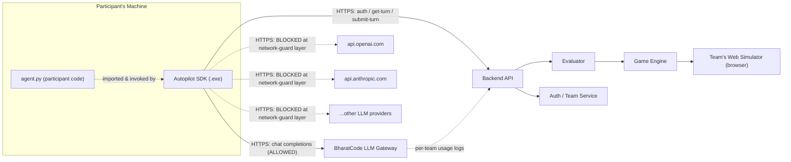
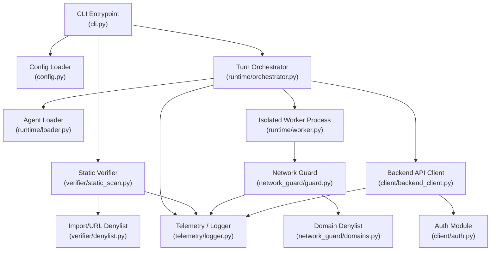
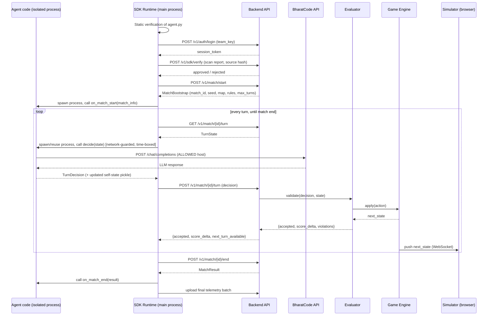

> **Historical design (Oct 2026).** The LLM client is now `autopilot_sdk.llm.LLMClient` (standard chat completions) and the gateway is the organisers' own `/llm/v1`; "BharatCode" below is the original placeholder name.

# Autopilot SDK — Technical Design Document

---

## 1. Purpose & Scope

### 1.1 What the SDK is

The SDK is a **single executable file** (`autopilot.exe` on Windows, `autopilot` on macOS/Linux) that a participant downloads once and runs from their terminal, pointing it at their own `agent.py`:

```bash
./autopilot run --agent ./agent.py --team-key <TEAM_API_KEY>
```

Internally it is a Python application, but it is **compiled/frozen** (PyInstaller) so participants receive a binary, not readable/editable source. It embeds its own Python runtime so participants do **not** need Python installed.

### 1.2 What the SDK is responsible for

1. Authenticating the team with the backend.
2. Statically verifying the participant's `agent.py` before ever running it (fast fail on obvious rule violations).
3. Loading the participant's `Agent` class and running its lifecycle (`on_match_start` → `decide()` per turn → `on_match_end`).
4. Fetching turn state from the backend and submitting the agent's decision back, every turn, until the match ends.
5. **Enforcing, at runtime, that the agent process cannot reach any LLM provider other than BharatCode's API** — regardless of which HTTP/network library the participant's code uses.
6. Enforcing a per-turn time budget so a slow/stuck agent doesn't stall the match.
7. Persisting the agent's own memory (`self.*` attributes) across turns, safely, even though each turn runs in an isolated process.
8. Logging everything relevant (locally + uploaded) for support and anti-cheat audit purposes.

### 1.3 What the SDK is explicitly **not** responsible for

- It does **not** decide who wins. It does not compute damage, move zombies, or score anything — that's the **Evaluator** and **Game Engine** (separate services, separate doc). The SDK only ships state in and decisions out.
- It does **not** render anything. The **Simulator** (web app) is a separate service that receives state pushed from the backend.
- It is **not** a general-purpose sandbox/anti-cheat product. It raises the bar high enough to stop the overwhelming majority of participants from trivially or accidentally breaking the rules, and it produces an audit trail so the rest can be caught by humans after the fact. See §11 (Threat Model) — this is a deliberate, agreed scope decision, not an oversight.

---

## 2. Where the SDK Fits (System Context)



Key point: **the SDK only ever talks to two hosts it trusts: the Backend API and the BharatCode Gateway.** Every other host is either explicitly blocked (known LLM providers) or simply irrelevant to the SDK's job (participants are free to use the open internet for docs, packages, non-LLM tools, etc. — see §9, this is a **denylist**, not an allowlist).

---

## 3. Design Goals & Principles

These principles were agreed on before design and should guide every implementation decision below:

| Principle                         | Meaning in practice                                                                                                                                                                                                                                                                                                      |
| --------------------------------- | ------------------------------------------------------------------------------------------------------------------------------------------------------------------------------------------------------------------------------------------------------------------------------------------------------------------------ |
| **Server is the source of truth** | The SDK/agent runs on hardware we don't control. Nothing it reports is trusted until the backend validates it. If the SDK is fully compromised, the _worst_ outcome is that one team's own run gets flagged/disqualified — it can never corrupt another team's match or the leaderboard.                                 |
| **Defense in depth, not DRM**     | We are not trying to build unbreakable copy protection. We combine several imperfect layers (compiled binary, static scan, runtime network guard, server-side gateway logs) so that bypassing all of them requires deliberate, sustained effort — at which point it's a rules/disciplinary problem, not a technical one. |
| **Fail fast, fail clearly**       | If an agent breaks a rule, tell the participant immediately with a clear message, don't silently degrade. Good DX reduces support load during the event.                                                                                                                                                                 |
| **Everything is audited**         | Every verification result, network violation, timeout, and crash is logged locally and uploaded, so judges can always reconstruct what happened after the fact.                                                                                                                                                          |
| **Cross-platform from day one**   | Participants will show up with Windows, macOS (Intel & Apple Silicon), and Linux laptops.                                                                                                                                                                                                                                |

---

## 4. Functional Scope (Feature List)

- [ ] CLI entrypoint (`autopilot run`, `autopilot verify`, `autopilot version`)
- [ ] Config loading (backend URLs, BharatCode URL, timeouts) from a bundled/signed config file, **not** participant-editable
- [ ] Team authentication (`team_key` → session token)
- [ ] Static pre-flight verification of `agent.py` (banned imports, banned URL literals, obfuscation heuristics)
- [ ] Upload of verification report + source hash (+ optional full source) for server-side audit
- [ ] Dynamic loading of the participant's `Agent` class, validated against the required contract
- [ ] Match bootstrap (fetch seed/map/rules for this run)
- [ ] Turn loop: fetch state → run agent (isolated, time-boxed) → submit decision → repeat
- [ ] Cross-turn agent memory persistence (participant's `self.*` state), safely, across process-per-turn isolation
- [ ] Runtime network guard blocking known-LLM-provider domains, active only while the agent's code is executing
- [ ] `BharatCodeClient` convenience wrapper provided to participants (optional to use, but recommended)
- [ ] Per-turn timeout with forced termination and default no-op fallback
- [ ] Structured local logging (JSONL) + batched telemetry upload
- [ ] Graceful handling of backend/network errors (retry with backoff, reconnect mid-match)
- [ ] Self-version check / forced-update gate before a match can start
- [ ] Cross-platform packaging (Windows/macOS/Linux), each a single executable

---

## 5. Non-Functional Requirements

| Category            | Requirement                                                                                                         |
| ------------------- | ------------------------------------------------------------------------------------------------------------------- |
| Turn latency budget | Configurable per event, default target ceiling ~30–60s per turn (accounts for LLM round-trip latency)               |
| Reliability         | SDK must survive a transient network blip mid-match without losing the match (retry + reconnect, resumable session) |
| Portability         | Single-file executables for Windows x64, macOS (arm64 + x64), Linux x64                                             |
| Security posture    | "Pragmatic zero-trust" per §3 — no heavy DRM, but every trust decision defaults to server-side validation           |
| Observability       | Every match must be fully reconstructable from uploaded telemetry alone                                             |
| Footprint           | No admin/root privileges required to run                                                                            |

---

## 6. The Agent Contract

This is the interface every participant's `agent.py` must implement. It is the one piece of this document that also becomes **participant-facing documentation** — treat its stability as a public API.

```python
# autopilot_sdk/contracts/agent_base.py
from abc import ABC, abstractmethod
from typing import Any, Dict

from .schemas import TurnState, TurnDecision, MatchBootstrap, MatchResult


class Agent(ABC):
    """Base class every participant must subclass in their agent.py.

    Lifecycle (all calls made by the SDK, never by the participant directly):

        __init__()          -> once, when the match starts
        on_match_start()    -> once, right after __init__, with match config
        decide(state)       -> once per turn, MUST be implemented
        on_match_end(result)-> once, when the match ends (win/lose/timeout)

    Anything you store on `self` during decide()/on_match_start() is
    automatically preserved across turns by the SDK (see design doc S8.3)
    as long as it is picklable (lists, dicts, strings, numbers, numpy
    arrays, your own plain objects, etc. all work; open file handles,
    sockets, or thread locks do not — avoid storing those on self).
    """

    def __init__(self, config: Dict[str, Any] | None = None):
        self.config = config or {}

    def on_match_start(self, match_info: MatchBootstrap) -> None:
        """Optional. Called once before the first turn. Override to
        prepare anything you need (e.g. read match_info.map into a
        pathfinding grid)."""
        pass

    @abstractmethod
    def decide(self, state: TurnState) -> TurnDecision:
        """Required. Called once per turn. Must return a TurnDecision
        within the configured per-turn time limit (state.time_limit_seconds)
        or the SDK will submit a no-op on your behalf for that turn."""
        raise NotImplementedError

    def on_match_end(self, result: MatchResult) -> None:
        """Optional. Called once when the match ends. Override for
        cleanup/logging on your side. Cannot affect the final score."""
        pass
```

A minimal valid participant submission:

```python
# agent.py  (participant-authored)
from autopilot_sdk import Agent, TurnState, TurnDecision, Action, ActionType, BharatCodeClient


class MyAgent(Agent):
    def on_match_start(self, match_info):
        self.llm = BharatCodeClient(self.config["bharatcode_api_key"])
        self.memory = []  # persisted automatically across turns

    def decide(self, state: TurnState) -> TurnDecision:
        self.memory.append(state.turn_number)
        plan = self.llm.chat(messages=[
            {"role": "system", "content": "You defend a base from zombies."},
            {"role": "user", "content": state.json()},
        ])
        # ... turn plan['content'] into concrete actions ...
        return TurnDecision(actions=[
            Action(type=ActionType.PLACE_DEFENSE, defense_type="turret",
                   position={"x": 4, "y": 2}),
        ])
```

---

## 7. SDK Internal Architecture



**Module responsibilities:**

| Module           | Responsibility                                                                                                                  |
| ---------------- | ------------------------------------------------------------------------------------------------------------------------------- |
| `cli.py`         | Parse CLI args/flags, wire everything together, top-level error handling & exit codes                                           |
| `config.py`      | Load bundled config (backend base URL, BharatCode base URL, default timeouts) — not exposed as an editable file to participants |
| `contracts/`     | `Agent` base class + all Pydantic schemas (§10) — this is the "public API" surface                                              |
| `verifier/`      | Static, pre-execution scan of `agent.py` source (§9)                                                                            |
| `network_guard/` | Runtime socket-level interception (§10)                                                                                         |
| `runtime/`       | Agent loading, process-per-turn isolation, timeout handling, state persistence (§8)                                             |
| `client/`        | All HTTP calls to the Backend API, retries, auth (§12)                                                                          |
| `telemetry/`     | Structured local logging + batched upload (§13)                                                                                 |

---

## 8. Execution Lifecycle

### 8.1 Sequence diagram (one full match)



### 8.2 Step-by-step narrative

1. **Startup** — CLI parses `--agent`, `--team-key`. Loads bundled config.
2. **Static verification** (§9) — runs before any network call. On failure: print violations, exit non-zero, nothing is uploaded/started.
3. **Auth** — exchange `team_key` for a short-lived `session_token`.
4. **Server-side verify** — upload the scan report + source hash (+ source if the event's data-handling policy allows) so the backend has an independent audit copy. Backend may itself re-run the same scan (defense in depth — never trust the client's "I passed" claim) and can reject a match start if it disagrees.
5. **Match bootstrap** — backend returns the seeded scenario (map, starting resources, rules, `max_turns`, `time_limit_seconds`).
6. **`on_match_start`** — called once, inside the isolated worker (see §8.3), so any LLM client set up there is already network-guarded.
7. **Turn loop** — see §8.3 in detail. Repeats until the backend reports the match has ended (win, loss, or `max_turns` reached).
8. **Match end** — fetch `MatchResult`, call `on_match_end`, flush all telemetry, exit 0.

### 8.3 Turn execution, isolation & state persistence

Two requirements pull in different directions, and this is the design that reconciles them:

- The participant's `Agent` instance must **feel persistent** — they can just append to `self.memory` and expect it to be there next turn, with zero extra code.
- Every turn must have a **hard, guaranteed timeout** — and Python cannot forcibly kill a stuck _thread_, only a _process_.

**Resolution:** each turn runs the agent's `decide()` call in a **fresh subprocess**, but the SDK automatically pickles the agent's `__dict__` at the end of a successful turn and restores it into the new subprocess at the start of the next one. From the participant's point of view, `self` just persists — they never see the process boundary.

```python
# autopilot_sdk/runtime/worker.py
import pickle
from multiprocessing.connection import Connection

from autopilot_sdk.network_guard.guard import install_network_guard
from autopilot_sdk.runtime.loader import load_agent_class
from autopilot_sdk.contracts.schemas import TurnState, TurnDecision


def agent_worker(agent_path: str, state_json: bytes,
                  prev_self_state: bytes | None, conn: Connection) -> None:
    """Entry point of the isolated per-turn subprocess."""
    install_network_guard()  # MUST happen before any participant code runs

    AgentClass = load_agent_class(agent_path)
    agent = AgentClass()
    if prev_self_state is not None:
        try:
            agent.__dict__.update(pickle.loads(prev_self_state))
        except Exception:
            pass  # corrupted/unpicklable state -> start this turn fresh, don't crash the match

    try:
        state = TurnState.parse_raw(state_json)
        decision: TurnDecision = agent.decide(state)
        try:
            new_state = pickle.dumps(agent.__dict__)
        except Exception:
            new_state = None  # agent stored something unpicklable -> memory not carried forward, warn only
        conn.send(("ok", decision.json(), new_state))
    except Exception as exc:                       # participant code raised
        conn.send(("error", repr(exc), None))
    finally:
        conn.close()
```

```python
# autopilot_sdk/runtime/orchestrator.py
import multiprocessing as mp
from autopilot_sdk.contracts.schemas import TurnState, TurnDecision
from autopilot_sdk.telemetry.logger import log_violation
from autopilot_sdk.runtime.worker import agent_worker


class TurnOrchestrator:
    def __init__(self, agent_path: str, default_timeout_s: float):
        self.agent_path = agent_path
        self.default_timeout_s = default_timeout_s
        self._pickled_self_state: bytes | None = None

    def run_turn(self, state: TurnState) -> TurnDecision:
        timeout_s = state.time_limit_seconds or self.default_timeout_s
        parent_conn, child_conn = mp.Pipe()
        proc = mp.Process(
            target=agent_worker,
            args=(self.agent_path, state.json().encode(),
                  self._pickled_self_state, child_conn),
            daemon=True,
        )
        proc.start()
        proc.join(timeout_s)

        if proc.is_alive():
            proc.terminate()
            proc.join()
            log_violation("turn_timeout", turn=state.turn_number, limit_s=timeout_s)
            return TurnDecision(actions=[], metadata={"timeout": True})

        if not parent_conn.poll():
            log_violation("worker_crashed_no_output", turn=state.turn_number)
            return TurnDecision(actions=[], metadata={"crashed": True})

        status, payload, new_state = parent_conn.recv()
        if status == "error":
            log_violation("agent_exception", turn=state.turn_number, detail=payload)
            return TurnDecision(actions=[], metadata={"error": payload})

        self._pickled_self_state = new_state
        return TurnDecision.parse_raw(payload)
```

**Why a hard process kill is safe here:** the participant's own code cannot escape `proc.terminate()` — it's an OS-level SIGTERM/TerminateProcess on the child, not a cooperative cancellation. Whatever partial work was in flight (including any half-finished LLM call) is simply discarded. On timeout, the SDK submits a `no_op` decision for that turn and moves on — this is the "safety net, not a fairness mechanism" behaviour agreed for this event (each team's session is isolated, so a slow turn only costs that team time).

---

## 9. Static Verification Layer (pre-flight)

Runs once, before authentication, entirely offline. Purpose: catch obvious/lazy violations instantly with a clear error message, and produce the report that gets uploaded for audit. **This is a convenience and an audit signal, not the actual enforcement** — the runtime network guard (§10) is what actually stops a violation from working, because static analysis can always be defeated by obfuscation (string concatenation, base64, `getattr`, env vars, etc.).

```python
# autopilot_sdk/verifier/denylist.py
BANNED_IMPORT_ROOTS = {
    "openai", "anthropic", "cohere", "mistralai", "replicate", "groq",
    "ai21", "together", "huggingface_hub", "google.generativeai",
    "vertexai", "boto3",          # boto3 flagged -> could be used for AWS Bedrock; see note below
    "litellm",                     # unified wrapper that can call ANY provider
    "langchain_openai", "langchain_anthropic", "langchain_community",
    "ollama",
}

# Literal substrings we look for anywhere in the source (URLs, base_url= overrides, etc.)
BANNED_URL_SUBSTRINGS = [
    "api.openai.com", "openai.azure.com", "oaiusercontent.com",
    "api.anthropic.com", "claude.ai",
    "generativelanguage.googleapis.com", "aiplatform.googleapis.com",
    "api.cohere.ai", "api.cohere.com",
    "api.mistral.ai",
    "api.together.xyz", "api.together.ai",
    "api.groq.com",
    "api.perplexity.ai",
    "api.deepseek.com",
    "openrouter.ai",
    "api.replicate.com",
    "bedrock-runtime", ".amazonaws.com",
    "api.x.ai",
    "api.ai21.com",
    "api-inference.huggingface.co",
]

# Heuristics that don't fail the build but flag for manual review
OBFUSCATION_HEURISTICS = [
    r"base64\.b64decode",
    r"\bexec\s*\(",
    r"\beval\s*\(",
    r"codecs\.decode\(.*rot13",
]
```

> **Note on `boto3`:** it's a general-purpose AWS SDK, not LLM-specific, so we don't hard-block it — but we flag it (warning, not a hard failure) since it's the client used for AWS Bedrock. The runtime network guard (§10) is what actually blocks the Bedrock endpoint if they try to use it.

```python
# autopilot_sdk/verifier/static_scan.py
import ast
import re
from dataclasses import dataclass, field

from .denylist import BANNED_IMPORT_ROOTS, BANNED_URL_SUBSTRINGS, OBFUSCATION_HEURISTICS


@dataclass
class VerificationReport:
    passed: bool
    violations: list[str] = field(default_factory=list)
    warnings: list[str] = field(default_factory=list)


class _ImportVisitor(ast.NodeVisitor):
    def __init__(self):
        self.violations: list[str] = []

    def _check(self, module: str, lineno: int):
        root = module.split(".")[0]
        if root in BANNED_IMPORT_ROOTS or module in BANNED_IMPORT_ROOTS:
            self.violations.append(f"Line {lineno}: banned import '{module}'")

    def visit_Import(self, node: ast.Import):
        for alias in node.names:
            self._check(alias.name, node.lineno)
        self.generic_visit(node)

    def visit_ImportFrom(self, node: ast.ImportFrom):
        if node.module:
            self._check(node.module, node.lineno)
        self.generic_visit(node)


def scan_source(source: str) -> VerificationReport:
    violations: list[str] = []
    warnings: list[str] = []

    # 1. Regex pass over raw text — catches URL literals even outside imports
    #    (e.g. requests.post("https://api.openai.com/v1/..."))
    for needle in BANNED_URL_SUBSTRINGS:
        for m in re.finditer(re.escape(needle), source, re.IGNORECASE):
            line_no = source.count("\n", 0, m.start()) + 1
            violations.append(f"Line {line_no}: banned URL literal '{needle}' found")

    for pattern in OBFUSCATION_HEURISTICS:
        if re.search(pattern, source):
            warnings.append(f"Obfuscation-style pattern matched: '{pattern}' — flagged for manual review")

    # 2. AST pass — catches imports the regex pass might phrase differently
    #    (import openai as o, from openai import OpenAI, etc.)
    try:
        tree = ast.parse(source)
        visitor = _ImportVisitor()
        visitor.visit(tree)
        violations.extend(visitor.violations)
    except SyntaxError as exc:
        violations.append(f"agent.py failed to parse: {exc}")

    return VerificationReport(passed=len(violations) == 0, violations=violations, warnings=warnings)
```

On failure, the CLI prints something like:

```
✗ Static verification failed for agent.py:
  - Line 12: banned import 'openai'
  - Line 47: banned URL literal 'api.anthropic.com' found

Only the BharatCode API may be used for LLM access. See the Agent
Contract doc, section "Allowed LLM Access", for details.
Run `autopilot verify --agent ./agent.py` to re-check after fixing.
```

---

## 10. Runtime Network Guard — the actual enforcement layer

This is the most important section of this document. Static scanning (§9) is a courtesy; **this is what actually stops the outbound call from succeeding**, and it cannot be defeated just by hiding a string.

### 10.1 Model: denylist, not allowlist

Participants are free to use the open internet — search APIs, maps, weather, package registries, documentation, non-LLM SaaS tools, whatever their strategy needs. The **only** thing that's banned is talking to an LLM/generative-AI provider other than BharatCode. So the network guard is a **denylist** of known LLM provider hosts (+ heuristics for local LLM servers), not a lockdown to two allowed hosts.

### 10.2 Where it runs

The guard is installed **inside the per-turn worker subprocess**, before the participant's `Agent` class is even imported (see `agent_worker()` in §8.3, first line: `install_network_guard()`). It is **not** installed in the SDK's own main process, which needs unrestricted access to talk to our Backend API.

### 10.3 Interception point

Every popular Python HTTP stack (`requests`, `httpx`, `urllib3`, `aiohttp`, the `openai`/`anthropic` SDKs, raw `http.client`) ultimately opens a TCP socket via `socket.create_connection()` (or `socket.socket().connect()`). Patching at this single, low-level choke point covers all of them without needing per-library patches, and it inspects the **hostname string before DNS/connection happens** — so it works over TLS/SNI too, before any bytes are sent.

```python
# autopilot_sdk/network_guard/domains.py
ALLOWED_HOSTS = {
    "api.bharatcode.dev",          # placeholder — set to the real production domain
    "api.autopilot.gdg.dev",       # our own Backend API — see note below
}

BLOCKED_HOST_SUFFIXES = {
    # OpenAI
    "api.openai.com", "openai.com", "oaiusercontent.com", "openai.azure.com",
    # Anthropic
    "api.anthropic.com", "claude.ai",
    # Google
    "generativelanguage.googleapis.com", "aiplatform.googleapis.com",
    "aistudio.google.com",
    # Cohere / Mistral / AI21
    "api.cohere.ai", "api.cohere.com", "api.mistral.ai", "api.ai21.com",
    # Aggregators / multi-model gateways
    "openrouter.ai", "api.together.xyz", "api.together.ai", "api.groq.com",
    "api.replicate.com", "api.perplexity.ai", "api.deepseek.com", "api.x.ai",
    # AWS Bedrock (any region)
    "bedrock-runtime.amazonaws.com",
    # HuggingFace hosted inference (dataset hub itself is NOT blocked, only inference API)
    "api-inference.huggingface.co",
}

# Ports commonly used by locally-run LLM servers — connecting to localhost on
# these ports is a strong signal of "running Ollama / LM Studio / vLLM /
# text-generation-webui locally to dodge the domain denylist"
LOCAL_LLM_PORTS = {11434, 1234, 5000, 5001, 7860, 8000, 8080, 8888}
```

> **Note:** these are literal hostnames the SDK ships with, updated via the SDK's own version/config, **not** something the participant can edit. Extend this table centrally as new providers appear (see §17 rollout — maintaining this list is an ongoing operational task, not a one-time build task).

```python
# autopilot_sdk/network_guard/guard.py
import ipaddress
import socket

from .domains import ALLOWED_HOSTS, BLOCKED_HOST_SUFFIXES, LOCAL_LLM_PORTS
from autopilot_sdk.telemetry.logger import log_violation


class BlockedNetworkCallError(RuntimeError):
    pass


_original_create_connection = socket.create_connection


def _host_matches(host: str, table: set[str]) -> bool:
    host = host.lower().rstrip(".")
    return any(host == h or host.endswith("." + h) for h in table)


def _is_loopback(host: str) -> bool:
    if host in ("localhost",):
        return True
    try:
        return ipaddress.ip_address(host).is_loopback
    except ValueError:
        return False


def _check_host(host: str, port: int) -> None:
    if _host_matches(host, ALLOWED_HOSTS):
        return

    if _is_loopback(host) and port in LOCAL_LLM_PORTS:
        log_violation("blocked_local_llm_server", host=host, port=port)
        raise BlockedNetworkCallError(
            f"Blocked connection to local LLM server at {host}:{port}. "
            "Only the BharatCode API may be used for LLM access."
        )

    if _host_matches(host, BLOCKED_HOST_SUFFIXES):
        log_violation("blocked_llm_provider", host=host, port=port)
        raise BlockedNetworkCallError(
            f"Blocked outbound call to '{host}'. Only the BharatCode API may "
            "be used for LLM access — see the Agent Contract doc."
        )

    # Anything else (docs sites, package registries, non-LLM APIs, etc.) is allowed.


def _guarded_create_connection(address, *args, **kwargs):
    host, port = address[0], address[1]
    _check_host(host, port)
    return _original_create_connection(address, *args, **kwargs)


_original_getaddrinfo = socket.getaddrinfo


def _guarded_getaddrinfo(host, *args, **kwargs):
    # Catches libraries that resolve DNS manually before connecting, and
    # gives a clean error before any connection attempt is even made.
    if host is not None:
        _check_host(str(host), args[0] if args else 0)
    return _original_getaddrinfo(host, *args, **kwargs)


def install_network_guard() -> None:
    socket.create_connection = _guarded_create_connection
    socket.getaddrinfo = _guarded_getaddrinfo
```

### 10.4 Handling the "OpenAI-compatible client, different `base_url`" case

Several providers (Groq, Together, OpenRouter, and BharatCode's own API too) are deliberately **OpenAI-wire-compatible**, meaning a participant could `import openai`, point `base_url` at a different provider, and the static import-scan alone wouldn't tell you which provider they're actually hitting. This is exactly why §9 also scans for literal blocked URL substrings (catches `base_url="https://api.groq.com/openai/v1"` even though the import is just `openai`), and — more importantly — why the runtime guard in §10.3 checks the **actual hostname of every connection**, independent of which client library or wire format is used. The enforcement point is the network, not the import statement.

Because of this, if BharatCode's own API happens to be OpenAI-wire-compatible, participants may legitimately `import openai` and set `base_url` to BharatCode's endpoint — the static scanner would flag the `openai` import as a warning (not a hard fail, since `openai` alone isn't proof of misuse) while the URL/host checks are the actual pass/fail signal.

### 10.5 What the guard deliberately does not attempt (documented trade-off)

- It does **not** stop an agent from shelling out to a subprocess (`curl`, another Python interpreter, a compiled binary) that bypasses the in-process socket patch entirely. A true OS-level fix (network namespace / firewall rule scoped to the worker process) is listed as a v2 hardening item in §17 — for this event, this residual risk is accepted per the "pragmatic zero-trust, not heavy DRM" decision in §3, backed up by:
- **Server-side gateway logging** (§10.6) as the real backstop.

### 10.6 Server-side backstop: BharatCode gateway logs

Because BharatCode's API gateway is ours to control, the strongest signal is not on the participant's laptop at all — it's the gateway's own per-team request log. The Evaluator can cross-check: _"this team's agent is producing sophisticated, LLM-quality decisions turn after turn, but the gateway shows near-zero BharatCode calls for their team this match."_ That combination is flagged for manual judge review. This is why §3 calls this "defense in depth": the local network guard is layer one, gateway logging is layer two, and layer two cannot be bypassed by anything happening on the participant's machine.

### 10.7 The convenience client we hand participants

To make "just do the right thing" the path of least resistance, the SDK ships a small helper. Using it is optional — the network guard enforces the same rule no matter what HTTP client is used — but it also gives us exact, reliable LLM-call counts for telemetry without needing packet inspection.

```python
# autopilot_sdk/contracts/bharatcode_client.py
import requests

from autopilot_sdk.telemetry.logger import log_event


class BharatCodeClient:
    """Convenience wrapper around the BharatCode chat API. Optional to use —
    the network guard enforces the provider restriction regardless — but
    recommended: you get retries and usage telemetry for free."""

    BASE_URL = "https://api.bharatcode.dev/v1"  # placeholder, see domains.py

    def __init__(self, api_key: str, timeout_s: float = 30.0):
        self._api_key = api_key
        self._timeout_s = timeout_s
        self._session = requests.Session()

    def chat(self, messages: list[dict], **kwargs) -> dict:
        resp = self._session.post(
            f"{self.BASE_URL}/chat/completions",
            headers={"Authorization": f"Bearer {self._api_key}"},
            json={"messages": messages, **kwargs},
            timeout=self._timeout_s,
        )
        resp.raise_for_status()
        log_event("bharatcode_call", model=kwargs.get("model"), tokens=resp.json().get("usage"))
        return resp.json()
```

---

## 11. Threat Model & Known Limitations

| #   | Threat                                                                                 | Mitigation                                                                                                                | Residual risk                                                                                                                                 |
| --- | -------------------------------------------------------------------------------------- | ------------------------------------------------------------------------------------------------------------------------- | --------------------------------------------------------------------------------------------------------------------------------------------- |
| 1   | Participant edits agent.py to call OpenAI/Claude directly                              | Static scan (§9) blocks the obvious case; runtime network guard (§10) blocks the connection even if static scan is evaded | None realistically — connection is blocked at the socket layer regardless of obfuscation                                                      |
| 2   | Participant runs a local LLM (Ollama, LM Studio) to dodge domain blocking              | Loopback + known-local-LLM-port heuristic (§10.3)                                                                         | A custom port not in our list could slip through; extend the port list as discovered                                                          |
| 3   | Participant shells out to `curl`/another process to bypass the in-process socket patch | None at the SDK layer in v1                                                                                               | Accepted risk (§10.5); backstopped by gateway logs (§10.6) and post-event manual audit                                                        |
| 4   | Participant decompiles the PyInstaller executable to read/patch our loop logic         | Compiled build + light obfuscation, not full DRM                                                                          | A sufficiently motivated person can still do this; server treats all SDK output as untrusted so this cannot corrupt other teams' results (§3) |
| 5   | Participant submits a forged/replayed turn decision without running our SDK at all     | Server-side session tokens, per-turn nonces/sequence numbers validated by the Backend/Evaluator                           | Low — this is why the server, not the SDK, is the actual authority on legality/scoring                                                        |
| 6   | Agent code hangs/infinite-loops                                                        | Hard per-turn process kill (§8.3)                                                                                         | None — `terminate()` is unconditional                                                                                                         |
| 7   | Agent stores something unpicklable in `self`, breaking cross-turn memory               | Caught, logged as a warning, match continues with memory reset for that agent                                             | Participant-visible degradation only, not a crash                                                                                             |

---

## 12. Backend API Contract (SDK's perspective)

The SDK only ever talks to the **Backend API** — it has no direct knowledge of the Evaluator or Game Engine, which are internal to the backend (see system context, §2).

| Endpoint              | Method | Purpose                                           | Request body                                                                         | Response body                                                       |
| --------------------- | ------ | ------------------------------------------------- | ------------------------------------------------------------------------------------ | ------------------------------------------------------------------- |
| `/v1/auth/login`      | POST   | Exchange team key for a session                   | `{team_key}`                                                                         | `{session_token, team_id, expires_at}`                              |
| `/v1/sdk/verify`      | POST   | Upload static scan report + source hash for audit | `{session_token, sdk_version, source_sha256, source_b64?, violations[], warnings[]}` | `{approved: bool, reason?}`                                         |
| `/v1/match/start`     | POST   | Bootstrap a new match                             | `{session_token, difficulty_tier}`                                                   | `MatchBootstrap` (§14)                                              |
| `/v1/match/{id}/turn` | GET    | Fetch current turn's state                        | `{session_token}`                                                                    | `TurnState` (§14)                                                   |
| `/v1/match/{id}/turn` | POST   | Submit this turn's decision                       | `{session_token, turn_number, decision, client_metrics}`                             | `{accepted, validation_errors[], score_delta, next_turn_available}` |
| `/v1/match/{id}/end`  | POST   | Finalize / fetch final result                     | `{session_token}`                                                                    | `MatchResult` (§14)                                                 |
| `/v1/telemetry`       | POST   | Batched log/event upload                          | `{session_token, events[]}`                                                          | `{ok: true}`                                                        |
| `/v1/sdk/heartbeat`   | POST   | Liveness + forced-update check                    | `{session_token, sdk_version}`                                                       | `{ok, latest_version, force_update}`                                |

All requests carry `Authorization: Bearer <session_token>` after `/v1/auth/login`.

---

## 13. Data Schemas

All schemas are Pydantic models shared between the SDK, the Backend API, and (as plain JSON) the Simulator.

```python
# autopilot_sdk/contracts/schemas.py
from enum import Enum
from typing import Any, Dict, List, Optional
from pydantic import BaseModel


class Position(BaseModel):
    x: int
    y: int


class ZombieState(BaseModel):
    id: str
    type: str                 # "walker" | "runner" | "brute" | "boss" | ...
    position: Position
    health: int
    max_health: int
    speed: float
    target: Optional[Position] = None


class DefenseState(BaseModel):
    id: str
    type: str                 # "wall" | "turret" | "mine" | "spike" | ...
    position: Position
    health: int
    ammo: Optional[int] = None
    cooldown_remaining: int = 0


class ResourceState(BaseModel):
    currency: int
    energy: int


class MapInfo(BaseModel):
    width: int
    height: int
    obstacles: List[Position] = []
    spawn_points: List[Position] = []
    base_position: Position


class TurnState(BaseModel):
    match_id: str
    turn_number: int
    max_turns: int
    time_limit_seconds: float
    map: MapInfo
    zombies: List[ZombieState]
    defenses: List[DefenseState]
    resources: ResourceState
    score_so_far: float
    events: List[str] = []      # human-readable log of what happened last turn


class ActionType(str, Enum):
    PLACE_DEFENSE = "place_defense"
    UPGRADE_DEFENSE = "upgrade_defense"
    REMOVE_DEFENSE = "remove_defense"
    REPAIR_DEFENSE = "repair_defense"
    NO_OP = "no_op"


class Action(BaseModel):
    type: ActionType
    defense_type: Optional[str] = None
    position: Optional[Position] = None
    target_id: Optional[str] = None


class TurnDecision(BaseModel):
    actions: List[Action] = []
    metadata: Dict[str, Any] = {}   # optional: llm_calls_made, reasoning notes, timeout/error flags


class MatchBootstrap(BaseModel):
    match_id: str
    seed: int
    map: MapInfo
    max_turns: int
    time_limit_seconds: float
    starting_resources: ResourceState
    rules: Dict[str, Any] = {}


class MatchResult(BaseModel):
    match_id: str
    outcome: str               # "won" | "lost" | "timed_out"
    final_score: float
    turns_survived: int
    breakdown: Dict[str, Any] = {}
```

Example `TurnState` JSON payload (what a participant's `decide()` actually receives):

```json
{
  "match_id": "m_9f2c",
  "turn_number": 5,
  "max_turns": 40,
  "time_limit_seconds": 45.0,
  "map": {
    "width": 20,
    "height": 20,
    "obstacles": [{ "x": 3, "y": 3 }],
    "spawn_points": [
      { "x": 0, "y": 0 },
      { "x": 19, "y": 19 }
    ],
    "base_position": { "x": 10, "y": 10 }
  },
  "zombies": [
    {
      "id": "z1",
      "type": "walker",
      "position": { "x": 2, "y": 1 },
      "health": 40,
      "max_health": 40,
      "speed": 1.0
    }
  ],
  "defenses": [
    {
      "id": "d1",
      "type": "turret",
      "position": { "x": 9, "y": 9 },
      "health": 100,
      "ammo": 12,
      "cooldown_remaining": 0
    }
  ],
  "resources": { "currency": 250, "energy": 80 },
  "score_so_far": 130.0,
  "events": ["Zombie z0 destroyed by d1"]
}
```

---

## 14. Error Handling, Retries & Reconnection

| Situation                                                 | SDK behaviour                                                                                                           |
| --------------------------------------------------------- | ----------------------------------------------------------------------------------------------------------------------- |
| Backend request times out / connection drops              | Retry with exponential backoff (e.g. 1s, 2s, 4s, capped, up to N attempts) before surfacing an error to the participant |
| Mid-match network loss for >N seconds                     | On reconnect, call `GET /v1/match/{id}/turn` again — it is idempotent for the _current_ turn, so no state is lost       |
| Backend rejects a submitted decision (`accepted: false`)  | Log the validation errors, still advance to the next turn (never lets one bad decision hang the match)                  |
| Agent raises an exception in `decide()`                   | Caught in the worker (§8.3), logged, `no_op` submitted for that turn, match continues                                   |
| Agent exceeds per-turn timeout                            | Process killed, `no_op` submitted, match continues (§8.3)                                                               |
| SDK version too old (`force_update: true` from heartbeat) | Refuse to start a match, print upgrade instructions, exit non-zero                                                      |
| Static verification fails                                 | Refuse to even authenticate; nothing uploaded; exit non-zero with violation list (§9)                                   |

---

## 15. Logging, Telemetry & Audit Trail

- **Local log** (`~/.autopilot/logs/<match_id>.jsonl`): every lifecycle event, every turn's timing, every network-guard violation, every exception — one JSON object per line.
- **Uploaded telemetry** (`POST /v1/telemetry`, batched every turn or every few seconds): a subset of the above needed for judging/audit — turn timings, violation events, LLM call counts, final verification report. Full local logs remain on the participant's machine and are not exfiltrated wholesale (only the audit-relevant subset + the source hash/report from §9 go to the backend, consistent with the earlier zero-trust decision to have _an_ audit trail without being invasive).
- Every log line and telemetry event is tagged with `match_id`, `team_id`, `turn_number`, `sdk_version`.

---

## 16. Packaging, Build & Distribution

### 16.1 Build (example PyInstaller spec, one per OS in CI matrix)

```python
# build/pyinstaller.spec (simplified)
# -*- mode: python ; coding: utf-8 -*-
a = Analysis(
    ['src/autopilot_sdk/cli.py'],
    pathex=['src'],
    hiddenimports=['pydantic', 'requests'],
    excludes=[],
)
pyz = PYZ(a.pure)
exe = EXE(
    pyz, a.scripts, a.binaries, a.datas,
    name='autopilot',
    onefile=True,
    console=True,
    strip=True,       # strip debug symbols — mild obfuscation, not real DRM
)
```

CI builds this on `windows-latest`, `macos-latest` (arm64 + a rosetta/x64 job), and `ubuntu-latest`, producing `autopilot-win.exe`, `autopilot-macos-arm64`, `autopilot-macos-x64`, `autopilot-linux-x64`, each uploaded as a release artifact and code-signed where the platform requires it (macOS notarization, Windows Authenticode) to avoid OS security warnings on participants' machines.

### 16.2 Versioning

- SDK reports its own semver on every request (`sdk_version` field).
- `/v1/sdk/heartbeat` lets the backend force an upgrade mid-event if a critical bug (e.g. a network-guard bypass) is found — this is the operational lever for patching the denylist in §10.3 without needing every participant to notice on their own.
