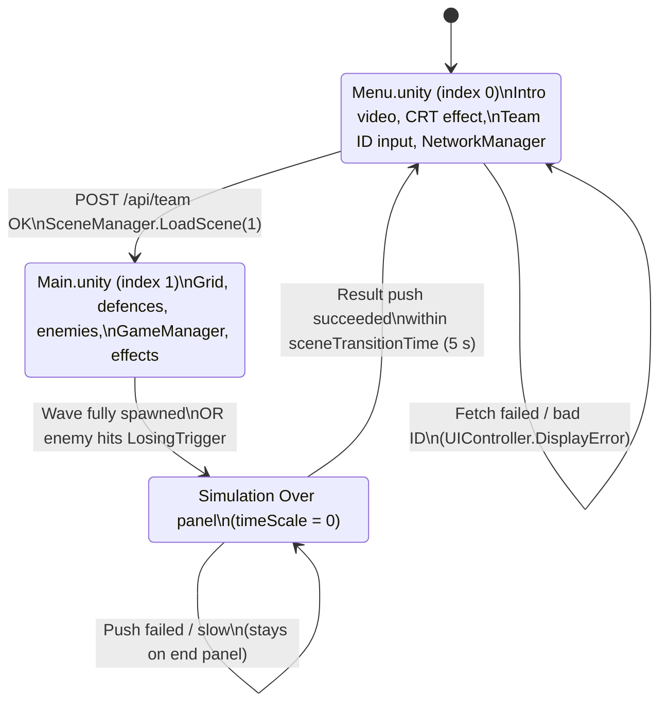
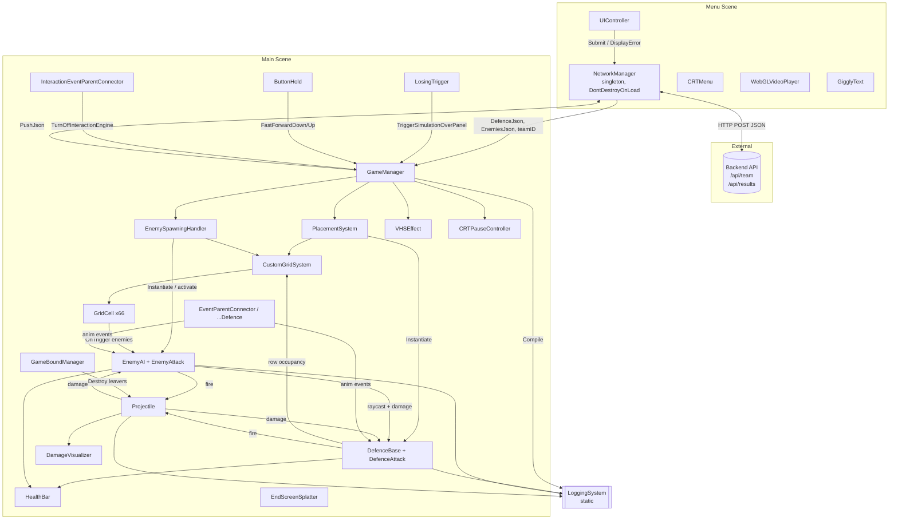
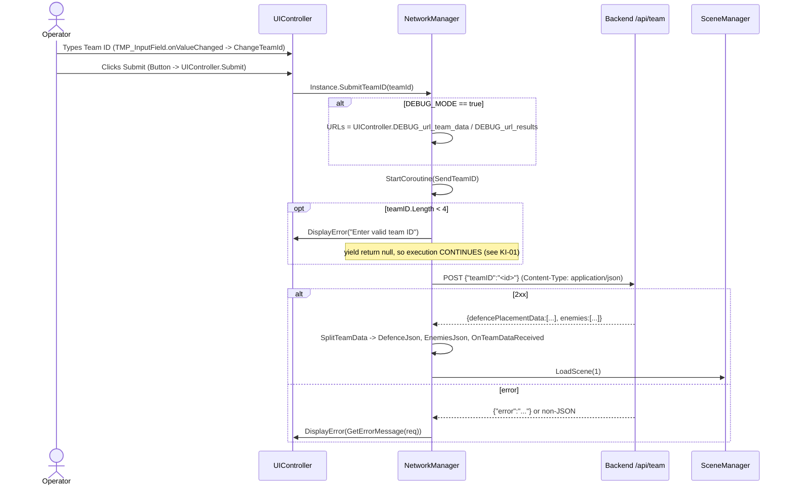
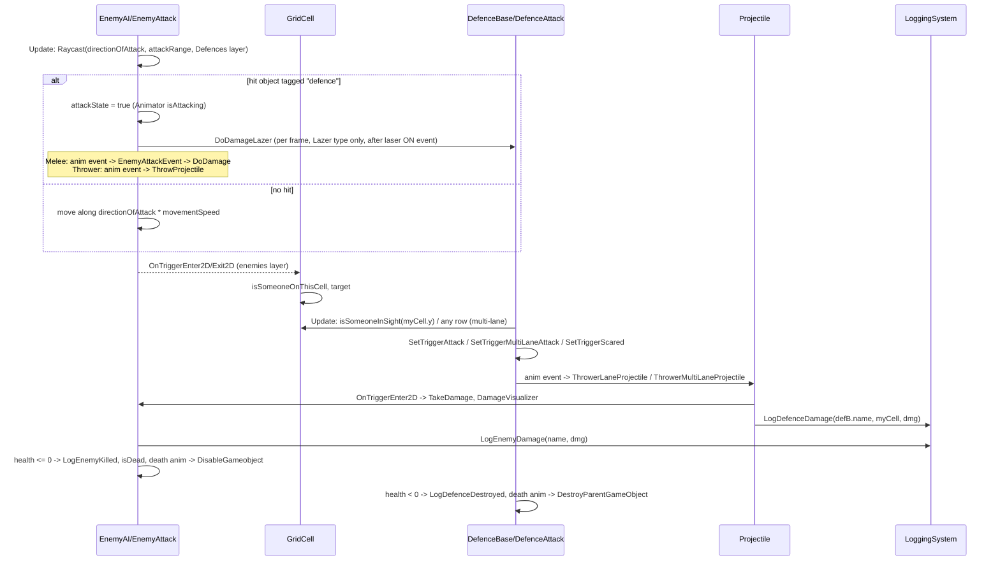
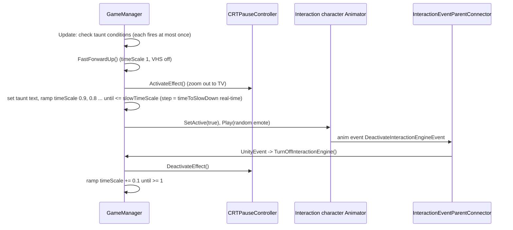

# Design Document: AutoPilot Architecture Overview

> Documentation of the existing system as found in the code. Nothing here is a proposal to change it.
> Sources: all 33 scripts in `Scripts/`, plus targeted reads of `Scenes/Main.unity`, `Scenes/Menu.unity`, prefabs, animation clips, `ProjectSettings/` and `Packages/manifest.json`.
> Tags used below: **[Verified]** = read directly in code/assets. **[Inferred]** = reasoned from evidence, not confirmed.

## Overview

AutoPilot is a lane-based, Plants-vs-Zombies-style **auto-battle simulation** built in Unity for a GDG event. Nobody plays it live. A team types its Team ID on the Menu screen. The client fetches that team's pre-submitted defence layout and an enemy wave from an external backend, then runs the battle on its own. At the end it uploads a telemetry report.

There are two scenes. **Menu** (build index 0) handles Team ID entry, the intro video and the network fetch. **Main** (build index 1) hosts a 11 × 6 grid. Defences are placed on that grid from server data. Enemies spawn at the right edge on random rows and walk left. The run ends when the wave has finished spawning or when any enemy reaches the left-side losing trigger. A static `LoggingSystem` collects damage and kill/destroy events. Those are compiled into a JSON report and POSTed to `/api/results`.

On top of the simulation sits a presentation layer with CRT and VHS post effects, a fast-forward button, an end-screen egg/tomato splatter, and an "Interaction Engine". The Interaction Engine taunts the team (slow-motion, CRT zoom-out, an animated character and an insult line) when their layout looks weak.

## Platform & Tech Stack

| Item | Value | Status |
|---|---|---|
| Unity editor | 6000.1.17f1 (Unity 6.1) | [Verified] `ProjectSettings/ProjectVersion.txt` |
| Render pipeline | URP 17.1.0, 2D Renderer (`Settings/Renderer2D.asset`, `UniversalRP.asset`) | [Verified] |
| 2D packages | 2d.animation 11.0.0, 2d.aseprite 1.2.5, 2d.psdimporter 10.1.1, 2d.spriteshape, 2d.tilemap(+extras) | [Verified] `manifest.json` |
| UI | uGUI 2.0.0 + TextMeshPro | [Verified] |
| Input | Input System 1.14.0 (`extras/InputSystem_Actions.inputactions`). No script reads input directly. Interaction goes through uGUI EventSystem callbacks. | [Verified] |
| Networking | `UnityWebRequest`, JSON via `JsonUtility` | [Verified] |
| Target platform | **WebGL** | [Inferred] from `WebGLVideoPlayer` loading `StreamingAssets/intro.mp4` by URL (the WebGL-compatible video path) and a separate `debugScript` for diagnosing video playback |
| Backend | HTTP JSON service at `127.0.0.1:5000` | [Verified] URLs. Port 5000 suggests Flask. [Inferred] |

## Scene Flow



`NetworkManager` is a `DontDestroyOnLoad` singleton created in Menu. It carries `TeamID`, `DefenceJson` and `EnemiesJson` into Main. When Menu is reloaded, the Menu scene's own copy destroys itself in `Awake` and the original persists.

## Architecture



### Design style (observed)

- **Scene-wired MonoBehaviours.** References are set in the Inspector, with `FindFirstObjectByType` / `FindAnyObjectByType` as fallbacks. There is no DI, no ScriptableObject config and no event bus.
- **Polling, not events.** `GameManager.Update` polls spawner and placement state every frame. `DefenceBase.Update` polls grid row occupancy every frame.
- **Animation-driven combat timing.** Melee hits, projectile launches, laser activation and death cleanup all fire from Animator **animation events**. A child "connector" component on the visual object forwards them to the parent.
- **Index-mapped prefabs.** Server data uses integer IDs that index Inspector-ordered prefab lists.
- **Static telemetry.** `LoggingSystem` is a static class with process-lifetime dictionaries.

## Sequence Diagrams

### 1. Team login and data fetch (Menu)



### 2. Simulation start (Main)

```mermaid
sequenceDiagram
    participant GM as GameManager
    participant NM as NetworkManager
    participant ESH as EnemySpawningHandler
    participant PS as PlacementSystem
    participant GRID as CustomGridSystem

    Note over GRID: Awake: build 11x6 GridCell instances (nodeSize 1.5)
    GM->>GM: Start()
    alt quickTestMode == false (scene value)
        GM->>ESH: InitializeEnemies(NM.EnemiesJson, true)
        GM->>PS: ConvertDefencePlacementJsonToObject(NM.DefenceJson)
    else quickTestMode == true
        GM->>ESH: InitializeEnemies("{}", false) (uses Inspector wave)
    end
    ESH->>ESH: Instantiate every enemy INACTIVE under SpawnQueue
    GM->>ESH: StartSpawning() -> coroutine SpawnEnemies
    GM->>PS: InitializeDefences()
    loop each DefencePlacementCard
        PS->>GRID: GetCellFromNumbering(x, y)
        PS->>PS: Instantiate(defenceIndexMapping[defenceId]) at cell, set myCell, maxDefenceCount++
    end
    loop while SpawnQueue has children
        ESH->>GRID: random row at column gridColumnForEnemies (default = max X)
        ESH->>ESH: spawn VFX, wait 0.3 s, move random queued enemy to cell, reparent, SetActive(true)
        ESH->>ESH: wait timeLeft; timeLeft -= timeDecreaseRate
    end
    ESH->>ESH: completedWave = true
```

### 3. Combat loop (per frame plus animation events)



### 4. End of simulation and result push

```mermaid
sequenceDiagram
    participant LT as LosingTrigger
    participant GM as GameManager
    participant LOG as LoggingSystem
    participant NM as NetworkManager
    participant API as Backend /api/results
    participant SM as SceneManager

    alt enemy enters LosingTrigger
        LT->>GM: TriggerSimulationOverPanel()
    else ESH.IsWaveCompleted() && !endScreenTriggered
        GM->>GM: TriggerSimulationOverPanel(); endScreenTriggered = true
    end
    GM->>GM: StartCoroutine(SimulationOverCleanUp)
    GM->>LOG: Compile(success=false, teamID, saveToFile=true)
    LOG->>LOG: write persistentDataPath/battlelog_yyyyMMdd_HHmmss.json
    GM->>NM: PushJson(json, callback)
    GM->>GM: timeScale = 0, CRT ActivateEffect, show End Panel (EndScreenSplatter runs)
    loop attempt 1..maxAttempts (3)
        NM->>API: POST report JSON (timeout 10 s)
        alt 2xx
            API-->>NM: body; callback(true, body)
        else HTTP error (non-connection)
            NM-->>GM: callback(false, msg), no retry
        else connection error
            NM->>NM: wait retryDelaySeconds (2 s), retry
        end
    end
    GM->>GM: WaitForSecondsRealtime(sceneTransitionTime = 5)
    opt successValue == true at that moment
        GM->>SM: LoadScene(0)
    end
```

### 5. Interaction Engine (taunts)



## Components and Interfaces

Component interfaces are listed as public surface (C#). Private helpers are omitted.

### Networking

#### NetworkManager (Menu, persistent singleton)

**Purpose**: The only HTTP client. It fetches team data, splits it for consumers and pushes results with retry.

```csharp
public class NetworkManager : MonoBehaviour {
    public static NetworkManager Instance { get; }
    public string getTeamDataUrl;   // "http://127.0.0.1:5000/api/team"
    public string pushResultsUrl;   // "http://127.0.0.1:5000/api/results"
    public string teamID;
    public int maxAttempts; public float retryDelaySeconds; public int timeoutSeconds;
    public string DefenceJson { get; }   // {"defencePlacementData":[...]}
    public string EnemiesJson { get; }   // {"enemies":[...]}
    public event Action OnTeamDataReceived;   // no subscribers found in project
    public void SubmitTeamID(string teamId);
    public void PushJson(string json, Action<bool,string> onComplete = null);
}
```

**Responsibilities**:
- Singleton lifetime across scenes.
- `SendTeamID` coroutine: POST team ID, parse the response, then `LoadScene(1)`.
- `PushJson` coroutine: POST the report, up to `maxAttempts` tries. It retries **only** on `ConnectionError`.
- `GetErrorMessage`: maps a failed request to a readable string. It tries a `{"error": "..."}` body first and falls back to `"Request failed (<code>): <error>"`.
- DEBUG_MODE: replaces both URLs with values typed into Menu debug input fields.

#### UIController (Menu)

**Purpose**: Bridge between Menu uGUI and NetworkManager. It also shows animated error text.

```csharp
public class UIController : MonoBehaviour {
    public void ChangeTeamId(string teamID);   // InputField onValueChanged
    public string GetTeamID();
    public void Submit();                       // Submit button
    public void DisplayError(string error);
    public string DEBUG_url_team_data, DEBUG_url_results;
    public void DEBUG_TEAM_DATA_URL(string url); public void DEBUG_RESULTS_URL(string url);
}
```

`Start` resets `Time.timeScale = 1` (recovering from the frozen end panel) and activates `CRTMenu`.

### Game Orchestration

#### GameManager (Main)

**Purpose**: Simulation lifecycle, end conditions, Interaction Engine, fast-forward.

```csharp
public class GameManager : MonoBehaviour {
    public void TriggerSimulationOverPanel();   // called by LosingTrigger and internally
    public void TurnOffInteractionEngine();     // UnityEvent from InteractionEventParentConnector
    public void FastForwardDown();              // ButtonHold.onDown: timeScale = fastForwardTimeScale, VHS on
    public void FastForwardUp();                // ButtonHold.onUp:   timeScale = 1, VHS off
}
```

**Responsibilities**:
- `Start`: initialise enemies and defences from NetworkManager JSON, or from Inspector data in `quickTestMode`.
- `Update`: run `InteractionEngineConditions()` and `SimulationOverPanelConditions()`.
- `SimulationOverCleanUp`: compile and push the report, freeze time, show the panel, conditionally return to Menu.

#### LosingTrigger (Main, object "LossingCond")

A trigger collider on the left edge. Any collider on `enemiesLayer` that enters it calls `GameManager.TriggerSimulationOverPanel()`.

#### GameBoundManager (Main)

A trigger volume around the play area. **Any** collider that exits it is `Destroy`ed. That covers stray projectiles, sliding penguins, and anything else that leaves.

### Grid

#### CustomGridSystem (Main)

**Purpose**: Builds and queries the logical lane grid.

```csharp
public class CustomGridSystem : MonoBehaviour {
    public Vector2Int GetMaxCellCount();               // max INDEX, not count: (10, 5)
    public GridCell GetCellFromNumbering(int x, int y); // linear search, null if absent
    public bool isSomeoneInSight(int rowIndex);        // any cell in row occupied
    public EnemyAI GetEnemyIfSomeoneInSight(int rowIndex);
}
```

Geometry [Verified, Main.unity]: `startPosLocal (0,0)`, `endPosLocal (16,8)`, `GridCell.nodeSize = 1.5` (static). `maxX = int(16/1.5) = 10` and `maxY = int(8/1.5) = 5`. The loops are inclusive, so there are **11 columns (x 0..10) × 6 rows (y 0..5) = 66 cells**. The origin is the GridSystem transform's world position. Cell world position = origin + (x, y) × 1.5. Rows are stored as `grid[y][x]`.

#### GridCell (prefab `cell.prefab`)

```csharp
public class GridCell : MonoBehaviour {
    public static float nodeSize = 1.5f;
    public Vector2Int nodeNumbering;
    public bool isSomeoneOnThisCell;
    public EnemyAI target;
    public void UpdateLabel(int x, int y);   // sets numbering + "(x,y)" TMP label
}
```

Trigger collider. Enter/exit for colliders on `detectionLayerMask` (enemies) set or clear a **single** occupancy flag and target.

### Defences

#### PlacementSystem (Main, "DefencesPlacementSystem")

```csharp
public class PlacementSystem : MonoBehaviour {
    public void ConvertDefencePlacementJsonToObject(string json);
    public void InitializeDefences();
    public int DefenceCount();        // transform.childCount (live defences)
    public int MaxDefenceCount();     // number placed at start
    public bool isARowClearOfDefences(); // true if any row 0..maxY has no defence (by myCell.y)
}
```

#### DefenceBase (on each defence prefab)

```csharp
public enum AttackTriggerType { OnPoked, OnSight, OnSightMultiLane, Static }
[RequireComponent(typeof(DefenceAttack), typeof(Collider2D))]
public class DefenceBase : MonoBehaviour {
    public Vector2Int myCell;
    public void TakeDamage(float damage);   // OnPoked: also triggers attack
    public float GetCurrentHealth();
}
```

Per-frame decision logic by trigger type:

| Trigger | Behaviour |
|---|---|
| `OnPoked` | Does nothing until damaged. The first `TakeDamage` calls `SetTriggerAttack(true)`. |
| `OnSight` | Attacks while any cell in its own row (`myCell.y`) is occupied. |
| `OnSightMultiLane` | Scans rows 0..maxY and locks onto the first occupied cell's `EnemyAI`. |
| `Static` | Plays the "scared" animation while its row is occupied. No attack. |

`Cost` (100) is serialized but **not read anywhere** in the client. Budget enforcement, if any, is server-side [Inferred].

#### DefenceAttack

```csharp
public enum AttackType { None, slide, throwerLane, throwerMultiLane }
public class DefenceAttack : MonoBehaviour {
    public void SetTriggerAttack(bool state);
    public void SetTriggerScared(bool state);
    public void SetTriggerMultiLaneAttack(bool state, EnemyAI target);
    public void ThrowerLaneProjectile();        // anim event (via connector)
    public void ThrowerMultiLaneProjectile();   // anim event (via connector)
}
```

- `slide`: while attacking, moves along `direction` at `speed`. Each enemy it touches takes `attackDamage`, a hit VFX plays, and the damage is logged.
- `throwerLane`: straight projectile from `firePoint`. Uses `speed`, not `projectileSpeed`.
- `throwerMultiLane`: arcing Bézier projectile toward the locked target (`arcHeight`).

#### EventParentConnectorDefence

Animation-event relay on the visual child: `DefenceThrowAnimationEvent`, `DefenceThrowMultiLaneAnimationEvent`, and `DestroyParentGameObject` (end of death animation).

### Enemies

#### EnemySpawningHandler (Main, "EnemySpawnHandler")

```csharp
public class EnemySpawningHandler : MonoBehaviour {
    public void InitializeEnemies(string enemiesJson, bool isJson);
    public void StartSpawning();
    public int EnemyCountInSpawnQueue();   // SpawnQueue.childCount
    public int TotalEnemiesInWave();
    public bool IsWaveCompleted();         // true after LAST enemy spawned + its wait
}
```

Every enemy is pre-instantiated inactive under `SpawnQueue`. Spawning reparents a random queued enemy to the handler, positions it on a random row at `gridColumnForEnemies` (`-1` means max X, so column 10), and activates it. The inter-arrival time starts at `interArivalTime` and drops by `timeDecreaseRate` after each spawn, with no floor.

#### EnemyAI

```csharp
[RequireComponent(typeof(Rigidbody2D), typeof(EnemyAttack), typeof(Collider2D))]
public class EnemyAI : MonoBehaviour {
    public Vector3 directionOfAttack;   // (-1,0,0) on all prefabs
    public void SetPosition(Vector2 position);
    public void TakeDamage(float damage);
    public void EnemyAttackEvent();     // melee anim event
    public float GetCurrentHealth(); public bool GetCurrentAttackState();
    public LayerMask GetTargetLayerMask(); public string GetTargetTag(); public bool IsDead();
}
```

Each frame it raycasts `attackRange` along `directionOfAttack` against `targetLayers`. If the hit object is tagged `defence`, it stops and attacks. Otherwise it moves. Optional health regeneration. `OnEnable` resets state, which is groundwork for pooling, but enemies are never re-enabled after death.

#### EnemyAttack

```csharp
public enum EnemyType { Melee, Thrower, Lazer, SucideBomber }
public class EnemyAttack : MonoBehaviour {
    public void ThrowProjectile();          // Thrower anim event
    public void SetLaserON(); public void SetLaserOFF();
    public void DoDamageLazer(DefenceBase d);   // per-frame continuous damage
    public void DoDamage(DefenceBase d);        // discrete hit
}
```

- **Melee**: the `EnemyMeeleAnimationEvent` animation event plays melee VFX and calls `DoDamage`.
- **Thrower**: the animation event spawns a straight `Projectile` rotated 135°.
- **Lazer**: the `EnemyLazerAnimationEvent` event (end of `attackPrep`) turns the LineRenderer on. Then `attackDamage × deltaTime` is applied every frame while the target is in range.
- **SucideBomber**: in `OnDisable`, if health ≤ 0, an `OverlapCircleAll(blastRadius)` damages every `defence`-tagged collider. The pirate attack clip has **no** animation event, so its only damage is this death blast [Verified].

#### EventParentConnector (enemy visual child)

Relays `EnemyMeeleAnimationEvent`, `EnemyLazerAnimationEvent`, `EnemyThrowAnimationEvent`, and `DisableGameobject` (end of death clip, which sets the parent inactive).

### Combat / Projectiles

#### Projectile

```csharp
public enum ProjectileType { enemy, defence }
public enum ProjectilePathType { straight, arial }
public class Projectile : MonoBehaviour {
    public void SetAttributes(float speed, float damage, Vector3 dir, DefenceBase b, EnemyAI a); // straight
    public void SetAttributes(float speed, float damage, float arcHeight, EnemyAI target, DefenceBase b); // arial
    public void Throw();
}
```

- `straight`: constant velocity along `direction`.
- `arial`: quadratic Bézier from the start point to the target's live (or last known) position, with control point at the midpoint + `arcHeight`. It is destroyed at t = 1 if nothing was hit.
- On a trigger hit against `collisionLayer`, an `enemy` projectile damages a `DefenceBase`. A `defence` projectile damages an `EnemyAI` and triggers its `DamageVisualizer`. Both log, play the hit VFX and self-destroy.

#### HealthBar / DamageVisualizer / DamageVisualizerTextHandler

- `HealthBar.UpdateHealth(current, max)`: scales the sprite width and colours it from a gradient.
- `DamageVisualizer.TriggerDamageVisuals(damage, pos)`: gradient flash on all listed sprites, plus optional knockback opposite to `directionOfAttack`. The floating damage text call is commented out.
- `DamageVisualizerTextHandler`: a pooled TMP damage-number system. It is **currently unused**.

### Logging / Telemetry

#### LoggingSystem (static)

```csharp
public static class LoggingSystem {
    public static void Reset();   // [RuntimeInitializeOnLoadMethod(SubsystemRegistration)]
    public static void LogDefenceDamage(string id, Vector2Int position, float damage);
    public static void LogEnemyDamage(string id, float damage);
    public static void LogDefenceDestroyed(string id);
    public static void LogEnemyKilled(string id);
    public static string Compile(bool success, string teamId, bool saveToFile = true);
}
```

It accumulates into two `Dictionary<string, Log>` keyed by **`transform.name`**. `Compile` aggregates totals, serializes with `JsonUtility` (pretty-printed) and, when asked, writes `battlelog_<timestamp>.json` to `Application.persistentDataPath`.

Call sites [Verified]:

| Event | Caller |
|---|---|
| Defence damage | `Projectile` (defence type), `DefenceAttack` slide hit |
| Enemy damage | `Projectile` (enemy type), `EnemyAttack.DoDamage`, `DoDamageLazer`, suicide blast |
| Defence destroyed | `DefenceBase.CheckCurrentHealth` (every frame while `health < 0`) |
| Enemy killed | `EnemyAI.TriggerDeathSequence` (every frame while `health <= 0`) |

### UI & Visual Effects

| Component | Scene | Role |
|---|---|---|
| `CRTMenu` | Menu | Renders the game camera into a RenderTexture at `renderHeight` / `displayFps`, shown through a CRT shader on an overlay RawImage, with an optional TV frame (CanvasGroup) and a temporary Bloom + Chromatic Aberration volume. Activated in `UIController.Start`. |
| `CRTPauseController` | Main | Same technique without the frame. "Zoom out to TV" during taunts and on the end panel. Restores camera, overlay and volume when done. Uses unscaled time. |
| `VHSEffect` | Main | Fast-forward overlay: VHS material (`_T`, `_Dir`, `_Intensity`) plus runtime-cloned volume profile (Chromatic Aberration + Film Grain), with jittered fade in/out. |
| `EndScreenSplatter` | Main (End Panel) | Procedurally generated eggs and tomatoes thrown at the screen, with splats, chunks, drips, shake, CRT glitch pulse and optional sounds. Unscaled time. |
| `GigglyText` | Menu | Per-character sine wobble on a TMP text. |
| `ButtonHold` | Main | `IPointerDown/UpHandler` exposing `onDown`/`onUp` UnityEvents, wired to `FastForwardDown/Up`. |
| `WebGLVideoPlayer` | Menu | Loads `StreamingAssets/intro.mp4` via URL, prepares it, then plays. |
| `debugScript` | none (not in either scene) | VideoPlayer diagnostics logger. |

### Interaction Engine

This is part of `GameManager`, with `InteractionEventParentConnector` on the character object. There are two one-shot taunts, each with its own insult list (6 lines):

| Taunt | Condition (evaluated every frame) |
|---|---|
| Row taunt | `PlacementSystem.isARowClearOfDefences()`, meaning at least one of the 6 rows has no defence |
| Defence taunt | `DefenceCount() <= MaxDefenceCount()/2` **and** `TotalEnemiesInWave()/2 <= EnemyCountInSpawnQueue()` (integer division), meaning half the defences are gone while at least half the wave has not spawned yet |

Sequence: reset fast-forward, activate CRT zoom-out, set the text, ramp `timeScale` down in 0.1 steps every `timeToSlowDown` real seconds, then show and play a random emote clip. Its trailing animation event restores normal speed. The character Animator uses **Normal (scaled)** update mode, so emotes play in slow motion [Verified `m_UpdateMode: 0`].

## Data Models

### External API contract (as Unity expects it)

The backend is an external system. The shapes below are inferred from the client's serializers and parsers.

#### `POST {getTeamDataUrl}` (default `http://127.0.0.1:5000/api/team`)

Request (`Content-Type: application/json`, built by string concatenation):

```json
{ "teamID": "TEAM123" }
```

Success response (any 2xx), parsed into `TeamDataResponse`:

```json
{
  "defencePlacementData": [
    { "defenceId": 0, "defenceGridPosition": { "x": 0, "y": 0 } }
  ],
  "enemies": [
    { "enemyId": 1, "count": 6 }
  ]
}
```

Error response (non-2xx). The `error` field is shown to the operator verbatim:

```json
{ "error": "Team 'abc' not found" }
```

Constraints the client relies on but does **not** validate:
- `defenceId` ∈ [0, 3] and `enemyId` ∈ [0, 3] (prefab list indices, see Entity Catalogue).
- `defenceGridPosition.x` ∈ [0, 10] and `.y` ∈ [0, 5].
- `count` ≥ 0. Extra fields are ignored by `JsonUtility`.

#### `POST {pushResultsUrl}` (default `http://127.0.0.1:5000/api/results`)

Request body: the `Report` JSON below (pretty-printed). Success means any 2xx; the body is only logged. Non-2xx responses are not retried. Connection errors are retried up to 3 times, 2 s apart, with a 10 s timeout each.

### Report schema (LoggingSystem.Compile)

```json
{
  "teamID": "TEAM123",
  "success": false,
  "durationSeconds": 81.4,
  "enemiesKilled": 3,
  "defencesDestroyed": 2,
  "totalDefenceDamage": 4200.0,
  "totalEnemyDamage": 1650.0,
  "defences": [
    { "id": "defenceSoilder(Clone)", "position": { "x": 0, "y": 1 },
      "damageDealt": 900.0, "destroyed": true, "destroyedAtTime": 42.1 }
  ],
  "enemies": [
    { "id": "EnemClown(Clone)", "damageDealt": 300.0, "killed": true, "killedAtTime": 37.9 }
  ]
}
```

Field semantics [Verified]:
- `id` is the GameObject name. Instantiated prefabs are named `<Prefab>(Clone)`, so **all instances of a type share one entry** (KI-04).
- `position` is set only by `LogDefenceDamage`. A defence that was destroyed without dealing damage reports `(0,0)`.
- Entities that never dealt damage and were never destroyed or killed are absent.
- `enemiesKilled` / `defencesDestroyed` count **dictionary entries** with the flag set, not individual units.
- Times are seconds since `LoggingSystem.startTime`, which is set once at app start (KI-05).

### Internal serializable models

| Class | File | Fields | Used by |
|---|---|---|---|
| `TeamDataResponse` | NetworkManager.cs | `List<DefencePlacement> defencePlacementData`, `List<EnemySpawn> enemies` | Parse full server reply |
| `DefencePlacement` / `GridPosition` | NetworkManager.cs | `int defenceId`, `GridPosition{int x,y} defenceGridPosition` | Re-serialize to `DefenceJson` |
| `EnemySpawn` | NetworkManager.cs | `int enemyId`, `int count` | Re-serialize to `EnemiesJson` |
| `DefenceWrapper` / `EnemyWrapper` | NetworkManager.cs | wrapper lists | Produce the two JSON strings |
| `ErrorResponse` | NetworkManager.cs | `string error` | Error message extraction |
| `DefencePlacementDataWrapper` | DefencePlacementDataWrapper.cs | `List<DefencePlacementCard> defencePlacementData` | PlacementSystem (also Inspector test data) |
| `DefencePlacementCard` | DefencePlacementCard.cs | `int defenceId`, `Vector2Int defenceGridPosition` | PlacementSystem |
| `EnemyWave` | EnemyWave.cs | `List<EnemySpawnData> enemies` | EnemySpawningHandler (also Inspector test data) |
| `EnemySpawnData` | EnemySpawnData.cs | `int enemyId`, `int count` | EnemySpawningHandler |
| `LoggingSystem.DefenceLog` / `EnemyLog` / `Report` | LoggingSystem.cs | see schema above | Telemetry |

The network-side and game-side classes are **duplicates** that stay compatible only because their JSON field names match (`Vector2Int` serializes as `{"x","y"}`, the same as `GridPosition`).

### Physics layers and tags

| Kind | Value | Used for |
|---|---|---|
| Layer 6 `Defences` | all defence prefabs | Enemy raycast `targetLayers`, enemy projectile `collisionLayer`, suicide blast |
| Layer 7 `enemies` | enemy prefabs (except legacy `Enemy.prefab`, see below) | GridCell detection, LosingTrigger, defence projectile `collisionLayer` |
| Tag `defence` | defence roots | Enemy raycast target check, blast filter |
| Tag `enemy` | enemy roots | Penguin slide hit filter |
| Sorting layers | Default, background, defences_enemies, TextUI, UI | Rendering order |
| Physics2D | `QueriesHitTriggers=1`, `QueriesStartInColliders=1`, `CallbacksOnDisable=1` | Disabled/dying enemies fire `OnTriggerExit2D`, which clears cell occupancy |

## Entity Catalogue

### Defences: `PlacementSystem.defenceIndexMapping` [Verified, Main.unity + prefabs]

| defenceId | Prefab | Character | Trigger | AttackType | HP | Damage | Other |
|---|---|---|---|---|---|---|---|
| 0 | `defencePenguin` | Penguin | OnPoked | slide | 200 | 500 per enemy touched | speed 10, slides +X once poked, destroyed on leaving bounds |
| 1 | `defenceSoilder` | Soldier_Character_7 | OnSight | throwerLane | 200 | 20 per projectile | `ProjectileSoilder` (straight), launch speed = `speed` 10 |
| 2 | `defenceArcher` | Archer_Character_1 | OnSightMultiLane | throwerMultiLane | 200 | 5 per arrow | `arrow` (arial), arcHeight 1.5, targets any row |
| 3 | `defenceShield` | Warrior_Character_8 | Static | None | 600 | 0 | Wall. "Scared" animation when its row is occupied. |

All defences have `Cost: 100`, which is unused client-side.

### Enemies: `EnemySpawningHandler.enemyAIIndexMapping` [Verified]

| enemyId | Prefab | Character | EnemyType | HP | Damage | Range | Speed | Regen | Notes |
|---|---|---|---|---|---|---|---|---|---|
| 0 | `EnemClown` | Clown_Character_3 | Thrower | 150 | 25 per projectile | 5 | 3 | off | `projectileClown` straight. Knockback 0.1. |
| 1 | `EnemyMonk` | Monk_Character_4 | Melee | 100 | 10 per hit | 0.75 | 3 | off | Knockback 0.1 |
| 2 | `EnemyWizard` | Wizard_Character_9 | Lazer | 500 | 100 per second | 7 | 3 | **on**, 0.52/s | No knockback |
| 3 | `EnemyPirate` | Pirate_Character_6 | SucideBomber | 500 | 1000 blast on death | 0.5 | 3 | off | Blast radius 2 |
| (n/a) | `Enemy` | Monk_Character_4 | Melee | 100 | 10 | 0.5 | 3 | off | **Legacy, not mapped**, tag `Untagged` |

### Projectiles

| Prefab | ProjectileType | Path | Fired by |
|---|---|---|---|
| `ProjectileSoilder` | defence | straight (default) | Soldier |
| `arrow` | defence | arial | Archer |
| `projectileClown` | enemy | straight | Clown |

### Animation events [Verified, `animations/`]

| Clip | Event | Effect |
|---|---|---|
| clown/attack | `EnemyThrowAnimationEvent` @0.63 s | Clown throws |
| Monk/attack | `EnemyMeeleAnimationEvent` @0.53 s | Monk hits |
| wizard/attackPrep | `EnemyLazerAnimationEvent` @1.75 s | Laser on |
| clown, Monk, pirate, wizard / death | `DisableGameobject` | Enemy deactivated (pirate @0.017 s triggers blast) |
| soilder/attack | `DefenceThrowAnimationEvent` @0.2 s | Soldier fires |
| archer/attack | `DefenceThrowMultiLaneAnimationEvent` @0.3 s | Archer fires |
| archer, shield, soilder / death | `DestroyParentGameObject` | Defence destroyed |
| UI interaction engine/emote1, emote2 | `DeactivateInteractionEngineEvent` | End taunt |

Penguin has no death clip with an event (`penguin/none.anim`). How a dead penguin is removed is unconfirmed.

## Configuration / Tunables (scene-serialized values)

| Component | Field | Value | Notes |
|---|---|---|---|
| NetworkManager (Menu) | `getTeamDataUrl` | `http://127.0.0.1:5000/api/team` | |
| | `pushResultsUrl` | `http://127.0.0.1:5000/api/results` | |
| | `maxAttempts` / `retryDelaySeconds` / `timeoutSeconds` | 3 / 2 / 10 | |
| | `DEBUG_MODE` | **1 (on)** | URLs replaced by Menu debug fields (empty by default), see KI-12 |
| GameManager (Main) | `quickTestMode` | 0 (off) | |
| | `fastForwardTimeScale` | 2 | |
| | `sceneTransitionTime` | 5 s (real time) | |
| | `timeToSlowDown` / `slowTimeScale` | 0.15 s / 0.25 | |
| CustomGridSystem | `startPosLocal` / `endPosLocal` | (0,0) / (16,8) | 11 × 6 cells |
| GridCell | `nodeSize` (static) | 1.5 | Hard-coded |
| EnemySpawningHandler | `interArivalTime` / `timeDecreaseRate` | 6 s / 0.25 s | |
| | `gridColumnForEnemies` | -1 (means column 10) | |
| | Inspector test wave | Clown×6, Monk×6, Wizard×3, Pirate×6 (21) | Used only in quickTestMode |
| PlacementSystem | Inspector test layout | ids 0,1,2,3,3,0,… at column 0/1 | Used only in quickTestMode |
| WebGLVideoPlayer | `videoFileName` | `intro.mp4` (2.5 MB in StreamingAssets) | |

Derived timing for the 21-enemy test wave: spawn waits run 6.0, 5.75, … 1.0 s, plus 0.3 s VFX lead each. That is about 80 s of game time from start to `completedWave`.

## Correctness Properties

These are the invariants the existing system is **intended** to uphold, stated as universal properties. They describe intent, not new requirements. For each one, the Status column says whether the current code upholds it and links any violation to the matching Known Issue. Status was determined by reading `CustomGridSystem`, `EnemySpawningHandler`, `LoggingSystem` and `NetworkManager`. None of these properties has been executed as a test.

### Core properties

| ID | Property | Status in current code |
|---|---|---|
| CP-01 | **Grid size.** After `CustomGridSystem.Awake`, with `maxX = int(abs(end.x − start.x) / nodeSize)` and `maxY = int(abs(end.y − start.y) / nodeSize)`, the grid holds exactly `(maxX + 1) × (maxY + 1)` cells, and `GetMaxCellCount() = (maxX, maxY)`. | **Holds** [Verified]. Note that `GetMaxCellCount` returns the max index, not the count. |
| CP-02 | **Cell lookup.** ∀ x ∈ [0, maxX], y ∈ [0, maxY]: `GetCellFromNumbering(x, y)` returns a non-null cell with `nodeNumbering == (x, y)` and world position `origin + (x, y) × nodeSize`. For any coordinate outside that range it returns `null`. | **Holds** for lookup itself [Verified]. Callers do not handle the `null` case for out-of-range server positions (**KI-15**). |
| CP-03 | **Spawn exactly once.** For a wave with N queued enemies, `SpawnEnemies` activates each queued enemy exactly once, and `IsWaveCompleted()` becomes true only when the queue is empty. `TotalEnemiesInWave() = Σ count` over the wave entries. | **Holds** [Verified]. Each spawn reparents the child out of `SpawnQueue`, so it cannot be picked twice. Order is biased (**KI-10**). An invalid `enemyId` throws midway through `InitializeEnemies`, leaving a partial queue (**KI-15**). "Wave completed" means "fully spawned", not "resolved" (**KI-03**). |
| CP-04 | **Spawn position.** Every spawn position equals the world position of cell `(c, r)`, where `c = gridColumnForEnemies` (with `-1` resolving to `maxX`) and `r ∈ [0, maxY]`. | **Holds** for the scene configuration [Verified]. A misconfigured `gridColumnForEnemies > maxX` or `< -1` only logs an error, then dereferences a `null` cell. That is a configuration edge case, not a listed KI. |
| CP-05 | **Report totals.** For any sequence of `Log*` calls followed by `Compile`: `totalDefenceDamage = Σ defences[i].damageDealt` and `totalEnemyDamage = Σ enemies[j].damageDealt`. | **Holds by construction** [Verified]. The totals are correct sums of the entries, but the entries are per-type, not per-unit (**KI-04**), and can include earlier runs (**KI-05**). |
| CP-06 | **Flag counts.** `enemiesKilled = |{ e ∈ enemies : e.killed }|` and `defencesDestroyed = |{ d ∈ defences : d.destroyed }|`. | **Holds by construction** [Verified]. The intended meaning (number of units killed or destroyed) is violated because instances share one entry per type (**KI-04**). Timestamps are taken from the last frame of the death animation, not the moment of death (**KI-06**). |
| CP-07 | **Team data round-trip.** ∀ valid `TeamDataResponse` JSON: after `SplitTeamData`, `DefenceJson` parsed as `DefencePlacementDataWrapper` yields the same `(defenceId, x, y)` list in the same order, and `EnemiesJson` parsed as `EnemyWave` yields the same `(enemyId, count)` list. A missing list becomes an empty list. | **Holds** for well-formed input [Verified]. It relies on `GridPosition` and `Vector2Int` both serializing as `{x, y}`. On malformed input the error is shown but scene 1 still loads with stale or `null` JSON (**KI-13**). Values are not range-checked (**KI-15**). |
| CP-08 | **Push retry policy.** `PushJsonRoutine` sends at most `maxAttempts` requests. It retries only after `ConnectionError`. It stops after the first success or the first non-connection failure, and calls `onComplete` exactly once. | **Retry count and policy hold** [Verified]. "Calls `onComplete` exactly once" is violated on every error path in Main, because `DisplayError` hits a destroyed `UIController` before the callback runs (**KI-14**). The caller only waits 5 s for the callback (**KI-08**). |

### Additional intended invariants (currently violated)

| ID | Property | Violated by |
|---|---|---|
| CP-09 | A Team ID shorter than 4 characters never produces a network request. | **KI-01** |
| CP-10 | Each run produces exactly one compiled report and one result push. | **KI-07** |
| CP-11 | A report contains only events from the current run, and `durationSeconds` and timestamps are measured from the start of that run. | **KI-05** |
| CP-12 | Each placed defence and each spawned enemy has its own report entry. | **KI-04** |
| CP-13 | `success` reflects the run's outcome. | **KI-02** |
| CP-14 | A cell's `isSomeoneOnThisCell` is true exactly when at least one live enemy overlaps it. | **KI-09**, **KI-19** |
| CP-15 | While the end panel is shown, `Time.timeScale = 0`. While no effect is active, `Time.timeScale = 1`. | **KI-16**, **KI-17** |
| CP-16 | The JSON request body is valid and contains the Team ID exactly as typed. | **KI-11** |

## Error Handling

Behaviour as currently implemented:

| Scenario | Condition | Response | Recovery |
|---|---|---|---|
| Invalid Team ID | length < 4 | `DisplayError`, but the request is still sent (KI-01) | Operator retries |
| Server unreachable (team fetch) | `ConnectionError` | "Could not reach the server…" | Operator retries. No automatic retry. |
| Server rejects team | non-2xx with `{"error"}` | Server message shown | Operator retries |
| Malformed team JSON | exception in `SplitTeamData` | "Received invalid data…" shown, **then scene 1 still loads** (KI-13) | None |
| Result push network failure | `ConnectionError` | Retry ×3 at 2 s, then "Failed after 3 attempts…" | Stays on end panel. Local JSON file remains. |
| Result push rejected | non-2xx | Error shown, no retry | Stays on end panel |
| Out-of-range server IDs or positions | bad `defenceId` / `enemyId` / cell | Unhandled exception (index or null reference) | None |
| Stray objects | leave play bounds | `GameBoundManager` destroys them | n/a |

## Testing Strategy

### Current state

- There are **no automated tests** in `Assets/`: no `Tests` folder or test assemblies. `CustomGridSystem.cs` imports `NUnit.Framework` without using it.
- Manual testing paths: `GameManager.quickTestMode` (runs Main with Inspector data and no network), `NetworkManager.DEBUG_MODE` with URL input fields (point at a different backend), the grid cell coordinate labels, and `debugScript` for video issues.
- Natural seams for future unit or property tests [Inferred]: `LoggingSystem.Compile` (pure aggregation), `CustomGridSystem` geometry, `NetworkManager.GetErrorMessage`, the JSON split/round-trip between `TeamDataResponse` and the wrapper classes, and `PlacementSystem.isARowClearOfDefences`.

### Suggested approach (not implemented)

Use the **Unity Test Framework** (`com.unity.test-framework`, NUnit-based) with a dedicated test assembly. Pure logic goes in **EditMode** tests. Anything that needs `Awake`, coroutines or physics goes in **PlayMode** tests. Express the Correctness Properties as **property-based** tests:

- **FsCheck** (+ `FSharp.Core`) dropped into `Assets/Plugins` as .NET Standard DLLs. It gives generators and shrinking. It is an extra dependency, so pin exact versions and check compatibility with the editor's scripting runtime.
- **Hand-rolled randomized generators**: a `System.Random` with a logged seed, run for N iterations per test, and the failing seed printed on assertion. This needs no dependency, but there is no automatic shrinking.

| Property | Test kind | How it could be checked |
|---|---|---|
| CP-01, CP-02 | PlayMode | Generate random `startPosLocal` / `endPosLocal` / `nodeSize` values. Build a grid with a stub cell prefab. Assert the cell count, that `GetCellFromNumbering` returns matching numbering and position for every in-range `(x, y)`, and that it returns `null` for random out-of-range coordinates. |
| CP-03, CP-04 | PlayMode | Generate random waves (ids within the mapping, counts 0..30) and use stub enemy prefabs with near-zero `interArivalTime`. Run the coroutine and assert each instance is activated exactly once, that `IsWaveCompleted()` implies an empty queue, and that every spawn position lies on column `c` and a row in `[0, maxY]`. |
| CP-05, CP-06 | EditMode | Generate random sequences of `Log*` calls over random ids. Call `Compile(…, saveToFile: false)`, parse the JSON, and assert that the totals equal the sums and the flag counts equal the flagged entries. Call `Reset()` before each case. Static state is the reason KI-05 exists. |
| CP-07 | EditMode | Generate random `TeamDataResponse` objects, serialize them, run the split, and parse with the game-side wrappers. Assert list equality. `SplitTeamData` is private, so this needs reflection or a refactor into a testable seam (out of scope here). |
| CP-08 | PlayMode | Point `pushResultsUrl` at a local stub endpoint, or extract the retry decision into a pure function. Generate random sequences of outcomes (success, HTTP error, connection error). Assert the attempt count is ≤ `maxAttempts`, that retries only follow connection errors, and that `onComplete` is called exactly once. |
| CP-09 to CP-16 | Mixed | Write each as a regression test that currently **fails**, documenting the matching KI. They should pass only once that issue is fixed. |

Integration testing stays manual. Use `quickTestMode` for the simulation, and `DEBUG_MODE` against a local backend for the network path.

## Performance Considerations

- Per-frame polling: every defence scans its row (or all 66 cells for the Archer) each frame. `GameManager` calls `GetComponentsInChildren<DefenceBase>()` every frame through `isARowClearOfDefences`. This is fine at the current scale (66 cells, roughly 20 defences, 21 enemies).
- `GetCellFromNumbering` is a linear O(cells) search. It is called only during setup and spawns.
- Projectiles and VFX are `Instantiate`/`Destroy` with no pooling. Enemies are pre-instantiated, but dead ones are disabled and never reused.
- The CRT effects manually render the game camera into a RenderTexture at 24 fps while active. `EndScreenSplatter` generates textures procedurally in `Awake` (CPU cost at panel creation).
- `GigglyText` calls `ForceMeshUpdate` every frame.

## Security Considerations

- **Transport**: plain HTTP to `127.0.0.1`. A WebGL build served over HTTPS will hit mixed-content blocking. Any non-local deployment also needs CORS headers on the backend [Inferred].
- **Authentication**: none. Team ID is the only identifier and is sent in clear text. Anyone who knows a team ID can fetch its layout or push results for it.
- **Client-authored results**: the score report is computed and sent by the client, so it can be forged. Trust has to be enforced server-side [Inferred].
- **JSON construction**: the team ID is concatenated into the request body without escaping (KI-11).
- **Local data**: reports are written to `persistentDataPath`. On WebGL that is IndexedDB-backed [Inferred].

## Dependencies

| Dependency | Location | Used for |
|---|---|---|
| Unity URP 17.1 + 2D Renderer | Packages / `Settings/` | Rendering, Volume post effects (Bloom, ChromaticAberration, FilmGrain) |
| TextMeshPro (via uGUI 2.0) | Package | Labels, taunt text, error text, GigglyText |
| Input System 1.14 | Package, `extras/InputSystem_Actions.inputactions` | UI EventSystem input |
| Unity 2D Animation / PSD / Aseprite importers | Packages | Rigged character sprites and Animator controllers in `animations/` |
| JMO Assets – Cartoon FX Remaster (CFXR) | `JMO Assets/`, prefabs like `CFXR3 Hit …` | Hit and spawn VFX |
| VFXPACK_IMPACT_WALLCOEUR (free) | `VFXPACK_IMPACT_WALLCOEUR_FreeVersion/`, `VFX_Classic_01` | Impact VFX |
| "imported Assets" | `imported Assets/` | Character and art assets [Inferred] |
| Custom shaders/materials | `UI/CRTPauseOverlay` shader, CRT and VHS materials | CRT and VHS effects |
| External backend | `http://127.0.0.1:5000` | Team data and result ingestion |

## Known Issues & Risks

These are observed in the code and serialized assets. No code was changed. Severity: **High** = wrong results or a broken run; **Medium** = incorrect behaviour in common cases; **Low** = cosmetic, latent or edge case.

| ID | Severity | Area | Issue | Evidence |
|---|---|---|---|---|
| KI-01 | Medium | Networking | Invalid-ID check does not stop the request: `yield return null` instead of `yield break`, so the POST is still sent after "Enter valid team ID". | `NetworkManager.SendTeamID` |
| KI-02 | High | Results | `success` is always `false`. `Compile(false, …)` is hard-coded, and there is no win condition anywhere. | `GameManager.SimulationOverCleanUp` |
| KI-03 | High | End condition | Wave "completed" is set right after the **last enemy spawns** plus its final wait (about 1 s for the test wave), not when enemies are dead. The run ends with enemies still on the field, which cuts their contribution and the defence-damage totals short. | `EnemySpawningHandler.SpawnEnemies` |
| KI-04 | High | Telemetry | Log keys are `transform.name`, and instantiated objects are all `<Prefab>(Clone)`. Every instance of a type merges into one entry: damage is summed, `destroyed`/`killed` flags are shared, `enemiesKilled`/`defencesDestroyed` count **types** not units, and `position` is whichever instance damaged last. Nothing renames instances. | `LoggingSystem`, all `Log*` call sites |
| KI-05 | High | Telemetry | Static dictionaries and `startTime` are reset only once, at app start (`SubsystemRegistration`). Back-to-back runs in one session (Main → Menu → Main) **carry previous teams' data** into the next report, and `durationSeconds` / timestamps measure from app launch. | `LoggingSystem.Reset` (no other callers) |
| KI-06 | Medium | Telemetry | `LogEnemyKilled` runs every frame from death until the disable event, and `LogDefenceDestroyed` every frame until the destroy event. Timestamps record the **last** frame, not the moment of death. | `EnemyAI.CheckCurrentHealth`, `DefenceBase.CheckCurrentHealth` |
| KI-07 | Medium | End condition | `TriggerSimulationOverPanel` has no re-entry guard. Every enemy entering `LosingTrigger` starts another `SimulationOverCleanUp`, causing duplicate compiles, files and **duplicate result pushes**. Wave completion can add one more. `endScreenTriggered` only guards the wave path. | `LosingTrigger`, `GameManager` |
| KI-08 | Medium | End flow | Return to Menu depends on the push callback arriving within `sceneTransitionTime` (5 s). Push timeout is 10 s with up to 3 attempts, so a slow or failed push leaves the app on the end panel with no retry or exit control. | `SimulationOverCleanUp` |
| KI-09 | Medium | Grid sensing | `GridCell` keeps one boolean and one target. With two enemies overlapping a cell, the first to leave clears the flag while the second is still inside, so `OnSight` defences in that row can stop firing. The target can also be a dead or dying enemy. | `GridCell.OnTriggerExit2D` |
| KI-10 | Medium | Spawning | `Random.Range(0, enemyCount - 1)` (int, exclusive max) never picks the last queued child until it is the only one left. All enemies still spawn, but the order is biased. `timeLeft` has no lower bound: waves longer than 24 enemies get zero or negative waits and spawn every frame. | `EnemySpawningHandler.SpawnEnemies` |
| KI-11 | Medium | Security | Team ID is concatenated into JSON without escaping, so a `"` or `\` breaks or alters the body. Plain HTTP, no auth, client-authored scores. | `NetworkManager.SendTeamID` |
| KI-12 | High (deploy) | Config | `DEBUG_MODE` is serialized **on** in Menu.unity, and the debug URL fields default to empty. If the operator leaves the debug inputs blank, both URLs become `""` and every request fails. | Menu.unity NetworkManager / UIController |
| KI-13 | Medium | Networking | If `SplitTeamData` throws, the error is shown but `LoadScene(1)` still runs. Main then calls `JsonUtility.FromJson(null)` and the simulation breaks. | `SendTeamID` |
| KI-14 | Medium | Networking | In Main, `NetworkManager.uicontroller` still points at the Menu `UIController`, which was destroyed on scene load. Main has no `UIController`. Any push error calls `DisplayError` on a destroyed object, causing a `MissingReferenceException`, and the `onComplete` callback is then skipped. | `PushJson` / `PushJsonRoutine` |
| KI-15 | Medium | Robustness | No validation of server data. Out-of-range `defenceId` or `enemyId` throws `ArgumentOutOfRangeException`. Out-of-grid positions return a `null` cell, causing an NRE in `InitializeDefences`. Duplicate positions stack defences on one cell. | `PlacementSystem`, `EnemySpawningHandler` |
| KI-16 | Medium | Time control | Fast-forward and taunts all write `Time.timeScale` with no arbitration. Holding fast-forward overrides slow-mo. `FastForwardUp` on button release unfreezes a frozen end panel (sets 1). A `DeactivateInteractionEngine` ramp that is still running when the game ends pushes timeScale from 0 back up to 1. The slow-down ramp sets `1 - i*0.1` (absolute), ends at **0.2** rather than `slowTimeScale` 0.25, and the restore ramp may overshoot 1.0 due to float accumulation. | `GameManager` |
| KI-17 | Low | Interaction Engine | Both taunt conditions can be true on the first frame: any layout leaving a row empty, or an empty layout (`MaxDefenceCount()==0`). Two taunt coroutines can then run at once and fight over `timeScale` and the text. | `InteractionEngineConditions` |
| KI-18 | Medium | Combat | A defence projectile logs `defB.name` on hit. If the firing defence was destroyed mid-flight, this throws a `MissingReferenceException` before `Destroy(gameObject)`, so the projectile survives. An arial projectile created with a `null` target divides by `initialDistance = 0` and flies to the world origin. | `Projectile` |
| KI-19 | Low | Combat | Defences keep detecting and attacking during their death animation. Enemies keep raycasting and dealing laser damage while `isDead`. A Wizard keeps regenerating health after death. `DefenceBase` uses `health < 0`, so exactly 0 HP is not dead. | `DefenceBase`, `EnemyAI` |
| KI-20 | Low | Combat | Soldier and Archer launch projectiles with `speed`, not the `projectileSpeed` field (the field is unused for defences). The Pirate's only damage is its death blast; its attack clip has no event. | `DefenceAttack`, pirate anim |
| KI-21 | Low | Dev workflow | Opening Main directly with `quickTestMode = 0` throws an NRE (`NetworkManager.Instance` is null). Rapid Submit clicks start parallel fetches. | `GameManager.Start`, `SubmitTeamID` |
| KI-22 | Low | UI | TMP `alpha` is given 0–255 values (expects 0–1): `UIController.DisplayError`, and `DamageVisualizerTextHandler`, which is also unused. `interactionCharacter.StopPlayback()` does not stop normal playback (it is a recorder API). | `UIController`, `GameManager` |
| KI-23 | Low | Hygiene | Inactive `sampleDummies/defence` object in Main has null Animator references. It would throw every frame if enabled. `debugScript`, the legacy `Enemy.prefab`, `OnTeamDataReceived` (no subscribers) and the unused `NUnit` import are dead code. The usage comment in `LoggingSystem` refers to a non-existent `BattleLogger`. | Main.unity, scripts |

Checked and **not** an issue: `GetRandomSpawnPosition` uses `Random.Range(0, maxCellCount.y + 1)`. Because `GetMaxCellCount()` returns the max **index** (5), this correctly covers rows 0–5.
