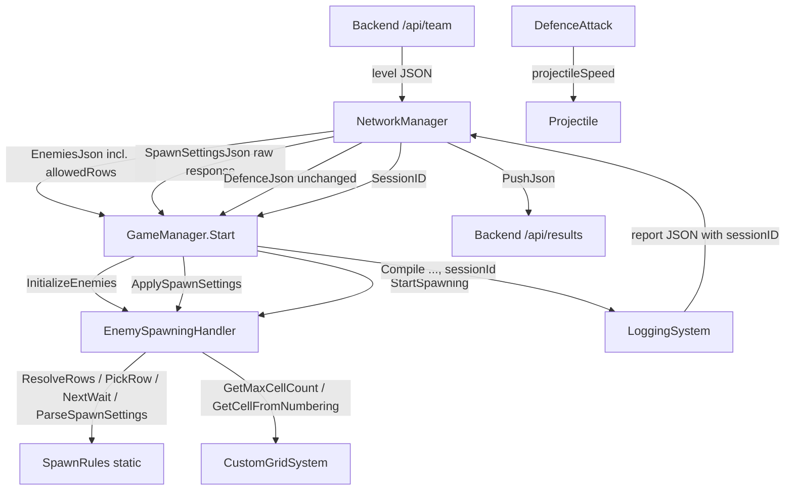
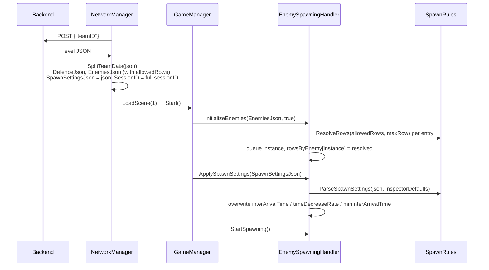
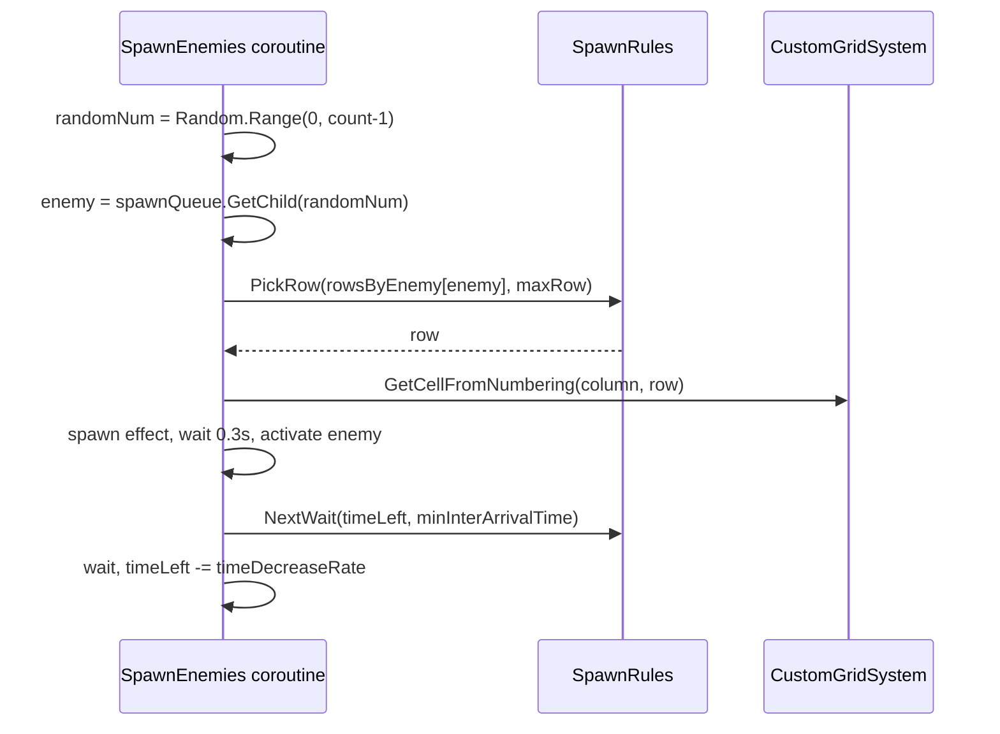
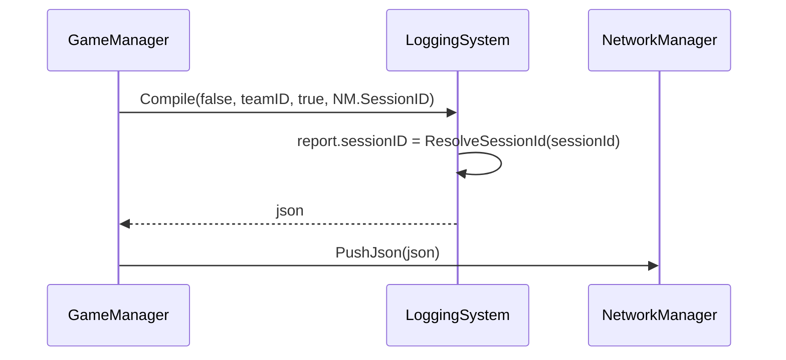

# Design Document: Backend Level Config

## Overview

The backend becomes the source of truth for three pieces of level data that are hardcoded in the client today: which rows each enemy type may spawn in (`allowedRows`), the spawn timing (`spawnSettings`) and the session id (`sessionID`) written into the results report. The same change fixes a bug where thrower defences fire projectiles with the penguin slide `speed` instead of `projectileSpeed`.

The design changes as little code as possible. Every new field is optional, and its default is the value the game uses now, so a backend that doesn't send the new fields gives exactly today's behaviour. The existing `NetworkManager` split pattern (`DefenceJson` / `EnemiesJson`) stays. It gains a `SpawnSettingsJson` string and a `SessionID` property. `quickTestMode` keeps using inspector values.

Testable logic goes into one small static class (`SpawnRules`) and one static helper on `LoggingSystem`. EditMode NUnit tests can then cover it without scenes or MonoBehaviours. `EnemyAI`, `Projectile`, `PlacementSystem`, prefabs and the scene don't change.

Target level-start JSON:

```json
{
  "sessionID": "abc123",
  "spawnSettings": { "interArrivalTime": 6, "timeDecreaseRate": 0.25, "minInterArrivalTime": 0 },
  "enemies": [ { "enemyId": 0, "count": 2, "allowedRows": [0, 1, 2] } ],
  "defencePlacementData": [ ]
}
```

## Architecture



### Change map

| File | Change |
|------|--------|
| `Scripts/NetworkManager.cs` | `EnemySpawn.allowedRows`, `TeamDataResponse.sessionID`, new `SessionID` and `SpawnSettingsJson` properties set in `SplitTeamData` |
| `Scripts/EnemySpawnData.cs` | `allowedRows` field |
| `Scripts/SpawnSettings.cs` (new) | `SpawnSettings`, `SpawnSettingsEnvelope`, static `SpawnRules` |
| `Scripts/EnemySpawningHandler.cs` | `minInterArrivalTime` field, per-instance row map, `ApplySpawnSettings`, row-aware spawn position, wait floor |
| `Scripts/LoggingSystem.cs` | Optional `sessionId` parameter on `Compile`, `ResolveSessionId` helper |
| `Scripts/GameManager.cs` | One added call (`ApplySpawnSettings`), one extra argument to `Compile` |
| `Scripts/DefenceAttack.cs` | Two thrower methods pass `projectileSpeed` instead of `speed` |

## Sequence Diagrams

### Level start



### One spawn step



### Results push



## Components and Interfaces

### NetworkManager (modified)

**Purpose**: It already fetches level data and splits it into strings for the scene scripts. It now also exposes the session id and the raw JSON for spawn settings.

```csharp
public string SessionID { get; private set; }          // null/blank → report fallback
public string SpawnSettingsJson { get; private set; }  // raw response text; only "spawnSettings" is read
```

**Responsibilities**:
- Carry `allowedRows` through the existing `EnemySpawn` → `EnemyWrapper` → `EnemiesJson` re-serialisation.
- Store the raw response for spawn settings. `JsonUtility` can't tell a missing value-type field from `0`, so the spawner needs the raw text to overlay values onto its defaults.
- Store `sessionID` without validating it. The fallback lives in `LoggingSystem`.

### EnemySpawningHandler (modified)

**Purpose**: Queues and spawns enemies. It now respects each type's allowed rows and the backend timing.

```csharp
[SerializeField] float minInterArrivalTime = 0f;                      // new inspector field, default 0
readonly Dictionary<Transform, List<int>> rowsByEnemy = new();         // null value = all rows

public void InitializeEnemies(string enemiesJson, bool isJson);        // signature unchanged
public void ApplySpawnSettings(string levelJson);                      // new
public void StartSpawning();                                           // unchanged
Vector3 GetRandomSpawnPosition(List<int> validRows);                   // gains a parameter (private)
```

**Responsibilities**:
- Resolve each entry's `allowedRows` once at queue time and map every queued instance to the resolved list. A parallel dictionary keyed by `Transform` keeps `EnemyAI` and the prefabs unchanged.
- Choose the enemy before the row, so the row comes from that enemy's list.
- Apply the timing overlay before `StartSpawning` sets `timeLeft`.

### SpawnRules (new, static, pure)

**Purpose**: Small pure functions that the tests can call directly.

```csharp
public static class SpawnRules
{
    public const string RowsWarningPrefix = "[Spawn] ";
    public static List<int> ResolveRows(List<int> allowedRows, int maxRow, string label);
    public static int PickRow(List<int> validRows, int maxRow);
    public static float NextWait(float timeLeft, float minInterArrivalTime);
    public static SpawnSettings ParseSpawnSettings(string levelJson, SpawnSettings defaults);
}
```

### LoggingSystem (modified)

```csharp
public const string DefaultSessionId = "Not Implemented Yet";
public static string ResolveSessionId(string sessionId);
public static string Compile(bool success, string teamId, bool saveToFile = true, string sessionId = null);
```

Adding `sessionId` as an optional last parameter keeps every existing call site and test compiling.

### GameManager (modified, two lines)

- Non-quick branch: call `enemySpawner.ApplySpawnSettings(NetworkManager.Instance.SpawnSettingsJson)` between `InitializeEnemies` and `StartSpawning`.
- `SimulationOverCleanUp`: pass `NetworkManager.Instance.SessionID` as the 4th argument to `Compile`.
- The `quickTestMode` branch stays as it is. It skips `ApplySpawnSettings`, so inspector timing applies, and it never calls `Compile`.

### DefenceAttack (bug fix)

`ThrowerLaneProjectile` and `ThrowerMultiLaneProjectile` pass `projectileSpeed` to `Projectile.SetAttributes`. `speed` is still used only by the `AttackType.slide` movement in `AttackUpdateLoop`.

> Gameplay note: prefab values aren't changed. Soldier currently has `projectileSpeed = 20` and Archer has `projectileSpeed = 100`, so projectile speeds will change once this ships, until those values are tuned in the inspector. The arial (Archer) projectile divides `speed` by `initialDistance`, so `100` gives a very fast arc.

## Data Models

### Level JSON additions (backend contract)

| Path | Type | Required | Default when absent | Rules |
|------|------|----------|---------------------|-------|
| `sessionID` | string | no | `"Not Implemented Yet"` in report | null, empty or whitespace → default |
| `spawnSettings` | object | no | inspector values | Absent object or absent field → that field's inspector value |
| `spawnSettings.interArrivalTime` | float (s) | no | inspector `interArivalTime` (6) | First wait after the first spawn |
| `spawnSettings.timeDecreaseRate` | float (s) | no | inspector `timeDecreaseRate` (0.25) | Subtracted after each spawn |
| `spawnSettings.minInterArrivalTime` | float (s) | no | inspector `minInterArrivalTime` (0) | Floor on each wait |
| `enemies[].allowedRows` | int[] | no | all rows | Out-of-grid values dropped with a warning; none valid → all rows |

### C# types

```csharp
// NetworkManager.cs (modified)
[Serializable] public class EnemySpawn { public int enemyId; public int count; public List<int> allowedRows; }

[Serializable]
public class TeamDataResponse
{
    public string sessionID;                              // new
    public List<DefencePlacement> defencePlacementData;
    public List<EnemySpawn> enemies;
}

// EnemySpawnData.cs (modified) — also the inspector type for quickTestMode
[System.Serializable]
public class EnemySpawnData
{
    public int enemyId;
    public int count;
    public List<int> allowedRows;                         // new; empty in inspector = all rows
}

// SpawnSettings.cs (new)
[Serializable]
public class SpawnSettings
{
    public float interArrivalTime;
    public float timeDecreaseRate;
    public float minInterArrivalTime;

    public SpawnSettings Copy() => (SpawnSettings)MemberwiseClone();
}

[Serializable]
public class SpawnSettingsEnvelope { public SpawnSettings spawnSettings; }   // mirrors the root key
```

**Validation rules**:
- `allowedRows`: `null` and `[]` mean the same thing, because `JsonUtility` gives an empty list for a missing array. Valid values are `0 ≤ r ≤ maxCellCount.y`. Duplicates are kept and act as weights, so no extra code is needed. Valid entries keep their order.
- `spawnSettings`: no range validation. A negative wait behaves like `WaitForSeconds` with a negative value (no wait), which is what happens today.
- `sessionID`: any non-blank string is passed through unchanged.
- Existing inspector data in `Main.unity` for `enemyWaves` deserialises with an empty `allowedRows`, which means all rows. No scene edit is needed.

## Key Functions with Formal Specifications

### SpawnRules.ResolveRows

```csharp
public static List<int> ResolveRows(List<int> allowedRows, int maxRow, string label)
```

**Preconditions:** `maxRow ≥ 0`. `allowedRows` may be null.

**Postconditions:**
- Returns `null` (meaning all rows) if `allowedRows` is null or empty, or if no entry falls in `[0, maxRow]`.
- Otherwise returns a new list with exactly the entries of `allowedRows` in `[0, maxRow]`, in their original order, duplicates kept.
- Logs one `Debug.LogWarning` per dropped value, naming `label` and the value. Logs one more warning when it falls back to all rows because nothing valid remained. Logs nothing when the input is null or empty.
- `allowedRows` isn't mutated.

**Loop invariant:** every element added to `result` is in `[0, maxRow]`.

### SpawnRules.PickRow

```csharp
public static int PickRow(List<int> validRows, int maxRow)
```

**Preconditions:** `maxRow ≥ 0`. `validRows` is null or a non-empty list with all elements in `[0, maxRow]` (that is, output of `ResolveRows`).

**Postconditions:**
- `validRows == null` → returns `UnityEngine.Random.Range(0, maxRow + 1)`. This is the same call the game makes today, so the RNG sequence is preserved.
- Otherwise → returns `validRows[UnityEngine.Random.Range(0, validRows.Count)]`, which is in `validRows`.
- Makes exactly one `Random.Range` call.

### SpawnRules.NextWait

```csharp
public static float NextWait(float timeLeft, float minInterArrivalTime) => Mathf.Max(timeLeft, minInterArrivalTime);
```

**Postconditions:** `result ≥ minInterArrivalTime`. `result == timeLeft` whenever `timeLeft ≥ minInterArrivalTime`. With `min = 0`, the effective wait equals today's (a negative `timeLeft` already meant no wait).

### SpawnRules.ParseSpawnSettings

```csharp
public static SpawnSettings ParseSpawnSettings(string levelJson, SpawnSettings defaults)
```

**Preconditions:** `defaults` is non-null.

**Postconditions:**
- Returns a new instance. `defaults` isn't mutated.
- `levelJson` null or whitespace → copy of `defaults`.
- Invalid JSON → copy of `defaults` plus one `Debug.LogWarning`.
- For each field `f`: `result.f = levelJson.spawnSettings.f` if that key exists in the JSON, otherwise `defaults.f`. An absent `spawnSettings` object gives all defaults.

**Approach:** `JsonUtility.FromJsonOverwrite(levelJson, envelope)` where `envelope.spawnSettings = defaults.Copy()`. `FromJsonOverwrite` leaves fields that aren't in the JSON unchanged, and it ignores unknown root keys (`enemies`, `sessionID`, …). Tests must confirm that a partial nested object keeps defaults for its missing fields (Property 5). If that test fails on the project's Unity version, the fallback is to overlay twice: first a `SpawnSettingsEnvelope` built from defaults, then the parsed one, using a raw-text `"\"field\""` key presence check for each of the three fields. Use this only if the test requires it.

### LoggingSystem.ResolveSessionId

```csharp
public static string ResolveSessionId(string sessionId) =>
    string.IsNullOrWhiteSpace(sessionId) ? DefaultSessionId : sessionId;
```

**Postconditions:** never returns null or blank. Returns a non-blank input unchanged.

### LoggingSystem.Compile (modified)

**Postconditions:** the output report's `sessionID == ResolveSessionId(sessionId)`. Every other field is identical to the current output for the same inputs.

## Algorithmic Pseudocode

### InitializeEnemies (changed lines marked `// NEW`)

```csharp
public void InitializeEnemies(string enemiesJson, bool isJson)
{
    enemyCount = 0;
    rowsByEnemy.Clear();                                                    // NEW
    int maxRow = gridSystem.GetMaxCellCount().y;                            // NEW (grid built in Awake)
    Dictionary<string, int> typeCounters = new Dictionary<string, int>();
    if (isJson) enemyWaves = JsonUtility.FromJson<EnemyWave>(enemiesJson);

    foreach (EnemySpawnData spawnData in enemyWaves.enemies)
    {
        string prefabName = enemyAIIndexMapping[spawnData.enemyId].name;
        List<int> rows = SpawnRules.ResolveRows(spawnData.allowedRows, maxRow, prefabName); // NEW, once per entry
        for (int i = 0; i < spawnData.count; i++)
        {
            EnemyAI enemy = Instantiate(enemyAIIndexMapping[spawnData.enemyId], spawnQueue);
            // ... existing naming "<Prefab>_<n>" unchanged ...
            rowsByEnemy[enemy.transform] = rows;                            // NEW
            enemy.gameObject.SetActive(false);
            enemyCount++;
        }
    }
}
```

### ApplySpawnSettings (new)

```csharp
public void ApplySpawnSettings(string levelJson)
{
    SpawnSettings defaults = new SpawnSettings {
        interArrivalTime = interArivalTime, timeDecreaseRate = timeDecreaseRate,
        minInterArrivalTime = minInterArrivalTime };
    SpawnSettings s = SpawnRules.ParseSpawnSettings(levelJson, defaults);
    interArivalTime     = s.interArrivalTime;
    timeDecreaseRate    = s.timeDecreaseRate;
    minInterArrivalTime = s.minInterArrivalTime;
}
```

### SpawnEnemies (reordered so the enemy is known before the row)

```csharp
IEnumerator SpawnEnemies()
{
    int enemyCount = EnemyCountInSpawnQueue();
    while (enemyCount >= 1)
    {
        int randomNum = Random.Range(0, enemyCount - 1);                    // unchanged (off-by-one out of scope)
        Transform enemy = spawnQueue.GetChild(randomNum);                   // MOVED up from after the 0.3s wait
        rowsByEnemy.TryGetValue(enemy, out List<int> rows);                 // NEW; missing key → null → all rows
        Vector3 spawnPosition = GetRandomSpawnPosition(rows);

        Instantiate(spawnEffect, spawnPosition, Quaternion.identity);
        yield return new WaitForSeconds(0.3f);

        enemy.position = spawnPosition;
        enemy.parent = transform;
        enemy.gameObject.SetActive(true);

        yield return new WaitForSeconds(SpawnRules.NextWait(timeLeft, minInterArrivalTime)); // NEW floor
        timeLeft -= timeDecreaseRate;
        enemyCount = EnemyCountInSpawnQueue();
    }
    completedWave = true;
}
```

Moving `GetChild` before the 0.3s wait is safe. Only this coroutine removes children from `spawnQueue`, so the child at `randomNum` is the same before and after the wait. The order of `Random.Range` calls (enemy index, then row) stays the same.

### GetRandomSpawnPosition

```csharp
Vector3 GetRandomSpawnPosition(List<int> validRows)
{
    Vector2Int maxCellCount = gridSystem.GetMaxCellCount();
    // ... existing gridColumnForEnemies handling unchanged ...
    int row = SpawnRules.PickRow(validRows, maxCellCount.y);                // was Random.Range(0, maxCellCount.y + 1)
    return gridSystem.GetCellFromNumbering(gridColumnForEnemies, row).transform.position;
}
```

### SpawnRules.ResolveRows

```csharp
public static List<int> ResolveRows(List<int> allowedRows, int maxRow, string label)
{
    if (allowedRows == null || allowedRows.Count == 0) return null;
    List<int> result = new List<int>();
    foreach (int r in allowedRows)
    {
        // invariant: all of result ∈ [0, maxRow]
        if (r >= 0 && r <= maxRow) result.Add(r);
        else Debug.LogWarning($"{RowsWarningPrefix}{label}: row {r} outside 0..{maxRow}, ignored");
    }
    if (result.Count == 0)
    {
        Debug.LogWarning($"{RowsWarningPrefix}{label}: no valid allowedRows, using all rows");
        return null;
    }
    return result;
}
```

### NetworkManager.SplitTeamData (additions only)

```csharp
TeamDataResponse full = JsonUtility.FromJson<TeamDataResponse>(json);
// ... existing DefenceJson / EnemiesJson lines unchanged (EnemySpawn now carries allowedRows) ...
SessionID = full.sessionID;          // NEW
SpawnSettingsJson = json;            // NEW: raw text, overlay happens in the spawner
OnTeamDataReceived?.Invoke();
```

## Example Usage

```csharp
// Backend sends rows 0-2 for enemyId 0 on a 6-row grid (maxRow = 5)
var rows = SpawnRules.ResolveRows(new List<int> { 0, 1, 2, 9 }, 5, "EnemClown"); // [0,1,2], warns about 9
int row  = SpawnRules.PickRow(rows, 5);                                          // 0, 1 or 2

// Absent spawnSettings → inspector defaults
var d = new SpawnSettings { interArrivalTime = 6, timeDecreaseRate = 0.25f, minInterArrivalTime = 0 };
SpawnRules.ParseSpawnSettings("{\"enemies\":[]}", d);                          // 6 / 0.25 / 0
SpawnRules.ParseSpawnSettings("{\"spawnSettings\":{\"minInterArrivalTime\":1.5}}", d); // 6 / 0.25 / 1.5

SpawnRules.NextWait(-0.5f, 0f);  // 0
SpawnRules.NextWait(0.75f, 1.5f); // 1.5

LoggingSystem.Compile(false, "TEAM1", false, "abc123"); // "sessionID": "abc123"
LoggingSystem.Compile(false, "TEAM1", false);           // "sessionID": "Not Implemented Yet"
```

## Correctness Properties

### Property 1: Row membership

For any `allowedRows` and any `maxRow ≥ 0`, let `v = ResolveRows(allowedRows, maxRow)`. If `v != null`, `PickRow(v, maxRow) ∈ v`. If `v == null`, `PickRow(v, maxRow) ∈ [0, maxRow]`.

### Property 2: Resolve filtering

`ResolveRows` output is null or a non-empty subsequence of the input with every element in `[0, maxRow]`. It is null exactly when the input is null or empty, or has no in-range element. It warns exactly once per out-of-range input value, plus once more on fallback.

### Property 3: Default equivalence

For any seed, with `v == null`, `PickRow(v, maxRow)` after `Random.InitState(seed)` equals `Random.Range(0, maxRow + 1)` after the same `InitState`. Default rows reproduce today's spawn rows.

### Property 4: Wait floor

For any `timeLeft` and `min`, `NextWait(timeLeft, min) ≥ min`, and `NextWait(timeLeft, min) == timeLeft` when `timeLeft ≥ min`. For `min = 0`, `max(NextWait, 0) == max(timeLeft, 0)`, so the effective wait is the same as today.

### Property 5: Settings overlay

For any defaults `D` and any subset `S` of the three fields given random values in a `spawnSettings` object, every field in `S` takes the JSON value and every other field takes `D`'s value. An absent `spawnSettings`, null, empty, whitespace or invalid JSON yields `D` field by field. `D` is never mutated.

### Property 6: allowedRows round trip

For any `allowedRows` list, parsing a level JSON into `TeamDataResponse`, re-serialising it with `EnemyWrapper` (as `SplitTeamData` does) and parsing that with `EnemyWave` gives an equal `allowedRows`. A missing `allowedRows` comes back empty.

### Property 7: Session id

For any string `s`, `Compile(..., saveToFile:false, s)` has `sessionID == s` when `s` is non-blank, and `"Not Implemented Yet"` otherwise. Calling it without the 4th argument gives `"Not Implemented Yet"`. Every other field equals the output of the 3-argument call.

### Property 8: Thrower speed

Example or code review: `ThrowerLaneProjectile` and `ThrowerMultiLaneProjectile` pass `projectileSpeed`, and slide movement still uses `speed`.

## Error Handling

| Scenario | Condition | Response | Recovery |
|----------|-----------|----------|----------|
| Out-of-grid rows | `r < 0` or `r > maxCellCount.y` | `Debug.LogWarning` per value, value dropped | Remaining rows used |
| No valid rows | All entries out of grid | Extra `Debug.LogWarning` | All rows (today's behaviour) |
| Missing `allowedRows` | Key absent or `[]` | None | All rows |
| Missing `spawnSettings` / fields | Key absent | None | Inspector values |
| Bad JSON for settings | `FromJsonOverwrite` throws | `Debug.LogWarning` | Inspector values |
| Missing `sessionID` | null, empty or whitespace | None | `"Not Implemented Yet"` in report |
| Unknown queued instance | `rowsByEnemy` has no key (shouldn't happen) | None | All rows |
| Whole response invalid | Existing `SplitTeamData` catch | Existing error UI | Unchanged |

## Testing Strategy

### Unit testing (EditMode, NUnit)

- File: `Assets/Tests/Editor/BackendLevelConfigTests.cs`, in an `Editor` folder with no asmdef, so it compiles into Assembly-CSharp-Editor and can see the Assembly-CSharp scripts. This matches the existing logging spec's setup. `com.unity.test-framework` must be in `Packages/manifest.json`.
- Example tests: the cases in Example Usage; `allowedRows` with every value out of range; `"spawnSettings": {}`; JSON `"spawnSettings": null` (should give defaults; record what actually happens); the 3-argument `Compile` still compiles; `LoggingSystem.Reset()` in `[SetUp]`.
- Warnings: use `LogAssert.Expect(LogType.Warning, new Regex(...))` where the count matters. Otherwise `LogAssert.ignoreFailingMessages` isn't needed, because warnings don't fail tests.

### Property-based testing

- Property test library: none added. Use seeded `System.Random` loops (for example, 500 iterations), and print the seed on failure, as the existing logging tests do. Use `UnityEngine.Random.InitState(seed)` for `PickRow` and Property 3.
- Cover Properties 1–7. Generators: `maxRow ∈ [0, 10]`, row lists of length 0–8 with values in `[-3, maxRow + 3]`, floats in `[-5, 20]`, random field subsets for Property 5, and session strings including `null`, `""`, `"  "` and random ASCII.

### Integration / manual

- `quickTestMode = true`: play `Main.unity` and confirm enemies spawn in all rows with inspector timing, as before.
- Backend with no new fields: same spawn and timing behaviour, and the report shows `"sessionID": "Not Implemented Yet"`.
- Backend with `allowedRows: [0]` for one type: that type spawns only in row 0, and the other types use all rows.
- Thrower defences fire at their `projectileSpeed`. Tune Soldier and Archer prefabs afterwards.

## Performance Considerations

`ResolveRows` runs once per `enemies` entry. `PickRow` and the dictionary lookup are O(1) per spawn. The dictionary holds one entry per queued enemy and is cleared on each `InitializeEnemies` call. There is no per-frame cost.

## Security Considerations

Backend values only affect spawn rows, timing and a report string. Rows are bounds-checked before grid lookup, so a bad row can't cause a null cell or an index error. Timing values aren't range-checked. A malicious backend could already control the whole level, so that's acceptable. `sessionID` is written into JSON with `JsonUtility`, which escapes it. The existing HTTP endpoints have no authentication, and this design doesn't change that.

## Dependencies

- Unity `JsonUtility` (`FromJson`, `FromJsonOverwrite`, `ToJson`). Already in use.
- Unity Test Framework (`com.unity.test-framework`, NUnit) for EditMode tests.
- No new runtime packages.
