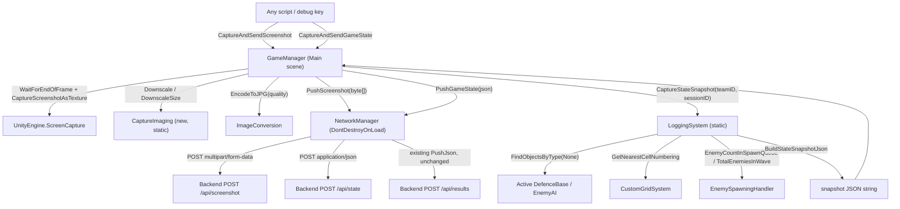
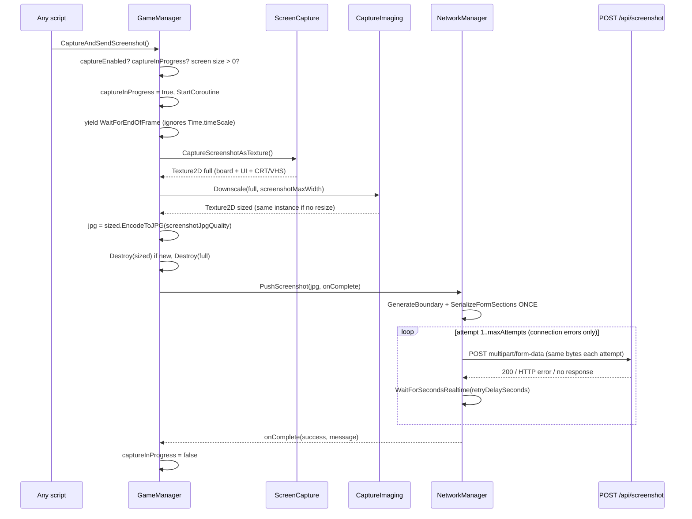
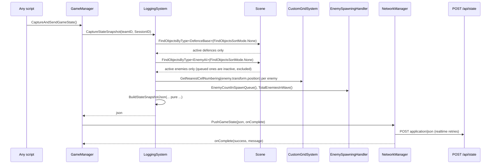

# Design Document: Game State Capture

## Overview

The game needs to hand an LLM a picture of "what is happening right now", mid-simulation. This design adds two independent capture mechanisms, each reachable through one public `GameManager` method that any script can call at any time during play.

**Mechanism A (screenshot)** grabs the whole screen exactly as the player sees it (board, health bars, taunt character, CRT/VHS overlays, every UI layer), encodes it as JPG in memory and POSTs it to a new backend endpoint as `multipart/form-data` with `teamID` and `sessionID` as text fields. Nothing touches the file system, because the target is WebGL.

**Mechanism B (JSON snapshot)** asks the static `LoggingSystem` for the same information in structured form: every active defence and enemy with its id, derived type, health, max health and grid cell, plus wave progress and elapsed time. It is synchronous, needs no frame timing and no graphics, and is the cheaper option when the consumer can read JSON.

The two mechanisms share nothing but the `NetworkManager` retry settings and `LoggingSystem.ResolveSessionId`. Either can ship or be used without the other. Neither touches the end-of-simulation flow: no `Time.timeScale` writes, no `endScreenTriggered`, no `SimulationOverCleanUp` changes, and all new waits are frame-based or realtime so they work while the game is fast-forwarded, slowed by the interaction engine, or paused. `UIController` is not changed, and the new upload paths never call `DisplayError`.

## Decisions to Confirm (Open Questions)

| # | Question | Chosen default | Notes |
|---|----------|----------------|-------|
| 1 | Where does the JSON snapshot (B) go? Own endpoint, the screenshot endpoint, or local only? | Its own `pushGameStateUrl` field, `http://127.0.0.1:5000/api/state`, matching the existing localhost convention | Not specified by the user. It is a public inspector string, so repointing it to `/api/screenshot` or any other path is a one-field edit, and leaving the URL blank can be made a "build the JSON, log it, don't upload" mode |
| 2 | Who triggers a capture mid-game? | Nobody yet. Both methods are public and unreferenced | Out of scope here. A debug key, an interaction-engine hook or a backend poll can all call them later |
| 3 | Capture cadence / rate limit | Caller-driven, with a single-flight guard that drops overlapping requests | WebGL is single-threaded, so more than roughly one capture per second will be felt |
| 4 | Should a screenshot and a snapshot taken together share a correlation id? | No. The backend can correlate on `sessionID` plus arrival time | Adding a `captureId` later is additive on both payloads |
| 5 | `quickTestMode` behaviour for B | Build the snapshot with `teamID = "LOCAL"` and `Debug.Log` it, no upload | `NetworkManager.Instance` is null in that mode |

## Architecture



### Change map

| File | Change |
|------|--------|
| `Scripts/GameManager.cs` | New `State Capture` inspector fields, `captureInProgress` guard, public `CaptureAndSendScreenshot()`, public `CaptureAndSendGameState()`, private `CaptureScreenshotRoutine()` |
| `Scripts/NetworkManager.cs` | New `pushScreenshotUrl` and `pushGameStateUrl` fields, `PushScreenshot(byte[], Action<bool,string>)`, `PushGameState(string, Action<bool,string>)`, their two coroutines, `BuildScreenshotFileName()` |
| `Scripts/CaptureImaging.cs` (new) | Static `DownscaleSize(int, int, int)` (pure) and `Downscale(Texture2D, int)` (blit + ReadPixels) |
| `Scripts/LoggingSystem.cs` | New state DTOs, pure `BuildStateSnapshotJson(...)`, `CaptureStateSnapshot(...)`, `ElapsedSeconds()`, private scene collectors |
| `Scripts/CustomGridSystem.cs` | New instance `GetNearestCellNumbering(Vector3)` and pure static `NearestCellNumbering(Vector2, Vector2, float, Vector2Int)` |
| `Scripts/EnemyAI.cs` | New `GetMaxHealth()` |
| `Scripts/DefenceBase.cs` | New `GetMaxHealth()` |
| `Tests/Editor/GameStateCaptureTests.cs` (new) | EditMode NUnit tests for the pure logic |
| `Scenes/Main.unity` | Inspector values for the new `GameManager` fields only. No new GameObjects, no new references |
| `Scripts/UIController.cs` | **Unchanged.** No debug URL override, and the new upload paths never call `DisplayError` |
| `Scripts/EnemySpawningHandler.cs`, `PlacementSystem.cs`, `GridCell.cs` | **Unchanged.** Only their existing public getters are read |

## Sequence Diagrams

### A. Screenshot capture and upload



### B. JSON state snapshot



## Components and Interfaces

### GameManager (modified)

**Purpose**: owns both public entry points and the only new coroutine. It is the right place because it already lives in the Main scene, already holds inspector tuning fields, and already talks to `NetworkManager` and `LoggingSystem`.

```csharp
[Header("State Capture")]                               // NEW
[SerializeField] bool captureEnabled = true;            // NEW: master off switch
[SerializeField] int screenshotJpgQuality = 75;         // NEW: 1..100, tuned for LLM reading
[SerializeField] int screenshotMaxWidth = 1280;         // NEW: 0 or less = no downscale
[SerializeField] bool logStateSnapshotLocally = true;   // NEW: also Debug.Log the JSON

bool captureInProgress = false;                         // NEW: single-flight guard

public void CaptureAndSendScreenshot();                 // NEW: safe to call any time
public void CaptureAndSendGameState();                  // NEW: synchronous build, async push
IEnumerator CaptureScreenshotRoutine();                 // NEW
```

**Responsibilities**:
- Validate preconditions (enabled, not already capturing, screen has pixels, `NetworkManager.Instance` present) and return quietly when they fail.
- Capture after rendering, downscale, encode, release textures, hand the bytes to `NetworkManager`.
- Never write `Time.timeScale`, never read or set `endScreenTriggered`, never call `TriggerSimulationOverPanel`. Capture is invisible to the end-of-simulation path.
- The `onComplete` callback only assigns a bool and logs, so it is harmless if it fires after this `GameManager` has been destroyed by a scene load. Setting a managed field on a destroyed MonoBehaviour is legal; calling Unity APIs on one is not, so the callback does neither.

### NetworkManager (modified)

**Purpose**: already the only HTTP component and already `DontDestroyOnLoad`, so an in-flight upload survives the scene change back to the menu. It gains two push methods that mirror `PushJson` but follow stricter rules.

```csharp
[Header("Mid-game capture")]                                                    // NEW
public string pushScreenshotUrl = "http://127.0.0.1:5000/api/screenshot";       // NEW
public string pushGameStateUrl  = "http://127.0.0.1:5000/api/state";            // NEW

public void PushScreenshot(byte[] jpgBytes, Action<bool, string> onComplete = null);   // NEW
public void PushGameState(string json, Action<bool, string> onComplete = null);        // NEW
IEnumerator PushScreenshotRoutine(byte[] jpgBytes, Action<bool, string> onComplete);   // NEW
IEnumerator PushGameStateRoutine(string json, Action<bool, string> onComplete);        // NEW
string BuildScreenshotFileName();                                                      // NEW
```

**Responsibilities**:
- Reuse `maxAttempts`, `retryDelaySeconds`, `timeoutSeconds` and `GetErrorMessage(UnityWebRequest)` unchanged.
- Retry on `Result.ConnectionError` only. A server-side rejection (4xx/5xx) is final, exactly like `PushJsonRoutine`.
- Build a fresh `UnityWebRequest` per attempt (they cannot be reused) but serialise the multipart body **once**, with one generated boundary, so every attempt sends byte-identical content.
- Invoke `onComplete` exactly once on every exit path.

**Two rules the new paths follow and the existing `PushJsonRoutine` does not:**

| Existing issue in `PushJsonRoutine` | Why it bites | New code does |
|---|---|---|
| Calls `uicontroller.DisplayError(...)` on failure, but `uicontroller` was wired in the Menu scene and that object is destroyed when scene 1 loads | During gameplay those error branches can throw a null/destroyed-reference error | Never touches `uicontroller`. `Debug.LogWarning` / `Debug.LogError` only. Capture is best-effort and must not surface UI errors over live gameplay |
| Retry delay is `WaitForSeconds(retryDelaySeconds)`, which never elapses at `Time.timeScale = 0` | Retries freeze during pause and slow to a crawl in slow-mo | Uses `WaitForSecondsRealtime(retryDelaySeconds)` |

Both are pre-existing behaviour of the results push. This spec does **not** change `PushJson` / `PushJsonRoutine`; it only avoids repeating the pattern in new code.

### CaptureImaging (new, static)

**Purpose**: keeps the resize arithmetic out of `GameManager` and makes it unit-testable without a scene or a GPU.

```csharp
public static class CaptureImaging                                      // NEW
{
    public static Vector2Int DownscaleSize(int width, int height, int maxWidth);  // pure
    public static Texture2D Downscale(Texture2D source, int maxWidth);            // needs graphics
}
```

**Responsibilities**:
- `DownscaleSize`: pure aspect-preserving arithmetic. Never upscales.
- `Downscale`: returns `source` itself when no resize is needed, so the caller can tell whether it owns a second texture. Uses `RenderTexture.GetTemporary` + `Graphics.Blit` + `ReadPixels` and always calls `RenderTexture.ReleaseTemporary`, restoring the previous `RenderTexture.active`.

### LoggingSystem (modified)

**Purpose**: already the single place that knows the simulation clock (`startTime`) and the id/type conventions (`DeriveType`, `ResolveSessionId`). The snapshot belongs here, next to `Compile`, and reuses both helpers.

```csharp
public static float ElapsedSeconds();                                   // NEW: Time.time - startTime

// NEW: pure, no scene / clock / disk access. The unit-testable half.
public static string BuildStateSnapshotJson(
    string teamId,
    string sessionId,
    float elapsedSeconds,
    StateCounts counts,
    List<DefenceStateEntry> defences,
    List<EnemyStateEntry> enemies,
    bool prettyPrint = true);

// NEW: thin collector. Walks the scene, then calls the builder.
public static string CaptureStateSnapshot(string teamId, string sessionId, bool saveToFile = false);

static List<DefenceStateEntry> CollectDefenceStates();                  // NEW
static List<EnemyStateEntry> CollectEnemyStates(CustomGridSystem grid);  // NEW
static StateCounts CollectCounts(int activeDefences, int activeEnemies); // NEW
```

**Responsibilities**:
- `CaptureStateSnapshot` is the only part that touches the scene. It finds units with `UnityEngine.Object.FindObjectsByType<T>(FindObjectsSortMode.None)` rather than taking scene references, because `LoggingSystem` is a static class with no inspector and no lifetime. The overload without a `FindObjectsInactive` argument **excludes inactive objects**, which is exactly the filter this feature needs: queued-but-unspawned enemies are inactive children of `spawnQueue`, so they are naturally left out of the unit lists (they are still reported in the counts via `EnemyCountInSpawnQueue()`).
- `saveToFile` defaults to **false**. WebGL has no usable file system, so `Compile`'s `persistentDataPath` write is not repeated here. The parameter exists only so an Editor debug session can dump a snapshot; it is never true in a WebGL build.
- `BuildStateSnapshotJson` must stay free of `Time`, `FindObjectsByType` and `File`, so tests can call it with synthetic lists.

**Which units appear in the snapshot**

| Unit state | In `defences` / `enemies`? | Why |
|---|---|---|
| Defence placed and alive | yes | Active object |
| Defence at `health <= 0` playing its death animation (not yet `Destroy`ed) | yes, with `health <= 0` | Still an active object; this matches what the screenshot shows |
| Defence already destroyed | no | Object gone. Its totals live in `Compile`'s report, not here |
| Enemy spawned and alive | yes | Active object |
| Enemy at `health <= 0`, `IsDead() == true`, death animation playing | yes, with `isDead: true` | Still visible on screen, so the snapshot and the screenshot agree |
| Enemy queued but never spawned | no, counted in `enemiesQueued` | `SetActive(false)` in `InitializeEnemies`, excluded by `FindObjectsByType` |

### CustomGridSystem (modified)

**Purpose**: enemies move continuously and have no `myCell`, so the snapshot needs a world-position → cell lookup. The existing `GetCellFromNumbering` is a linear scan over all cells and solves the opposite problem; it is not used here.

```csharp
// NEW: O(1) nearest cell for moving units, clamped into the grid
public Vector2Int GetNearestCellNumbering(Vector3 worldPosition);

// NEW: pure math behind it, testable without a scene (Awake builds startPos / maxCellCount)
public static Vector2Int NearestCellNumbering(Vector2 worldPosition, Vector2 origin, float cellSize, Vector2Int maxCellCount);
```

**Responsibilities**:
- Invert the placement formula from `PopulateGrid` (`cellWorld = startPos + (x, y) * GridCell.nodeSize`) with `Mathf.RoundToInt`, then `Mathf.Clamp` into `[0, maxCellCount.x]` and `[0, maxCellCount.y]`.
- The instance method only supplies `startPos`, `GridCell.nodeSize` and `maxCellCount`. No allocation, no search, no null return.

### DefenceBase and EnemyAI (modified)

`maxHealth` is a private `[SerializeField]` on both, and only `GetCurrentHealth()` is public. The snapshot needs the denominator so an LLM can reason about "half dead" rather than raw numbers.

```csharp
// DefenceBase.cs
public float GetMaxHealth()                 // NEW
{
    return maxHealth;
}

// EnemyAI.cs
public float GetMaxHealth()                 // NEW
{
    return maxHealth;
}
```

Two getters, matching the existing `GetCurrentHealth()` style. Nothing else in either class changes.

## Data Models

### Screenshot request (mechanism A)

`POST {pushScreenshotUrl}` with `Content-Type: multipart/form-data; boundary=<generated>`.

| Part name | Kind | Content type | Value |
|-----------|------|--------------|-------|
| `screenshot` | file | `image/jpeg` | JPG bytes from `EncodeToJPG(screenshotJpgQuality)` |
| `teamID` | text | `text/plain` (default) | `NetworkManager.teamID` |
| `sessionID` | text | `text/plain` (default) | `LoggingSystem.ResolveSessionId(SessionID)`, so it is never blank |

File name: `screenshot_<teamID>_<yyyyMMdd_HHmmss>.jpg`. It is informational; the backend should ignore it and derive its own storage name (see Security Considerations).

**Response contract**: `200` on success, any body. On failure, reply with the existing error shape `{"error": "..."}` so `GetErrorMessage` can surface a readable message in the log. No test-server changes are part of this spec.

### Snapshot JSON (mechanism B)

```csharp
[Serializable]
public class DefenceStateEntry                  // NEW
{
    public string id;                           // unique instance name, e.g. "defenceSoilder_1"
    public string type;                         // DeriveType(id), e.g. "defenceSoilder"
    public float health;
    public float maxHealth;
    public Vector2Int position;                 // myCell, set at placement
}

[Serializable]
public class EnemyStateEntry                    // NEW
{
    public string id;                           // e.g. "EnemClown_3"
    public string type;                         // "EnemClown"
    public float health;
    public float maxHealth;
    public Vector2Int position;                 // nearest grid cell, clamped
    public bool isAttacking;                    // GetCurrentAttackState()
    public bool isDead;                         // IsDead(), death animation still playing
}

[Serializable]
public class StateCounts                        // NEW
{
    public int activeDefenceCount;
    public int activeEnemyCount;
    public int enemiesQueued;                   // EnemyCountInSpawnQueue()
    public int totalEnemiesInWave;              // TotalEnemiesInWave()
}

[Serializable]
class StateSnapshot                             // NEW: internal, mirrors the Report pattern
{
    public string teamID;
    public string sessionID;
    public float elapsedSeconds;                // since LoggingSystem.Reset()
    public StateCounts counts;
    public List<DefenceStateEntry> defences;
    public List<EnemyStateEntry> enemies;
}
```

`Vector2Int` serialises as `{"x":int,"y":int}` through `JsonUtility`; the existing `DefenceLog.position` in `Report` already relies on that, so the shape is proven in this project.

| Field | Type | Meaning | Rules |
|-------|------|---------|-------|
| `teamID` | string | Passed in by the caller | Written as given, `JsonUtility` escapes it |
| `sessionID` | string | Backend session | `ResolveSessionId`: blank → `"Not Implemented Yet"` |
| `elapsedSeconds` | float | Seconds since `Reset()` | Scaled game time, same clock as `Report.durationSeconds` |
| `counts.activeDefenceCount` | int | `defences.Count` | Always equals the array length |
| `counts.activeEnemyCount` | int | `enemies.Count` | Always equals the array length. Close to `EnemySpawningHandler.ActiveEnemyCount()` but not identical: that method only counts `EnemyAI` parented under the spawner, this counts every active `EnemyAI` in the scene |
| `counts.enemiesQueued` | int | Not yet spawned | `0` if no spawner is found |
| `counts.totalEnemiesInWave` | int | Wave size | `0` if no spawner is found |
| `defences[].position` | `{x,y}` | Placement cell | From `DefenceBase.myCell` |
| `enemies[].position` | `{x,y}` | Nearest cell | Clamped to `[0,10] x [0,5]` on the current grid. `{-1,-1}` if no grid was found |
| `health` / `maxHealth` | float | Raw values, not a ratio | `health` can be `<= 0` for a unit still playing its death animation. Regenerating enemies are capped at `maxHealth` by `Regeneratehealth`, so the ratio stays in `(-inf, 1]` |

**Example snapshot** (real prefab names from this project, grid 11 columns `x 0..10` by 6 rows `y 0..5`, enemies walk from `x = 10` toward `x = 0`):

```json
{
  "teamID": "TEAM1",
  "sessionID": "abc123",
  "elapsedSeconds": 42.5,
  "counts": {
    "activeDefenceCount": 4,
    "activeEnemyCount": 3,
    "enemiesQueued": 5,
    "totalEnemiesInWave": 12
  },
  "defences": [
    { "id": "defencePenguin_0", "type": "defencePenguin", "health": 200.0, "maxHealth": 200.0, "position": { "x": 0, "y": 0 } },
    { "id": "defenceSoilder_0", "type": "defenceSoilder", "health": 85.5,  "maxHealth": 150.0, "position": { "x": 1, "y": 2 } },
    { "id": "defenceArcher_0",  "type": "defenceArcher",  "health": 150.0, "maxHealth": 150.0, "position": { "x": 2, "y": 4 } },
    { "id": "defenceShield_1",  "type": "defenceShield",  "health": -5.0,  "maxHealth": 400.0, "position": { "x": 1, "y": 5 } }
  ],
  "enemies": [
    { "id": "EnemClown_3",  "type": "EnemClown",  "health": 40.0,  "maxHealth": 100.0, "position": { "x": 2, "y": 2 }, "isAttacking": true,  "isDead": false },
    { "id": "EnemyMonk_1",  "type": "EnemyMonk",  "health": 180.0, "maxHealth": 180.0, "position": { "x": 7, "y": 4 }, "isAttacking": false, "isDead": false },
    { "id": "EnemyWizard_0","type": "EnemyWizard","health": 0.0,   "maxHealth": 120.0, "position": { "x": 5, "y": 0 }, "isAttacking": false, "isDead": true  }
  ]
}
```

`defenceShield_1` at `health: -5` and `EnemyWizard_0` with `isDead: true` are the mid-death-animation cases: both are still on screen, so both are still in the snapshot. `EnemyPirate` units simply have none alive in this example.

## Key Functions with Formal Specifications

### CustomGridSystem.NearestCellNumbering (pure, static)

```csharp
public static Vector2Int NearestCellNumbering(Vector2 worldPosition, Vector2 origin, float cellSize, Vector2Int maxCellCount)
```

**Preconditions**: `maxCellCount.x >= 0`, `maxCellCount.y >= 0`. `cellSize` should be `> 0`; `<= 0` is handled defensively.

**Postconditions**:
- `cellSize <= 0` → returns `Vector2Int.zero` and logs one `Debug.LogWarning`. This avoids a divide-by-zero turning into a NaN cast.
- Otherwise `result.x ∈ [0, maxCellCount.x]` and `result.y ∈ [0, maxCellCount.y]`, always.
- For `worldPosition == origin + (x, y) * cellSize` with `x ∈ [0, maxCellCount.x]`, `y ∈ [0, maxCellCount.y]`, the result is exactly `(x, y)`.
- For any offset `d` with `|d.x| < cellSize / 2` and `|d.y| < cellSize / 2` applied to an in-grid cell position, the result is still that cell.
- Exact half-cell ties follow `Mathf.RoundToInt`, which rounds half to **even** (`RoundToInt(0.5f) == 0`, `RoundToInt(1.5f) == 2`). Documented, not relied on.
- No allocation, no scene access, O(1).

**Loop invariants**: none, the function is branch-only.

### CustomGridSystem.GetNearestCellNumbering (instance)

```csharp
public Vector2Int GetNearestCellNumbering(Vector3 worldPosition)
```

**Preconditions**: `Awake` has run, so `startPos` and `maxCellCount` are set.

**Postconditions**: equals `NearestCellNumbering(new Vector2(worldPosition.x, worldPosition.y), startPos, GridCell.nodeSize, maxCellCount)`. `worldPosition.z` is ignored. Does not mutate the grid and never returns null (it is a struct).

### CaptureImaging.DownscaleSize (pure, static)

```csharp
public static Vector2Int DownscaleSize(int width, int height, int maxWidth)
```

**Preconditions**: `width >= 0`, `height >= 0`. `maxWidth` may be `0` or negative, meaning "no downscale".

**Postconditions**:
- `maxWidth <= 0` or `width <= maxWidth` or `width <= 0` or `height <= 0` → returns `(width, height)` unchanged. Never upscales.
- Otherwise `result.x == maxWidth` and `result.y == Mathf.Max(1, Mathf.RoundToInt(height * (float)maxWidth / width))`.
- `result.x >= 1` and `result.y >= 1` whenever the input had `width >= 1` and `height >= 1`.
- Aspect ratio is preserved to within one pixel of rounding: `|result.y - height * result.x / width| <= 0.5` before the `Max(1, ...)` floor.
- No allocation, no graphics calls.

### LoggingSystem.BuildStateSnapshotJson (pure, static)

```csharp
public static string BuildStateSnapshotJson(string teamId, string sessionId, float elapsedSeconds,
                                            StateCounts counts, List<DefenceStateEntry> defences,
                                            List<EnemyStateEntry> enemies, bool prettyPrint = true)
```

**Preconditions**: none. `counts`, `defences` and `enemies` may be null.

**Postconditions**:
- Returns a non-empty JSON object string parseable by `JsonUtility.FromJson<StateSnapshot>`.
- `teamID` is `teamId` as given (null becomes `""` through `JsonUtility`). `sessionID == ResolveSessionId(sessionId)`, so it is never null or blank.
- `elapsedSeconds` is written as given, unclamped.
- Null `defences` / `enemies` are written as empty arrays, not `null`.
- `counts.activeDefenceCount == defences.Count` and `counts.activeEnemyCount == enemies.Count` after the builder normalises them from the list lengths. A caller-supplied mismatch is corrected, so the arrays and the counts can never disagree.
- `enemiesQueued` and `totalEnemiesInWave` pass through untouched.
- Entry order is the order of the input lists.
- Deterministic: the same inputs always produce the identical string.
- Does not read `Time`, does not call `FindObjectsByType`, does not touch the file system, does not mutate the input lists or `counts`.

### LoggingSystem.CaptureStateSnapshot (collector)

```csharp
public static string CaptureStateSnapshot(string teamId, string sessionId, bool saveToFile = false)
```

**Preconditions**: called from the main thread during play. The grid and spawner may be absent.

**Postconditions**:
- Returns the output of `BuildStateSnapshotJson` for the units active at the moment of the call.
- Exactly one `FindObjectsByType<DefenceBase>` and one `FindObjectsByType<EnemyAI>` call, so every entry comes from one consistent instant.
- Inactive objects are absent from both lists.
- No grid in the scene → every enemy gets `position = (-1, -1)` and one `Debug.LogWarning` is logged for the snapshot, not one per enemy.
- No spawner in the scene → `enemiesQueued = 0`, `totalEnemiesInWave = 0`.
- Does not mutate the `defences` / `enemies` damage dictionaries, does not touch `startTime`, and does not interfere with a later `Compile` call.
- `saveToFile == false` (the default and the only WebGL-safe value) → no file system access at all.

### GameManager.CaptureAndSendScreenshot

```csharp
public void CaptureAndSendScreenshot()
```

**Preconditions**: none. Safe during play, fast-forward, interaction-engine slow-mo and `Time.timeScale == 0`.

**Postconditions**:
- `captureEnabled == false`, or a capture already in flight, or `Screen.width <= 0`, or `Screen.height <= 0` → returns immediately, starts no coroutine, logs at most one line.
- Otherwise sets `captureInProgress = true` and starts exactly one `CaptureScreenshotRoutine`.
- At most one capture is in flight at any time, counted from this call until `onComplete` fires or the routine bails out.
- Every `Texture2D` and `RenderTexture` the routine creates is released before the routine ends, on every path including the failure paths.
- `Time.timeScale`, `endScreenTriggered`, `tauntRowTriggered`, `tauntDefenceTriggered` and the simulation-over panel are not read or written.
- `NetworkManager.Instance == null` (the `quickTestMode` case) → logs a warning, releases the textures, clears the guard, uploads nothing, throws nothing.

### GameManager.CaptureAndSendGameState

```csharp
public void CaptureAndSendGameState()
```

**Preconditions**: none. Synchronous, no frame timing, no graphics.

**Postconditions**:
- `captureEnabled == false` → returns immediately.
- `NetworkManager.Instance == null` → builds the snapshot with `teamId = "LOCAL"` and a blank session id (so `ResolveSessionId` fills the placeholder), logs it when `logStateSnapshotLocally` is true, uploads nothing, throws nothing.
- Otherwise builds the snapshot from the live `teamID` / `SessionID` and calls `PushGameState` exactly once.
- Independent of mechanism A: it does not read or set `captureInProgress`, and it works whether or not a screenshot upload is in flight.

### NetworkManager.PushScreenshot

```csharp
public void PushScreenshot(byte[] jpgBytes, Action<bool, string> onComplete = null)
```

**Preconditions**: none. `jpgBytes` may be null or empty.

**Postconditions**:
- `jpgBytes` null or empty → `onComplete(false, message)` is invoked synchronously, no request is made, one `Debug.LogWarning` is logged.
- Otherwise starts `PushScreenshotRoutine`, which:
  - serialises the multipart body once with one `UnityWebRequest.GenerateBoundary()` result, so every attempt sends identical bytes;
  - makes at most `maxAttempts` requests, each on a fresh `UnityWebRequest` inside a `using` block, each with `timeout = timeoutSeconds`;
  - retries only on `Result.ConnectionError`, waiting `WaitForSecondsRealtime(retryDelaySeconds)` between attempts;
  - invokes `onComplete` exactly once, on every exit path;
  - never calls `uicontroller`, and logs failures with `Debug.LogWarning` / `Debug.LogError` only.

### NetworkManager.PushGameState

```csharp
public void PushGameState(string json, Action<bool, string> onComplete = null)
```

Same contract as `PushScreenshot`, with `Content-Type: application/json`, a UTF-8 body, and a blank-or-null `json` short-circuiting to `onComplete(false, ...)`.

## Algorithmic Pseudocode

### GameManager: screenshot capture (new code, marked)

```csharp
// NEW: public mid-game screenshot capture, callable from anywhere
public void CaptureAndSendScreenshot()
{
    if (!captureEnabled)
    {
        return;
    }
    if (captureInProgress)
    {
        Debug.Log("[Capture] Screenshot already in progress, request ignored");
        return;
    }
    if (Screen.width <= 0 || Screen.height <= 0)
    {
        Debug.LogWarning("[Capture] Screen has no pixels, screenshot skipped");
        return;
    }
    captureInProgress = true;
    StartCoroutine(CaptureScreenshotRoutine());
}

// NEW: capture after rendering, encode in memory, release textures, upload
IEnumerator CaptureScreenshotRoutine()
{
    // WaitForEndOfFrame ignores Time.timeScale, so this also works
    // during fast-forward, interaction-engine slow-mo and full pause.
    yield return new WaitForEndOfFrame();

    // WebGL cannot write files, so the file-based ScreenCapture.CaptureScreenshot
    // is never used. This reads the back buffer: board, UI, taunt character, CRT/VHS.
    Texture2D full = ScreenCapture.CaptureScreenshotAsTexture();
    byte[] jpg = null;

    if (full != null)
    {
        Texture2D sized = CaptureImaging.Downscale(full, screenshotMaxWidth);
        jpg = sized.EncodeToJPG(screenshotJpgQuality);
        if (sized != full)
        {
            Destroy(sized);
        }
        Destroy(full);
    }

    if (jpg == null || jpg.Length == 0)
    {
        Debug.LogWarning("[Capture] JPG encode produced no bytes, screenshot dropped");
        captureInProgress = false;
        yield break;
    }

    if (NetworkManager.Instance == null)
    {
        Debug.LogWarning("[Capture] No NetworkManager (quickTestMode?), screenshot not uploaded");
        captureInProgress = false;
        yield break;
    }

    NetworkManager.Instance.PushScreenshot(jpg, (success, message) =>
    {
        captureInProgress = false;                       // only a managed field, safe after destroy
        if (!success)
        {
            Debug.LogWarning("[Capture] Screenshot upload failed: " + message);
        }
    });
}
```

The callback style matches the existing `PushJson` call in `SimulationOverCleanUp`, which is the one place this codebase uses a lambda.

### GameManager: state snapshot (new code, marked)

```csharp
// NEW: public mid-game JSON state snapshot, independent of the screenshot path
public void CaptureAndSendGameState()
{
    if (!captureEnabled)
    {
        return;
    }

    if (NetworkManager.Instance == null)
    {
        // quickTestMode: no backend, still useful to see the snapshot locally
        string localJson = LoggingSystem.CaptureStateSnapshot("LOCAL", null);
        if (logStateSnapshotLocally)
        {
            Debug.Log("[Capture] Local state snapshot:\n" + localJson);
        }
        return;
    }

    string json = LoggingSystem.CaptureStateSnapshot(NetworkManager.Instance.teamID,
                                                     NetworkManager.Instance.SessionID);
    if (logStateSnapshotLocally)
    {
        Debug.Log("[Capture] State snapshot:\n" + json);
    }

    NetworkManager.Instance.PushGameState(json, (success, message) =>
    {
        if (!success)
        {
            Debug.LogWarning("[Capture] State snapshot upload failed: " + message);
        }
    });
}
```

### CaptureImaging (new file)

```csharp
public static class CaptureImaging                                        // NEW
{
    // NEW: pure aspect-preserving size math, never upscales
    public static Vector2Int DownscaleSize(int width, int height, int maxWidth)
    {
        if (maxWidth <= 0 || width <= 0 || height <= 0 || width <= maxWidth)
        {
            return new Vector2Int(width, height);
        }
        float scale = (float)maxWidth / (float)width;
        int newHeight = Mathf.RoundToInt(height * scale);
        if (newHeight < 1)
        {
            newHeight = 1;
        }
        return new Vector2Int(maxWidth, newHeight);
    }

    // NEW: GPU downscale; returns source itself when no resize is needed
    public static Texture2D Downscale(Texture2D source, int maxWidth)
    {
        if (source == null)
        {
            return null;
        }
        Vector2Int size = DownscaleSize(source.width, source.height, maxWidth);
        if (size.x == source.width && size.y == source.height)
        {
            return source;
        }

        RenderTexture temp = RenderTexture.GetTemporary(size.x, size.y, 0);
        RenderTexture previous = RenderTexture.active;
        Graphics.Blit(source, temp);
        RenderTexture.active = temp;

        Texture2D scaled = new Texture2D(size.x, size.y, TextureFormat.RGB24, false);
        scaled.ReadPixels(new Rect(0, 0, size.x, size.y), 0, 0);
        scaled.Apply();

        RenderTexture.active = previous;
        RenderTexture.ReleaseTemporary(temp);
        return scaled;
    }
}
```

**Known platform risk**: blit/`ReadPixels` round trips come out **vertically flipped** on some graphics backends, and `ScreenCapture.CaptureScreenshotIntoRenderTexture` is documented as flipped on others. A WebGL build must be checked by eye. Two documented escapes, in order of preference:
1. set `screenshotMaxWidth = 0`, which bypasses `Downscale` completely and uploads the untouched `CaptureScreenshotAsTexture` result;
2. flip in the blit: `Graphics.Blit(source, temp, new Vector2(1f, -1f), new Vector2(0f, 1f));`.

Do not add a flip pre-emptively. Verify first, then pick one.

### LoggingSystem: snapshot collectors and builder (new code, marked)

```csharp
// NEW: seconds since Reset(), same clock as Report.durationSeconds
public static float ElapsedSeconds()
{
    return Time.time - startTime;
}

// NEW: thin collector, the only part that touches the scene
public static string CaptureStateSnapshot(string teamId, string sessionId, bool saveToFile = false)
{
    CustomGridSystem grid = UnityEngine.Object.FindAnyObjectByType<CustomGridSystem>();
    if (grid == null)
    {
        Debug.LogWarning("[Snapshot] No CustomGridSystem found, enemy positions will be (-1,-1)");
    }

    List<DefenceStateEntry> defenceStates = CollectDefenceStates();
    List<EnemyStateEntry> enemyStates = CollectEnemyStates(grid);
    StateCounts counts = CollectCounts(defenceStates.Count, enemyStates.Count);

    string json = BuildStateSnapshotJson(teamId, sessionId, ElapsedSeconds(), counts, defenceStates, enemyStates);

    // WebGL has no usable file system, so this stays off by default (Editor debugging only)
    if (saveToFile)
    {
        string path = Path.Combine(Application.persistentDataPath,
            $"statesnapshot_{DateTime.Now:yyyyMMdd_HHmmss}.json");
        File.WriteAllText(path, json);
        Debug.Log("State snapshot saved: " + path);
    }
    return json;
}

// NEW: active defences only (FindObjectsByType excludes inactive objects)
static List<DefenceStateEntry> CollectDefenceStates()
{
    List<DefenceStateEntry> list = new List<DefenceStateEntry>();
    DefenceBase[] found = UnityEngine.Object.FindObjectsByType<DefenceBase>(FindObjectsSortMode.None);
    foreach (DefenceBase defence in found)
    {
        DefenceStateEntry entry = new DefenceStateEntry();
        entry.id = defence.name;
        entry.type = DeriveType(defence.name);
        entry.health = defence.GetCurrentHealth();
        entry.maxHealth = defence.GetMaxHealth();
        entry.position = defence.myCell;                  // set at placement, defences never move
        list.Add(entry);
    }
    return list;
}

// NEW: active enemies only; queued enemies are inactive so they are excluded
static List<EnemyStateEntry> CollectEnemyStates(CustomGridSystem grid)
{
    List<EnemyStateEntry> list = new List<EnemyStateEntry>();
    EnemyAI[] found = UnityEngine.Object.FindObjectsByType<EnemyAI>(FindObjectsSortMode.None);
    foreach (EnemyAI enemy in found)
    {
        EnemyStateEntry entry = new EnemyStateEntry();
        entry.id = enemy.name;
        entry.type = DeriveType(enemy.name);
        entry.health = enemy.GetCurrentHealth();
        entry.maxHealth = enemy.GetMaxHealth();
        if (grid != null)
        {
            entry.position = grid.GetNearestCellNumbering(enemy.transform.position);
        }
        else
        {
            entry.position = new Vector2Int(-1, -1);
        }
        entry.isAttacking = enemy.GetCurrentAttackState();
        entry.isDead = enemy.IsDead();                    // true while the death animation plays
        list.Add(entry);
    }
    return list;
}

// NEW: wave progress from the spawner, zeros when it is absent
static StateCounts CollectCounts(int activeDefences, int activeEnemies)
{
    StateCounts counts = new StateCounts();
    counts.activeDefenceCount = activeDefences;
    counts.activeEnemyCount = activeEnemies;

    EnemySpawningHandler spawner = UnityEngine.Object.FindAnyObjectByType<EnemySpawningHandler>();
    if (spawner != null)
    {
        counts.enemiesQueued = spawner.EnemyCountInSpawnQueue();
        counts.totalEnemiesInWave = spawner.TotalEnemiesInWave();
    }
    return counts;
}

// NEW: pure JSON builder, no scene / clock / disk access, unit-testable
public static string BuildStateSnapshotJson(string teamId, string sessionId, float elapsedSeconds,
                                            StateCounts counts, List<DefenceStateEntry> defences,
                                            List<EnemyStateEntry> enemies, bool prettyPrint = true)
{
    StateSnapshot snapshot = new StateSnapshot();
    snapshot.teamID = teamId;
    snapshot.sessionID = ResolveSessionId(sessionId);
    snapshot.elapsedSeconds = elapsedSeconds;

    if (defences != null)
    {
        snapshot.defences = defences;
    }
    else
    {
        snapshot.defences = new List<DefenceStateEntry>();
    }

    if (enemies != null)
    {
        snapshot.enemies = enemies;
    }
    else
    {
        snapshot.enemies = new List<EnemyStateEntry>();
    }

    StateCounts resolved = new StateCounts();
    if (counts != null)
    {
        resolved.enemiesQueued = counts.enemiesQueued;
        resolved.totalEnemiesInWave = counts.totalEnemiesInWave;
    }
    // counts always agree with the arrays
    resolved.activeDefenceCount = snapshot.defences.Count;
    resolved.activeEnemyCount = snapshot.enemies.Count;
    snapshot.counts = resolved;

    return JsonUtility.ToJson(snapshot, prettyPrint);
}
```

### CustomGridSystem: nearest cell (new code, marked)

```csharp
// NEW: O(1) nearest cell for moving units (enemies have no myCell)
public Vector2Int GetNearestCellNumbering(Vector3 worldPosition)
{
    Vector2 flat = new Vector2(worldPosition.x, worldPosition.y);
    return NearestCellNumbering(flat, startPos, GridCell.nodeSize, maxCellCount);
}

// NEW: pure math, inverts the placement formula from PopulateGrid
public static Vector2Int NearestCellNumbering(Vector2 worldPosition, Vector2 origin, float cellSize, Vector2Int maxCellCount)
{
    if (cellSize <= 0f)
    {
        Debug.LogWarning("[Grid] Invalid cell size, nearest cell defaults to (0,0)");
        return Vector2Int.zero;
    }

    int x = Mathf.RoundToInt((worldPosition.x - origin.x) / cellSize);
    int y = Mathf.RoundToInt((worldPosition.y - origin.y) / cellSize);
    x = Mathf.Clamp(x, 0, maxCellCount.x);
    y = Mathf.Clamp(y, 0, maxCellCount.y);
    return new Vector2Int(x, y);
}
```

The existing `GetCellFromNumbering` linear search is left alone and is not used for this lookup. No per-enemy scan of the 66-cell grid happens.

### NetworkManager: screenshot upload (new code, marked)

```csharp
// NEW: multipart screenshot upload, best-effort, never touches the UI
public void PushScreenshot(byte[] jpgBytes, Action<bool, string> onComplete = null)
{
    if (jpgBytes == null || jpgBytes.Length == 0)
    {
        string msg = "Nothing to send: screenshot is empty.";
        Debug.LogWarning(msg);                                    // no uicontroller here
        onComplete?.Invoke(false, msg);
        return;
    }
    StartCoroutine(PushScreenshotRoutine(jpgBytes, onComplete));
}

IEnumerator PushScreenshotRoutine(byte[] jpgBytes, Action<bool, string> onComplete)
{
    // NEW: build the body ONCE so every retry sends identical bytes
    List<IMultipartFormSection> sections = new List<IMultipartFormSection>();
    sections.Add(new MultipartFormFileSection("screenshot", jpgBytes, BuildScreenshotFileName(), "image/jpeg"));
    sections.Add(new MultipartFormDataSection("teamID", teamID));
    sections.Add(new MultipartFormDataSection("sessionID", LoggingSystem.ResolveSessionId(SessionID)));

    byte[] boundary = UnityWebRequest.GenerateBoundary();
    byte[] body = UnityWebRequest.SerializeFormSections(sections, boundary);
    string contentType = "multipart/form-data; boundary=" + Encoding.UTF8.GetString(boundary);
    string lastError = "";

    for (int attempt = 1; attempt <= maxAttempts; attempt++)
    {
        // a UnityWebRequest can't be reused, so make a fresh one each attempt
        using (UnityWebRequest req = new UnityWebRequest(pushScreenshotUrl, "POST"))
        {
            req.uploadHandler = new UploadHandlerRaw(body);
            req.downloadHandler = new DownloadHandlerBuffer();
            req.SetRequestHeader("Content-Type", contentType);
            req.timeout = timeoutSeconds;

            yield return req.SendWebRequest();

            if (req.result == UnityWebRequest.Result.Success)
            {
                Debug.Log("Screenshot push succeeded: " + req.downloadHandler.text);
                onComplete?.Invoke(true, req.downloadHandler.text);
                yield break;
            }

            lastError = GetErrorMessage(req);

            // server answered with an error (400, 404, 500...): retrying won't help
            if (req.result != UnityWebRequest.Result.ConnectionError)
            {
                Debug.LogError("Screenshot rejected by server: " + lastError);
                onComplete?.Invoke(false, lastError);
                yield break;
            }

            Debug.LogWarning($"Screenshot attempt {attempt}/{maxAttempts} failed (network): {req.error}");
        }

        if (attempt < maxAttempts)
        {
            // NEW: realtime, so retries still run at Time.timeScale = 0
            yield return new WaitForSecondsRealtime(retryDelaySeconds);
        }
    }

    string finalError = $"Screenshot failed after {maxAttempts} attempts. {lastError}";
    Debug.LogError(finalError);
    onComplete?.Invoke(false, finalError);
}

// NEW: informational file name; the backend should derive its own
string BuildScreenshotFileName()
{
    return $"screenshot_{teamID}_{DateTime.Now:yyyyMMdd_HHmmss}.jpg";
}
```

`PushGameStateRoutine` is the same loop with `UploadHandlerRaw(Encoding.UTF8.GetBytes(json))`, `Content-Type: application/json` and `pushGameStateUrl`. It is a near-copy of `PushJsonRoutine` with the two rule changes (realtime retry delay, no `uicontroller`) and a different URL, which keeps the results push untouched.

**CORS**: `/api/screenshot` and `/api/state` must allow the WebGL page origin the same way `/api/team` and `/api/results` do. `multipart/form-data` is a CORS-safelisted request content type, so the screenshot POST is a simple request and needs no preflight, unlike the JSON endpoints. The server still has to return `Access-Control-Allow-Origin`. In a WebGL build a CORS rejection surfaces as `Result.ConnectionError`, so it will burn all `maxAttempts` before logging; check the browser console, not just the Unity log.

## Example Usage

```csharp
// From any script, mid-simulation. Both are fire-and-forget.
GameManager manager = FindAnyObjectByType<GameManager>();
manager.CaptureAndSendScreenshot();     // mechanism A
manager.CaptureAndSendGameState();      // mechanism B, independent

// Debug hook in some test script's Update (not part of this design)
if (Input.GetKeyDown(KeyCode.F9))
{
    manager.CaptureAndSendScreenshot();
}

// Mechanism B without any upload at all
string json = LoggingSystem.CaptureStateSnapshot("TEAM1", "abc123");
Debug.Log(json);

// Pure pieces, callable from EditMode tests
CaptureImaging.DownscaleSize(1920, 1080, 1280);     // (1280, 720)
CaptureImaging.DownscaleSize(800, 600, 1280);       // (800, 600), no upscale
CaptureImaging.DownscaleSize(1920, 1080, 0);        // (1920, 1080), downscale off

Vector2Int origin = new Vector2Int(0, 0);
CustomGridSystem.NearestCellNumbering(new Vector2(3.1f, 0.1f), origin, 1.5f, new Vector2Int(10, 5)); // (2, 0)
CustomGridSystem.NearestCellNumbering(new Vector2(-40f, 99f), origin, 1.5f, new Vector2Int(10, 5)); // (0, 5), clamped

List<DefenceStateEntry> none = new List<DefenceStateEntry>();
List<EnemyStateEntry> alsoNone = new List<EnemyStateEntry>();
LoggingSystem.BuildStateSnapshotJson("TEAM1", "   ", 0f, null, none, alsoNone); // sessionID = "Not Implemented Yet"
```

## Correctness Properties

### Property 1: Nearest cell is always inside the grid

For any `worldPosition`, any `origin`, any `cellSize > 0` and any `maxCellCount` with non-negative components, `NearestCellNumbering` returns `(x, y)` with `0 <= x <= maxCellCount.x` and `0 <= y <= maxCellCount.y`. This holds for positions far outside the board, for negative coordinates and for very large values. A snapshot can therefore never carry an out-of-grid cell (the `(-1,-1)` no-grid marker is produced by the collector, not by this function).

### Property 2: Nearest cell inverts the placement formula

For every cell index pair `(x, y)` in range, `NearestCellNumbering(origin + new Vector2(x, y) * cellSize, origin, cellSize, maxCellCount) == (x, y)`. Feeding a cell's own world position back in returns that cell, so a stationary unit reports the cell it stands on.

### Property 3: Nearest cell is stable within half a cell

For any in-range cell `(x, y)` and any offset `d` with `|d.x| < cellSize / 2` and `|d.y| < cellSize / 2`, the result is still `(x, y)`. An enemy walking between two cells flips to the next index only after it passes the midpoint. Exact midpoints resolve by `Mathf.RoundToInt`'s half-to-even rule, which is documented rather than depended on.

### Property 4: Downscale never upscales and preserves aspect

For any `width >= 1`, `height >= 1` and any `maxWidth`, `DownscaleSize` returns `(w, h)` with `w <= width`, `h <= height`, `w >= 1`, `h >= 1`. When `maxWidth > 0` and `width > maxWidth`, `w == maxWidth` and `h` is `height * maxWidth / width` rounded to the nearest integer with a floor of 1. When `maxWidth <= 0` or `width <= maxWidth`, the input is returned unchanged.

### Property 5: Snapshot JSON round trip

For any synthetic `List<DefenceStateEntry>`, `List<EnemyStateEntry>` and `StateCounts`, parsing `BuildStateSnapshotJson(...)` back with `JsonUtility.FromJson<StateSnapshot>` yields the same entry count, the same per-entry `id`, `type`, `health`, `maxHealth`, `position` and enemy flags, in the same order, and the same `enemiesQueued` / `totalEnemiesInWave`. Empty and null lists both come back as empty arrays.

### Property 6: Counts agree with the arrays

For any inputs, including a caller that passes deliberately wrong numbers, the output always satisfies `counts.activeDefenceCount == defences.length` and `counts.activeEnemyCount == enemies.length`. An LLM reading the snapshot can trust either field.

### Property 7: Session id fallback

For any string `s`, the snapshot's `sessionID` equals `s` when `s` is non-blank and `"Not Implemented Yet"` otherwise, including `null`, `""` and whitespace. This is the same rule the results report already follows, so the two payloads agree for one session.

### Property 8: Builder purity and determinism

`BuildStateSnapshotJson` called twice with the same inputs returns byte-identical strings. It does not read `Time`, does not call `FindObjectsByType`, does not touch the file system, and does not mutate its arguments (the input lists and `counts` are unchanged after the call). This is what makes it testable in EditMode with no scene.

### Property 9: Inactive units are excluded, dying units are included

In any scene state, the snapshot's `enemies` array contains exactly the active `EnemyAI` instances: queued-but-unspawned enemies (inactive children of `spawnQueue`) are absent, and an enemy whose health has hit zero but whose death animation is still playing is present with `isDead: true`. The same rule gives defences: present with `health <= 0` while dying, absent once `Destroy` has run.

### Property 10: Capture never disturbs the simulation

Neither capture path reads or writes `Time.timeScale`, `endScreenTriggered`, `tauntRowTriggered`, `tauntDefenceTriggered`, the simulation-over panel, `LoggingSystem.startTime` or the damage dictionaries. The end-of-simulation flow (`TriggerSimulationOverPanel` → `SimulationOverCleanUp` → `Compile` → `PushJson`) produces exactly the same result whether or not captures happened during the run. Verified by code review plus the manual mid-game checklist.

### Property 11: Capture works at any time scale

All new waits are `WaitForEndOfFrame` or `WaitForSecondsRealtime`, so a capture started during fast-forward (`fastForwardTimeScale`), interaction-engine slow-mo (`slowTimeScale = 0.25`) or a full pause (`Time.timeScale = 0`) still completes and still retries. Verified manually in a WebGL build.

### Property 12: No texture outlives its capture

Every `Texture2D` created by `CaptureScreenshotRoutine` or `CaptureImaging.Downscale`, and every `RenderTexture` taken from `RenderTexture.GetTemporary`, is destroyed or released before the routine returns, on the success path and on every early-exit path. `RenderTexture.active` is restored to its previous value. Verified by code review plus a repeated-capture memory check in the browser.

### Property 13: At most one capture in flight

Between `CaptureAndSendScreenshot` setting `captureInProgress = true` and the guard being cleared (by the upload callback or by an early `yield break`), no second `CaptureScreenshotRoutine` starts. Overlapping requests are dropped with a log line, never queued.

### Property 14: Retries send identical bytes

Within one `PushScreenshotRoutine`, the multipart boundary and the serialised body are computed once before the attempt loop, so attempts 2 and 3 send exactly the bytes attempt 1 sent. A retry can never produce a half-valid multipart body with a mismatched boundary.

### Property 15: New upload paths never touch the UI

No code path added by this design references `uicontroller` or `DisplayError`. Every failure is reported through `Debug.LogWarning` or `Debug.LogError`. A failed capture is invisible to the player. Verified by code review (grep for `uicontroller` in the new methods).

## Error Handling

| Scenario | Condition | Response | Recovery |
|----------|-----------|----------|----------|
| Capture disabled | `captureEnabled == false` | Silent return | Flip the inspector flag |
| Overlapping capture | `captureInProgress == true` | One `Debug.Log`, request dropped | Caller retries later |
| No pixels | `Screen.width <= 0` or `Screen.height <= 0` (minimised or hidden tab) | `Debug.LogWarning`, no coroutine started | Retry when the tab is visible |
| Capture returned nothing | `CaptureScreenshotAsTexture()` null | `Debug.LogWarning`, guard cleared | Next call tries again |
| Encode produced nothing | `EncodeToJPG` null or zero length | `Debug.LogWarning`, textures already released, guard cleared | Lower `screenshotMaxWidth`, retry |
| No backend | `NetworkManager.Instance == null` (`quickTestMode`) | A: warning, no upload. B: snapshot built with `teamID = "LOCAL"` and logged | Run from the Menu scene for a real upload |
| Connection error / CORS block / server down | `Result.ConnectionError` | Up to `maxAttempts` attempts, `WaitForSecondsRealtime(retryDelaySeconds)` between, then one `Debug.LogError` | Fix the server or CORS headers. Gameplay unaffected |
| Server rejection | 4xx / 5xx | No retry, `Debug.LogError` with `GetErrorMessage(req)` | Fix the endpoint |
| Timeout | `req.timeout = timeoutSeconds` elapsed | Treated as a connection error, retried | Raise `timeoutSeconds` or shrink the image |
| Empty payload | `jpgBytes` null/empty, or blank `json` | `onComplete(false, msg)` synchronously, `Debug.LogWarning`, no request | Caller decides |
| No grid in scene | `FindAnyObjectByType<CustomGridSystem>()` null | One `Debug.LogWarning` per snapshot, enemy positions `(-1, -1)` | Snapshot is still valid and still uploaded |
| No spawner in scene | `FindAnyObjectByType<EnemySpawningHandler>()` null | `enemiesQueued = 0`, `totalEnemiesInWave = 0`, no log | Snapshot still valid |
| No active units | Both lists empty | Empty arrays, counts `0` | Valid snapshot, not an error |
| Vertically flipped image | Platform-specific blit/`ReadPixels` orientation | Caught by the manual WebGL check | `screenshotMaxWidth = 0` to bypass the blit, or add the flip blit |
| Scene unloaded mid-upload | Return to the Menu scene while a push is in flight | The push continues on the `DontDestroyOnLoad` `NetworkManager`; the callback only sets a bool and logs, which is safe on a destroyed `GameManager` | None needed |

## Performance Considerations

**WebGL is single-threaded.** Everything below happens on the main thread, inside one frame, and is felt as a hitch rather than a background cost.

- **Read-back and allocation**: `CaptureScreenshotAsTexture()` allocates a full-screen RGBA texture (1920x1080 is about 8 MB) and stalls the pipeline while the back buffer is read. This is the single most expensive step.
- **Encode**: `EncodeToJPG` is synchronous. At 1280x720 with quality 75 it is in the tens of milliseconds and produces roughly 100-250 KB for a board this busy. At full 1080p it is noticeably worse, and large encodes are what make a browser tab appear to freeze. This is why `screenshotMaxWidth` defaults to 1280 and quality to 75: enough to read unit sprites, health bars and grid labels, not archival.
- **Downscale**: one `Graphics.Blit` plus one `ReadPixels` into a smaller `Texture2D`. Cheaper than encoding the full-size image, and it shrinks the upload.
- **Texture lifetime**: Unity's WebGL heap does not shrink. A leaked `Texture2D` per capture is browser memory that never comes back, so the routine destroys both textures and releases the temporary `RenderTexture` on every path (Property 12). The manual checklist includes 20 repeated captures with the browser task manager open.
- **Cadence**: the single-flight guard (Property 13) is the rate limiter. Roughly one capture per second is comfortable; a burst is not. The guard is held through the upload precisely so that a flood of calls cannot stack encodes and in-flight requests. The cost of that choice is that a capture requested while a retrying upload is still running gets dropped.
- **Snapshot cost (mechanism B)**: two `FindObjectsByType` calls plus two `FindAnyObjectByType` calls per snapshot, each allocating an array. These are the expensive part of the snapshot and they scale with how many objects of that type exist, not with the 66 `GridCell` objects. With tens of units it is small, but it is not free: call it on demand, never from `Update`. Nearest-cell lookup is O(1) per enemy by design, with no use of the linear `GetCellFromNumbering`.
- **Snapshot size**: roughly 150 bytes per unit pretty-printed. Thirty units is about 5 KB, which is two orders of magnitude smaller than the screenshot. Mechanism B is the cheap option when the consumer can read JSON; set `prettyPrint = false` to shrink it further.
- **No file IO**: `saveToFile` is off by default, so neither mechanism touches `persistentDataPath` in a WebGL build.

## Security Considerations

- **Unauthenticated, cleartext endpoints.** `/api/screenshot` and `/api/state` are as open as the existing `/api/team` and `/api/results`: no token, no signature, plain HTTP. Anyone who knows the URL can upload a screenshot or a state blob under any `teamID`, and anyone on the network path can read them. Flagged, not solved here; it is the same exposure the project already accepts.
- **Mixed content.** A WebGL build served over HTTPS cannot POST to `http://127.0.0.1:5000`; the browser blocks it and Unity reports a connection error. Either serve the page over HTTP for local testing or give the backend HTTPS.
- **Client-supplied file name.** The multipart file name embeds `teamID`, which the player types. The backend must not use it as a path: derive storage names server-side from the session and a timestamp, and ignore the client value. Treat `teamID` and `sessionID` form fields as untrusted input.
- **Screenshot content.** The capture is the whole screen, so anything the UI shows at that moment ends up on the server, including the team id and any debug URLs rendered on screen. Nothing secret is on screen today; keep it that way, or the capture becomes a leak channel.
- **CORS is not a security control here.** Allowing the page origin is a functional requirement, not protection. Do not widen it to `*` on a deployed backend if authentication is ever added.
- **Backend resource use.** An unauthenticated image upload is an easy way to fill a disk. A size cap and a per-session rate limit on the server are worth having; both are server-side and out of scope for this spec.

## Testing Strategy

### Unit testing (EditMode, NUnit)

There is no test assembly in the repo yet (`Assets/Tests` does not exist). Add one file:

- `Assets/Tests/Editor/GameStateCaptureTests.cs`, in an `Editor` folder with **no asmdef**, so it compiles into `Assembly-CSharp-Editor` and can see the `Assembly-CSharp` scripts. `com.unity.test-framework` must be present in `Packages/manifest.json`; that file sits outside this workspace folder, so its presence is unverified and should be checked before writing tests.
- Only the pure logic is covered, because that is the only part that runs without a scene, a GPU or a server:

| Target | Cases |
|--------|-------|
| `CustomGridSystem.NearestCellNumbering` | Exact cell positions round trip (Property 2); interior offsets stay put (Property 3); far-outside and negative positions clamp (Property 1); `cellSize <= 0` returns `(0,0)` with a warning; the documented half-to-even tie at an exact midpoint |
| `CaptureImaging.DownscaleSize` | 1920x1080 → 1280x720; already-small input unchanged; `maxWidth` of `0` and negative; portrait input; 1-pixel-tall input keeps `h >= 1`; aspect within one pixel (Property 4) |
| `LoggingSystem.BuildStateSnapshotJson` | Round trip with `JsonUtility.FromJson<StateSnapshot>` (Property 5); empty lists; null lists become empty arrays; deliberately wrong counts get corrected (Property 6); determinism and non-mutation of inputs (Property 8); `prettyPrint = false` still parses |
| `LoggingSystem.ResolveSessionId` via the snapshot | `null`, `""`, `"   "` → `"Not Implemented Yet"`; a real id passes through (Property 7) |

- Call `LoggingSystem.Reset()` in `[SetUp]`, matching the existing logging tests.
- Use `LogAssert.Expect(LogType.Warning, ...)` for the `cellSize <= 0` and grid-missing warnings where the count matters.

### Property-based testing

- **Library**: none added. Use seeded `System.Random` loops (about 500 iterations) and print the seed on failure, the convention the existing specs in this repo already use.
- Generators: `cellSize ∈ {0.5, 1.5, 3}`, `origin` components in `[-20, 20]`, `maxCellCount` components in `[0, 12]`, world positions in `[-50, 50]`, image sizes in `[1, 4096]`, `maxWidth ∈ [-10, 4096]`, synthetic entry lists of length 0-40 with random ids drawn from the real prefab names, healths in `[-50, 500]`, and session strings including `null`, `""`, `"  "` and random ASCII.
- Properties 1-8 are the property-test targets. Properties 9-15 are behavioural and are covered by code review plus the manual checklist below.

### What cannot be unit-tested

Screen capture, JPG encoding and HTTP upload all need a running player, a graphics device and a server. There are no EditMode tests for them, and PlayMode tests are not proposed either: they would need the Main scene, a real frame loop and a live backend, which is more setup than value for a best-effort capture path. These are verified by hand.

### Manual WebGL checklist

Build for WebGL and, with a debug key wired to each method, mid-wave:

1. The uploaded JPG shows the board **right way up** (the blit flip risk), with readable unit sprites, health bars and grid labels.
2. The image includes the UI overlays, the taunt character when it is on screen, and the CRT/VHS effects. It is the screen as the player sees it.
3. The POST reaches `/api/screenshot` with a `200`, and the server receives three parts: the file plus `teamID` and `sessionID`.
4. Capture works while fast-forward is held, during an interaction-engine slow-mo, and at `Time.timeScale = 0` (Property 11).
5. Twenty captures in a row: browser memory returns to a flat baseline, no steady growth (Property 12). Overlapping clicks produce "already in progress" log lines, not stacked uploads (Property 13).
6. With the backend stopped: three attempts, realtime delays between them, one error log, no UI error popup, gameplay untouched (Property 15).
7. `CaptureAndSendGameState` mid-wave: the JSON lists exactly the units visible on screen, enemy cells match where they are standing, queued enemies are not listed, and a dying unit appears with `health <= 0` / `isDead: true` (Property 9).
8. Finish the simulation normally afterwards: the results push and the end screen behave exactly as before (Property 10).
9. In the Editor with `quickTestMode = true`: both methods log and neither throws, with no `NetworkManager` in the scene.

## Dependencies

- `UnityEngine.ScreenCapture.CaptureScreenshotAsTexture` and `UnityEngine.ImageConversion.EncodeToJPG`. Both in the core engine, both WebGL-safe. The file-based `ScreenCapture.CaptureScreenshot` is deliberately unused.
- `UnityEngine.Networking`: `UnityWebRequest`, `UploadHandlerRaw`, `DownloadHandlerBuffer`, `IMultipartFormSection`, `MultipartFormFileSection`, `MultipartFormDataSection`, `UnityWebRequest.GenerateBoundary`, `UnityWebRequest.SerializeFormSections`. Already partly in use.
- `UnityEngine.Object.FindObjectsByType<T>(FindObjectsSortMode)` and `FindAnyObjectByType<T>()`, the Unity 6 APIs. `FindAnyObjectByType` is already used across this codebase.
- `JsonUtility` for the snapshot, same as the existing `Report`.
- Unity Test Framework (`com.unity.test-framework`, NUnit) for the EditMode tests.
- Backend: two new endpoints, `POST /api/screenshot` (multipart) and `POST /api/state` (JSON), both with CORS for the page origin. No test-server changes are part of this spec.
- No new runtime packages, no new scene objects, no new prefabs.
