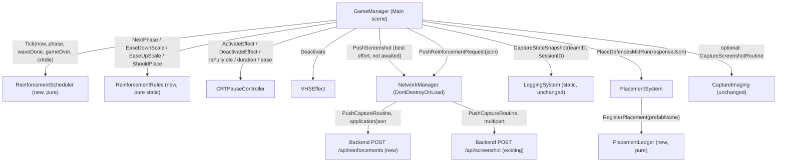
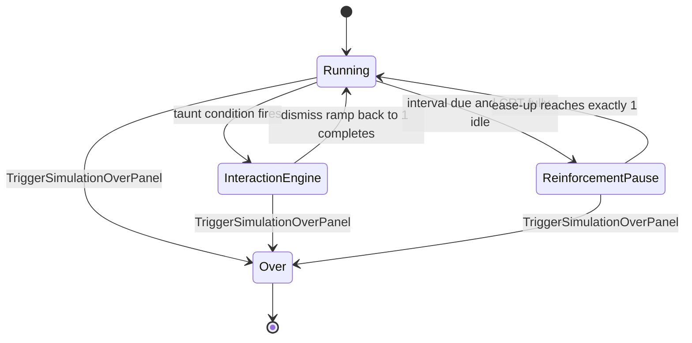
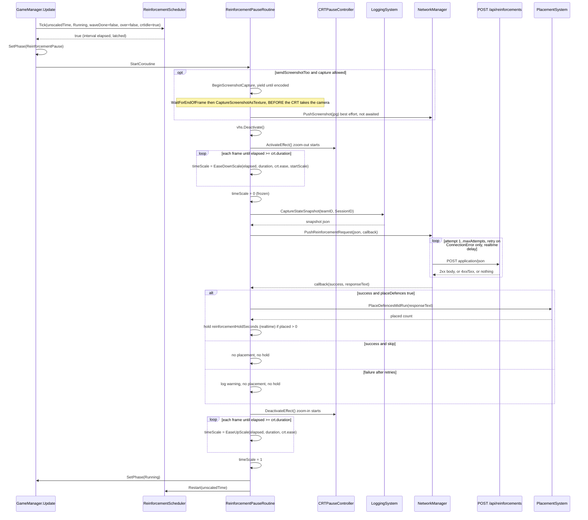
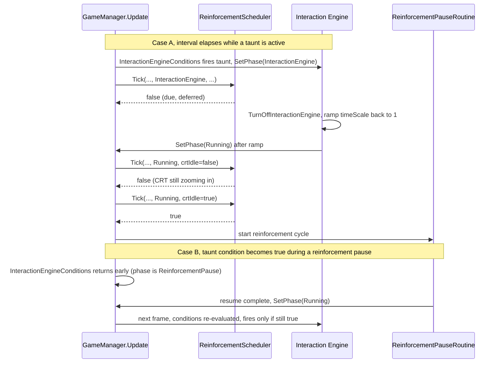
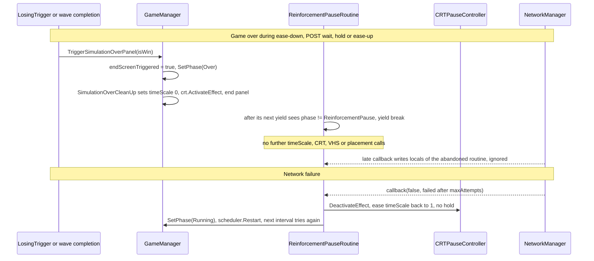

# Design Document: Mid-Run Defence Placement

## Overview

Today the backend chooses every defence once, at the start of the run (`NetworkManager.SubmitTeamID` → `SplitTeamData` → `GameManager.Start` → `PlacementSystem.InitializeDefences`). After that the board is fixed. This design lets the backend add defences during the run, at a fixed interval, through one request/response cycle per interval.

When the interval has elapsed and the game is free (no taunt running, CRT fully zoomed back in), `GameManager` enters a new `ReinforcementPause` phase. It can first take a clean screenshot, then turns on the CRT zoom-out and eases `Time.timeScale` down to exactly 0 in step with the CRT animation. At the freeze it captures the existing state snapshot (`LoggingSystem.CaptureStateSnapshot`) and POSTs it to a new `/api/reinforcements` endpoint. The response says either "place these defences" (the same card schema as start-of-run) or "skip". On "place", the new `PlacementSystem.PlaceDefencesMidRun(json)` appends the batch, the pause holds for about a second so the new defences show up inside the CRT feed, and then the CRT zooms back in while `Time.timeScale` eases back to exactly 1. The interval then restarts.

Three things hold the design together. A small `GamePhase` enum makes sure only one system (taunts, reinforcements, or the end-of-game cleanup) owns `Time.timeScale` and the CRT at any moment, with end-of-game always winning. A run-wide `PlacementLedger` keeps unit names unique across start-of-run and mid-run batches, because `LoggingSystem` keys everything by `transform.name`. The decision logic is extracted into MonoBehaviour-free classes (`ReinforcementScheduler`, `ReinforcementRules`, `PlacementLedger`) so EditMode property tests can cover it. In `quickTestMode`, or when there is no `NetworkManager`, the feature is completely off and the game behaves exactly as it does today.

### Scope

In scope: the interval-driven pause, a single JSON POST with up to `maxAttempts` attempts, place/skip handling, an optional screenshot sent separately, phase arbitration with taunts, fast-forward and game over, and run-wide unique naming.

Out of scope, by decision: a background polling listener in `NetworkManager`, per-card validation of the response (the backend evaluator guarantees validity), any change to the state snapshot schema (grid bounds and defence ids are handled on the backend), any behaviour in `quickTestMode`, and debug keys or canned test batches.

### Rejected alternatives

| Alternative | Why rejected |
|---|---|
| Background listener / polling in `NetworkManager` | Confirmed out of scope. The interval pause is the only trigger |
| One multipart request carrying the JSON snapshot and the JPG | It would pair them atomically, but the decision latency would then depend on image upload size, the reinforcement endpoint would become multipart, and a failed or oversized image would block the decision. Instead, the screenshot goes separately to `/api/screenshot` on a best-effort basis |
| Snapshot taken when the interval elapses (before the ease-down) | Units keep moving for about 0.6 game-seconds during the 1.2 s ease. The backend would decide on a stale board. The snapshot is taken at the freeze, which is exactly the state the placement is applied to |
| Restarting the name counter per batch | Mid-run `defenceSoilder_0` would collide with the start-of-run `defenceSoilder_0`, and the two units would merge into one `DefenceLog` entry |

## Architecture



### Phase model

`GamePhase` decides who may write `Time.timeScale` and drive the CRT. `Over` is absorbing: once there, nothing leaves it.



| Phase | Owner of `Time.timeScale` and CRT | Taunts | Reinforcement ping | Fast-forward buttons |
|---|---|---|---|---|
| `Running` | Fast-forward buttons | Evaluated | Fires when due and CRT idle | Work |
| `InteractionEngine` | `StartInteractionEngine` / `DeactivateInteractionEngine` | Evaluated (unchanged, overlapping taunts still possible as today) | Deferred | Work (unchanged) |
| `ReinforcementPause` | `ReinforcementPauseRoutine` | Deferred: `InteractionEngineConditions` returns early | Cannot re-fire | Ignored (guard) |
| `Over` | `SimulationOverCleanUp` | Unchanged from today | Stopped permanently | Unchanged from today |

Taunt and fast-forward behaviour only changes in `ReinforcementPause`, and that phase can't be reached in `quickTestMode`. That keeps `quickTestMode` identical to today.

### Change map

| File | Change |
|---|---|
| `Scripts/ReinforcementRules.cs` (new) | `GamePhase` enum, `ReinforcementDecision` DTO, `ReinforcementScheduler` class, `ReinforcementRules` static helpers. All pure |
| `Scripts/GameSettings.cs` (new) | `GameSettings` DTO, envelope and `GameSettingsRules.ParseGameSettings`: the backend `gameSettings` object overlays the four Reinforcements Inspector fields, with the same missing-key rules as `spawnSettings`. Applied by `GameManager.ApplyGameSettings` in `Start`, read from `NetworkManager.GameSettingsJson` |
| `Scripts/PlacementLedger.cs` (new) | Run-wide `<PrefabName>_<n>` naming and placed-count accounting. Pure |
| `Scripts/GameManager.cs` | New `Reinforcements` inspector fields, `phase` and `reinforcementScheduler` fields, `SetPhase`, `ReinforcementConditions`, `ReinforcementPauseRoutine`, `BeginScreenshotCapture` (extracted from `CaptureAndSendScreenshot`), scheduler creation in `Start`, phase writes in `InteractionEngineConditions` / `DeactivateInteractionEngine` / `TriggerSimulationOverPanel`, `ReinforcementPause` guards in `InteractionEngineConditions` / `FastForwardDown` / `FastForwardUp` |
| `Scripts/PlacementSystem.cs` | `PlacementLedger` field replaces `int maxDefenceCount`. New shared `PlaceDefence(card)` helper, new `PlaceDefencesMidRun(string)`, `InitializeDefences` loop uses the helper, `MaxDefenceCount()` returns the ledger count |
| `Scripts/NetworkManager.cs` | New `pushReinforcementsUrl` field and `PushReinforcementRequest(string, Action<bool,string>)`, which reuses `PushCaptureRoutine` |
| `Scripts/CRTPauseController.cs` | New read-only `IsFullyIdle()` getter |
| `Tests/Editor/MidRunDefencePlacementTests.cs` (new) | EditMode NUnit tests and seeded property loops for the pure classes |
| `Scenes/Main.unity` | Inspector values for the new `GameManager` fields only |
| Unchanged | `LoggingSystem.cs` (snapshot schema), `EnemySpawningHandler.cs`, `VHSEffect.cs`, `CaptureImaging.cs`, `DefencePlacementCard.cs`, `DefencePlacementDataWrapper.cs`, `LosingTrigger.cs`, `UIController.cs`, `PushJson` / `PushJsonRoutine` |

## Sequence Diagrams

### One full cycle (happy path, with the place / skip / failure branches)



### Arbitration with taunts (both directions)



### Interrupts: game over during the pause, and network failure



### Timeline of one cycle (default settings)

| Step | Clock | Typical duration |
|---|---|---|
| Interval | game time (`Time.time`), from end of previous resume (or end of `Start`) | `reinforcementIntervalSeconds` (30 game-seconds default, 20 s real time at 1.5× fast-forward) |
| Optional screenshot | one `WaitForEndOfFrame` plus encode | about 1 frame plus encode time |
| Ease-down with CRT zoom-out | unscaled | `crt.duration` = 1.2 s |
| Snapshot | synchronous, at the freeze | under 1 ms |
| POST with retries | realtime | refused connection: about 4 s total. Hung server: up to 3 × 10 s timeout + 2 × 2 s delay = **about 34 s frozen** |
| Hold (only if something was placed) | unscaled | `reinforcementHoldSeconds` = 1 s |
| Ease-up with CRT zoom-in | unscaled | 1.2 s |

The 34 s worst case is accepted. `timeoutSeconds`, `maxAttempts` and `retryDelaySeconds` are shared `NetworkManager` settings and are not changed by this design.

## Components and Interfaces

### GameManager (modified)

**Purpose**: owns the interval, the phase, and the whole reinforcement cycle. It already owns every `Time.timeScale` write, the CRT reference, the VHS reference, the placement system and the capture helpers.

```csharp
// NEW: mid-run reinforcement ping (backend may place extra defences)
[Header("Reinforcements")]
[SerializeField] bool reinforcementsEnabled = true;          // NEW: master switch (always off in quickTestMode)
[SerializeField] float reinforcementIntervalSeconds = 30f;   // NEW: unscaled seconds between pauses, <= 0 = off
[SerializeField] float reinforcementHoldSeconds = 1f;        // NEW: realtime hold after placing, only if something was placed
[SerializeField] bool sendScreenshotToo = false;             // NEW: also push a clean screenshot per ping

GamePhase phase = GamePhase.Running;                         // NEW: who owns timeScale / CRT
ReinforcementScheduler reinforcementScheduler;               // NEW: null = feature off

void SetPhase(GamePhase requested);                          // NEW: single writer, Over is final
void ReinforcementConditions();                              // NEW: called from Update
IEnumerator ReinforcementPauseRoutine();                     // NEW: one full cycle
Coroutine BeginScreenshotCapture();                          // NEW: extracted from CaptureAndSendScreenshot, null = skipped
```

**Responsibilities**:
- Create the scheduler at the end of the non-`quickTestMode` branch of `Start`, after `InitializeDefences`, so the first ping comes one full interval after initial placement.
- Tick the scheduler every `Update` after `SimulationOverPanelConditions`, so a wave that completes this frame wins over a ping in the same frame.
- Run the cycle: optional screenshot → CRT on + ease to 0 → snapshot → POST → place or skip → optional hold → CRT off + ease to 1 → `Running` → `Restart`.
- After every `yield`, check `phase != ReinforcementPause` and abort without any further writes. Only `Over` can cause this.
- Make sure no exception can leave the game frozen: response parsing never throws, and the placement call is wrapped in a `try/catch` with no `yield` inside.
- Ignore fast-forward input during `ReinforcementPause`, and defer taunt evaluation during it.

Field naming: the inspector label is "Send Screenshot Too". The field is `sendScreenshotToo` to match the camelCase used by the other `GameManager` fields (`captureEnabled`, `quickTestMode`). The screenshot also respects `captureEnabled` and the existing `captureInProgress` single-flight guard, because it goes through the same entry point as `CaptureAndSendScreenshot`.

### ReinforcementScheduler (new, pure)

**Purpose**: decides when a ping should start. No Unity calls, so tests can drive it with a synthetic clock.

```csharp
public class ReinforcementScheduler
{
    public ReinforcementScheduler(float intervalSeconds, bool enabled, float now);
    public void Restart(float now);                 // new cycle starts now, clears the latch
    public bool IsDue(float now);                   // now - cycleStart >= interval
    public bool IsStopped();                        // game over or wave done was seen
    public bool Tick(float now, GamePhase phase, bool waveCompleted, bool gameOver, bool crtIdle);
}
```

**Responsibilities**:
- It works from game-time timestamps (`Time.time`), so the interval counts gameplay seconds: fast-forward shortens the real wait, Taunt slow-downs lengthen it, and freezes stop it. `Time.deltaTime` is capped by `maximumDeltaTime`, so the long first frame after `LoadScene` can't make the first ping early.
- A due ping is deferred, not dropped, while `phase != Running` or the CRT is not fully idle.
- The latch means `Tick` returns `true` at most once per cycle, no matter what the caller does.
- `waveCompleted`, `gameOver` or `phase == Over` stop it permanently.

### ReinforcementRules (new, pure static)

```csharp
public static class ReinforcementRules
{
    public const string LogPrefix = "[Reinforcements] ";
    public static GamePhase NextPhase(GamePhase current, GamePhase requested);   // Over is absorbing
    public static bool ShouldPlace(string responseJson);                         // place vs skip, never throws
    public static float EaseDownScale(float elapsed, float duration, AnimationCurve ease, float startScale);
    public static float EaseUpScale(float elapsed, float duration, AnimationCurve ease);
}
```

**Responsibilities**:
- `EaseDownScale` / `EaseUpScale` apply the CRT's own `ease` to the same `elapsed / duration` progress the CRT uses, so `timeScale == startScale × (1 − crtAmount)` on the way down and `timeScale == 1 − crtAmount` on the way up. End values are exact (0 and 1), and the output is clamped so an overshooting inspector curve can never produce a negative time scale.
- `ShouldPlace` reads only `placeDefences`. The cards themselves are read by `PlacementSystem` from the same JSON text, so the start-of-run schema is reused as-is.

### PlacementSystem (modified)

**Purpose**: the only component that instantiates defences. It now has two entry points sharing one single-card helper and one run-wide ledger.

```csharp
PlacementLedger ledger = new PlacementLedger();             // NEW: replaces int maxDefenceCount

public void InitializeDefences();                           // UPDATED: loop calls PlaceDefence
public int PlaceDefencesMidRun(string defencePlacementJson); // NEW: appends a batch, returns count placed
DefenceBase PlaceDefence(DefencePlacementCard card);        // NEW: shared single-card placement
public int MaxDefenceCount();                               // UPDATED: ledger.PlacedCount()
```

**Responsibilities**:
- `PlaceDefencesMidRun` parses into a **local** `DefencePlacementDataWrapper` and never touches the serialized `defencePlacementData` field. The start-of-run batch is never re-placed or replaced.
- Every placed defence gets `myCell`, the `PlacementSystem` transform as parent, and a run-wide unique `<PrefabName>_<n>` name, and it increments the placed count. That count is the denominator of the Interaction Engine's `DefenceCount() <= MaxDefenceCount()/2` condition, and shifting it is intended.
- No per-card validation (decision 11). A blank or null card list places nothing.

### PlacementLedger (new, pure)

```csharp
public class PlacementLedger
{
    public string RegisterPlacement(string prefabName);  // returns "<prefabName>_<n>", n counted per prefab for the whole run
    public int PlacedCount();                            // total registrations
}
```

One instance lives for the life of the `PlacementSystem`, which is one Main scene load, which is one run. `LoggingSystem.Reset()` runs in the same `GameManager.Start`, so names and logs share a lifetime. `EnemySpawningHandler` keeps its own local counter: enemies are only spawned once per run, so it is left unchanged.

### NetworkManager (modified)

```csharp
[Header("Reinforcement settings")]                                                          // NEW
[SerializeField] string pushReinforcementsUrl = "http://127.0.0.1:5000/api/reinforcements"; // NEW

public void PushReinforcementRequest(string json, Action<bool, string> onComplete = null);  // NEW
```

**Responsibilities**: this is a thin wrapper around the existing `PushCaptureRoutine(url, body, "application/json", "Reinforcement request", onComplete)`. That gives it the existing `maxAttempts` / `retryDelaySeconds` / `timeoutSeconds`, retries on `ConnectionError` only, `WaitForSecondsRealtime` between attempts (required at `timeScale = 0`), no `uicontroller` access, and the response body passed to `onComplete(true, text)`. A blank `json` invokes `onComplete(false, msg)` synchronously, like `PushGameState`. `DEBUG_MODE` does not override this URL, which matches the capture URLs.

### CRTPauseController (modified, one getter)

```csharp
// NEW: true when fully zoomed back in and camera/overlay restored (no transition running)
public bool IsFullyIdle()
{
    return !stateSaved;
}
```

`IsEffectActive` turns false as soon as `DeactivateEffect()` is called, while the 1.2 s zoom-in and `gameCamera.targetTexture` are still live. Two things need the stronger "fully idle" signal. First, a clean screenshot: capturing during the zoom-in would grab the CRT overlay. Second, sync: activating during a partial zoom-in shortens the CRT's animation (`duration × |target − from|`), and the ease would fall out of step. `stateSaved` is set in `SaveStateAndEnableOverlay` and cleared only in `EndEffect`, which is exactly that window. `freezeTime` stays `false`, so `GameManager` remains the only writer of `Time.timeScale`.

## Data Models

### Request: `POST {pushReinforcementsUrl}`, `Content-Type: application/json`

The body is exactly `LoggingSystem.CaptureStateSnapshot(NetworkManager.Instance.teamID, NetworkManager.Instance.SessionID)`, captured in the frame `Time.timeScale` reaches 0. The schema is unchanged from the game-state-capture spec:

```json
{
  "teamID": "TEAM1",
  "sessionID": "abc123",
  "elapsedSeconds": 31.8,
  "counts": { "activeDefenceCount": 4, "activeEnemyCount": 3, "enemiesQueued": 5, "totalEnemiesInWave": 12 },
  "defences": [ { "id": "defenceSoilder_0", "type": "defenceSoilder", "health": 85.5, "maxHealth": 150.0, "position": { "x": 1, "y": 2 } } ],
  "enemies":  [ { "id": "EnemClown_3", "type": "EnemClown", "health": 40.0, "maxHealth": 100.0, "position": { "x": 2, "y": 2 }, "isAttacking": true, "isDead": false } ]
}
```

`elapsedSeconds` is scaled game time since `LoggingSystem.Reset()`. It does not advance during the pause.

### Response (any 2xx)

```json
{"placeDefences": true, "defencePlacementData": [ { "defenceId": 0, "defenceGridPosition": { "x": 3, "y": 2 } } ]}
```

```json
{"placeDefences": false}
```

```csharp
// NEW: decision flag only; cards are read from the same text as DefencePlacementDataWrapper
[Serializable]
public class ReinforcementDecision
{
    public bool placeDefences;
}
```

| Response | Interpretation |
|---|---|
| 2xx, `placeDefences: true`, non-empty `defencePlacementData` | Place, hold, resume |
| 2xx, `placeDefences: true`, empty or missing `defencePlacementData` | Place nothing, no hold, resume |
| 2xx, `placeDefences: false`, or key missing | Skip |
| 2xx, blank body (for example 204) or non-JSON | Skip, with a warning for non-JSON |
| 4xx / 5xx (no retry), or connection error after `maxAttempts` | Failure: resume, try again next interval |

**Same-schema guarantee**: `JsonUtility` ignores unknown keys, so the full response text parses directly as `DefencePlacementDataWrapper { List<DefencePlacementCard> defencePlacementData }`, and `placeDefences` is ignored. That is the same type and the same parse call that `ConvertDefencePlacementJsonToObject` uses at start-of-run. In the start-of-run path, the server JSON first goes through `TeamDataResponse` (`DefencePlacement` / `GridPosition {x, y}`), and `DefenceWrapper` re-serialises it to the identical `{"defenceId", "defenceGridPosition": {"x", "y"}}` shape before `PlacementSystem` reads it into `Vector2Int`. Property 12 locks this wire compatibility in with a test.

### Run-wide naming

| Batch | Cards (prefab) | Names |
|---|---|---|
| Start-of-run | soldier, soldier, archer | `defenceSoilder_0`, `defenceSoilder_1`, `defenceArcher_0` (identical to today) |
| Mid-run 1 | soldier, penguin | `defenceSoilder_2`, `defencePenguin_0` |
| Mid-run 2 | archer | `defenceArcher_1` |

`MaxDefenceCount()` = 3 → 5 → 6. `LoggingSystem.DeriveType` still returns the prefab name for every entry, so `defenceTypeStats` in the final report groups start-of-run and mid-run units together.

## Key Functions with Formal Specifications

### ReinforcementScheduler.Tick

```csharp
public bool Tick(float now, GamePhase phase, bool waveCompleted, bool gameOver, bool crtIdle)
```

**Preconditions**: `now` is non-decreasing across calls (it is `Time.time`).

**Postconditions**:
- `!isEnabled` (disabled at construction, or `intervalSeconds <= 0`) → `false`, always.
- `waveCompleted || gameOver || phase == Over` → sets `stopped = true` and returns `false`. Every later call returns `false`, including after `Restart`.
- `fired` (it already returned `true` this cycle) → `false` until `Restart`.
- `now - cycleStart < intervalSeconds` → `false`.
- Due, but `phase != Running` or `!crtIdle` → `false`. The scheduler stays due, so the ping is deferred, not dropped.
- Otherwise → sets `fired = true` and returns `true`.
- No allocation, no Unity calls.

**Loop invariants**: none (branch-only).

### ReinforcementScheduler.Restart

```csharp
public void Restart(float now)
```

**Postconditions**: `cycleStart = now`, `fired = false`. `stopped` and `isEnabled` are unchanged. Called once at construction and once at the end of every completed (non-aborted) cycle.

### ReinforcementRules.NextPhase

```csharp
public static GamePhase NextPhase(GamePhase current, GamePhase requested)
```

**Postconditions**: `current == Over` → `Over`. Otherwise → `requested`.

### ReinforcementRules.ShouldPlace

```csharp
public static bool ShouldPlace(string responseJson)
```

**Preconditions**: none. Any string, including `null`.

**Postconditions**:
- `null`, empty or whitespace → `false`.
- Text that `JsonUtility.FromJson<ReinforcementDecision>` rejects → `false` and one `Debug.LogWarning`. Never throws.
- Otherwise → the parsed `placeDefences` value. A missing key reads as `false`.
- Does not mutate anything.

### ReinforcementRules.EaseDownScale

```csharp
public static float EaseDownScale(float elapsed, float duration, AnimationCurve ease, float startScale)
```

**Preconditions**: none. `ease` may be `null` (linear fallback). Negative `startScale` is treated as 0.

**Postconditions**:
- `duration <= 0` or `elapsed >= duration` → exactly `0f`.
- `elapsed <= 0` → `startScale`.
- Otherwise → `startScale × (1 − clamp01(ease(clamp01(elapsed / duration))))`.
- The result is always in `[0, startScale]`.
- For a non-decreasing `ease` (the default `EaseInOut(0,0,1,1)`, or `Linear`), the result is non-increasing in `elapsed`.

### ReinforcementRules.EaseUpScale

```csharp
public static float EaseUpScale(float elapsed, float duration, AnimationCurve ease)
```

**Postconditions**:
- `duration <= 0` or `elapsed >= duration` → exactly `1f`.
- `elapsed <= 0` → `0f`.
- Otherwise → `clamp01(ease(clamp01(elapsed / duration)))`, which is in `[0, 1]`.
- Mirror: for `0 < elapsed < duration`, `EaseUpScale(e) + EaseDownScale(e, startScale: 1) == 1`.
- Non-decreasing in `elapsed` for a non-decreasing `ease`.

### PlacementLedger.RegisterPlacement

```csharp
public string RegisterPlacement(string prefabName)
```

**Preconditions**: `prefabName` is non-null (prefab names always are).

**Postconditions**:
- Returns `prefabName + "_" + k`, where `k` is the number of earlier registrations of the same `prefabName` on this ledger.
- `PlacedCount()` increases by exactly 1.
- Over the ledger's lifetime, no two calls return the same string.

### PlacementSystem.PlaceDefencesMidRun

```csharp
public int PlaceDefencesMidRun(string defencePlacementJson)
```

**Preconditions**: called on the main thread while the Main scene is live. The JSON follows the start-of-run schema (the backend guarantees valid ids and free, in-grid cells).

**Postconditions**:
- Blank JSON, `null` wrapper, or `null` card list → returns `0` and changes nothing.
- Otherwise, for each card in order: exactly one `PlaceDefence(card)`. Returns the number placed.
- `transform.childCount` and `MaxDefenceCount()` both grow by the returned count (assuming nothing was destroyed in the same frame).
- The serialized `defencePlacementData` (start-of-run batch) is unchanged, and no start-of-run defence is moved, renamed or re-instantiated.
- On an exception from a bad card (outside the contract), cards placed before it stay placed and the exception propagates to the caller, which catches it.

**Loop invariants**: after `i` iterations, exactly `i` new defences exist under `transform`, each with a name unique across the run, and `ledger.PlacedCount()` equals the start count plus `i`.

### PlacementSystem.InitializeDefences (preservation)

**Postconditions**: for the start-of-run batch, it produces the same prefabs, positions, parents, `myCell` values, names and `MaxDefenceCount()` as the current implementation. The ledger is empty when it runs, so `RegisterPlacement` produces the same `_0, _1, …` sequence per prefab that the old local `typeCounters` did.

### NetworkManager.PushReinforcementRequest

```csharp
public void PushReinforcementRequest(string json, Action<bool, string> onComplete = null)
```

**Postconditions**:
- Blank `json` → `onComplete(false, msg)` synchronously, one `Debug.LogWarning`, no request.
- Otherwise → one `PushCaptureRoutine` on `pushReinforcementsUrl`: at most `maxAttempts` POSTs, each a fresh `UnityWebRequest` with `timeout = timeoutSeconds`, retrying only on `ConnectionError` with `WaitForSecondsRealtime(retryDelaySeconds)` between attempts, and `onComplete` invoked exactly once (`true` with the response body, or `false` with an error message).
- Never touches `uicontroller`.

### GameManager.ReinforcementPauseRoutine

**Preconditions**: started only by `ReinforcementConditions`, in the same frame `phase` was set to `ReinforcementPause`. At that point `crt.IsFullyIdle()` is true and `NetworkManager.Instance != null`.

**Postconditions**:
- **Completed path** (phase never left `ReinforcementPause`): ends with `Time.timeScale == 1` exactly, `phase == Running`, `reinforcementScheduler` restarted at the current `Time.time`, VHS deactivated, and the CRT zoom-in finishing in the same frame.
- **Abort path** (phase became `Over`): from the first post-yield check that sees `Over`, the routine makes no `Time.timeScale` write and no CRT, VHS, placement, scheduler or phase call. A late network callback only writes the routine's own captured locals.
- At most one `PushReinforcementRequest` per cycle. At most one `PlaceDefencesMidRun` per cycle, and only if the request succeeded and `ShouldPlace` returned `true`.
- The hold runs only if `placed > 0`.
- The screenshot, if any, is captured before `crt.ActivateEffect()`.

**Loop invariants**:
- Ease-down loop: `0 <= Time.timeScale <= startScale`, and the routine's `elapsed` equals the CRT `Animate` coroutine's `time` (same start frame, same `Time.unscaledDeltaTime` additions).
- Wait loops (POST, hold): `Time.timeScale == 0`, and `phase == ReinforcementPause` at the top of each iteration.
- Ease-up loop: `0 <= Time.timeScale <= 1`, and `elapsed` equals the CRT zoom-in `time`.

### GameManager.FastForwardDown / FastForwardUp (guarded)

**Postconditions**: `phase == ReinforcementPause` → no effect (no `Time.timeScale` write, no VHS call). Any other phase → unchanged behaviour.

## Algorithmic Pseudocode

All snippets follow `.kiro/steering/codebase-rules.md`: `// NEW:` / `// UPDATED:` markers, explicit types, braces on their own lines, no ternaries, no LINQ. The only lambdas are network callbacks, matching the existing `PushJson` / `PushScreenshot` call sites.

### ReinforcementRules.cs (new file)

```csharp
using System;
using UnityEngine;

// NEW: who owns Time.timeScale and the CRT right now
public enum GamePhase
{
    Running,
    InteractionEngine,
    ReinforcementPause,
    Over
}

// NEW: backend decision flag for a reinforcement ping
[Serializable]
public class ReinforcementDecision
{
    public bool placeDefences;
}

// NEW: pure interval clock for the reinforcement ping (unscaled seconds)
public class ReinforcementScheduler
{
    float intervalSeconds;
    bool isEnabled;
    float cycleStart;
    bool fired;    // returned true this cycle, until Restart
    bool stopped;  // game over / wave done, permanent

    public ReinforcementScheduler(float intervalSeconds, bool enabled, float now)
    {
        this.intervalSeconds = intervalSeconds;
        isEnabled = enabled;
        if (intervalSeconds <= 0f)
        {
            isEnabled = false;
        }
        Restart(now);
    }

    public void Restart(float now)
    {
        cycleStart = now;
        fired = false;
    }

    public bool IsDue(float now)
    {
        return now - cycleStart >= intervalSeconds;
    }

    public bool IsStopped()
    {
        return stopped;
    }

    // true = start a reinforcement pause now
    public bool Tick(float now, GamePhase phase, bool waveCompleted, bool gameOver, bool crtIdle)
    {
        if (!isEnabled || stopped)
        {
            return false;
        }
        if (waveCompleted || gameOver || phase == GamePhase.Over)
        {
            stopped = true;
            return false;
        }
        if (fired)
        {
            return false;
        }
        if (!IsDue(now))
        {
            return false;
        }
        // due: deferred until no taunt and the CRT is fully zoomed back in
        if (phase != GamePhase.Running || !crtIdle)
        {
            return false;
        }
        fired = true;
        return true;
    }
}

// NEW: pure helpers for the reinforcement pause
public static class ReinforcementRules
{
    public const string LogPrefix = "[Reinforcements] ";

    // Over is final
    public static GamePhase NextPhase(GamePhase current, GamePhase requested)
    {
        if (current == GamePhase.Over)
        {
            return GamePhase.Over;
        }
        return requested;
    }

    // place vs skip; blank or unreadable = skip, never throws
    public static bool ShouldPlace(string responseJson)
    {
        if (string.IsNullOrWhiteSpace(responseJson))
        {
            return false;
        }

        ReinforcementDecision decision = null;
        try
        {
            decision = JsonUtility.FromJson<ReinforcementDecision>(responseJson);
        }
        catch (Exception e)
        {
            Debug.LogWarning(LogPrefix + "unreadable response, skipping: " + e.Message);
            return false;
        }

        if (decision == null)
        {
            return false;
        }
        return decision.placeDefences;
    }

    // startScale at the start, exactly 0 at the end, synced to the CRT zoom-out
    public static float EaseDownScale(float elapsed, float duration, AnimationCurve ease, float startScale)
    {
        if (startScale < 0f)
        {
            startScale = 0f;
        }
        if (duration <= 0f || elapsed >= duration)
        {
            return 0f;
        }
        if (elapsed <= 0f)
        {
            return startScale;
        }
        float eased = EvaluateEase(ease, elapsed / duration);
        return startScale * (1f - eased);
    }

    // 0 at the start, exactly 1 at the end, synced to the CRT zoom-in
    public static float EaseUpScale(float elapsed, float duration, AnimationCurve ease)
    {
        if (duration <= 0f || elapsed >= duration)
        {
            return 1f;
        }
        if (elapsed <= 0f)
        {
            return 0f;
        }
        return EvaluateEase(ease, elapsed / duration);
    }

    // same progress the CRT uses, clamped so overshooting curves can't go negative
    static float EvaluateEase(AnimationCurve ease, float progress)
    {
        float p = Mathf.Clamp01(progress);
        if (ease == null)
        {
            return p;
        }
        return Mathf.Clamp01(ease.Evaluate(p));
    }
}
```

### PlacementLedger.cs (new file)

```csharp
using System.Collections.Generic;

// NEW: run-wide unique "<PrefabName>_<n>" names + placed count (start-of-run and mid-run share it)
public class PlacementLedger
{
    readonly Dictionary<string, int> typeCounters = new Dictionary<string, int>();
    int placedCount;

    public string RegisterPlacement(string prefabName)
    {
        int n = 0;
        if (typeCounters.ContainsKey(prefabName))
        {
            n = typeCounters[prefabName];
        }
        typeCounters[prefabName] = n + 1;
        placedCount++;
        return prefabName + "_" + n;
    }

    public int PlacedCount()
    {
        return placedCount;
    }
}
```

### PlacementSystem.cs (modified)

```csharp
    [SerializeField] DefencePlacementDataWrapper defencePlacementData;

    PlacementLedger ledger = new PlacementLedger(); // NEW: run-wide names + count (replaces maxDefenceCount)

    public void InitializeDefences()
    {
        foreach (DefencePlacementCard defenceData in defencePlacementData.defencePlacementData)
        {
            PlaceDefence(defenceData); // UPDATED: shared single-card helper
        }
    }

    // NEW: extra batch mid-run, same JSON schema as start-of-run; appends, never replaces
    public int PlaceDefencesMidRun(string defencePlacementJson)
    {
        if (string.IsNullOrWhiteSpace(defencePlacementJson))
        {
            return 0;
        }
        DefencePlacementDataWrapper batch = JsonUtility.FromJson<DefencePlacementDataWrapper>(defencePlacementJson);
        if (batch == null || batch.defencePlacementData == null)
        {
            return 0;
        }

        int placed = 0;
        foreach (DefencePlacementCard card in batch.defencePlacementData)
        {
            PlaceDefence(card);
            placed++;
        }
        Debug.Log("[Placement] Mid-run batch placed: " + placed);
        return placed;
    }

    // NEW: one card -> one defence, used by both paths so names and counts stay run-wide
    DefenceBase PlaceDefence(DefencePlacementCard card)
    {
        GridCell cell = gridSystem.GetCellFromNumbering(card.defenceGridPosition.x, card.defenceGridPosition.y);
        Vector3 position = cell.transform.position;
        DefenceBase prefab = defenceIndexMapping[card.defenceId];
        DefenceBase defence = Instantiate(prefab, position, Quaternion.identity, transform);
        defence.myCell = cell.nodeNumbering;
        defence.name = ledger.RegisterPlacement(prefab.name);
        return defence;
    }

    public int MaxDefenceCount()
    {
        return ledger.PlacedCount(); // UPDATED: start-of-run + mid-run
    }
```

The old `int maxDefenceCount` field and the local `typeCounters` in `InitializeDefences` are removed. Both are now inside the ledger.

### NetworkManager.cs (modified)

```csharp
    // NEW: mid-run reinforcement endpoint (reuses retry settings above)
    [Header("Reinforcement settings")]
    [SerializeField] string pushReinforcementsUrl = "http://127.0.0.1:5000/api/reinforcements";

    // NEW: send state snapshot, response body (place/skip decision) goes to onComplete
    public void PushReinforcementRequest(string json, Action<bool, string> onComplete = null)
    {
        if (string.IsNullOrWhiteSpace(json))
        {
            string msg = "Nothing to send: reinforcement request is empty.";
            Debug.LogWarning(msg);
            onComplete?.Invoke(false, msg);
            return;
        }

        byte[] body = Encoding.UTF8.GetBytes(json);
        StartCoroutine(PushCaptureRoutine(pushReinforcementsUrl, body, "application/json", "Reinforcement request", onComplete));
    }
```

### GameManager.cs (modified)

```csharp
    // NEW: mid-run reinforcement ping
    [Header("Reinforcements")]
    [SerializeField] bool reinforcementsEnabled = true;
    [SerializeField] float reinforcementIntervalSeconds = 30f; // unscaled seconds between pauses
    [SerializeField] float reinforcementHoldSeconds = 1f;      // realtime hold after placing
    [SerializeField] bool sendScreenshotToo = false;           // clean screenshot per ping, best effort

    GamePhase phase = GamePhase.Running;                       // NEW: who owns timeScale / CRT
    ReinforcementScheduler reinforcementScheduler;             // NEW: null = feature off

    void Start()
    {
        LoggingSystem.Reset();
        if (quickTestMode)
        {
            // unchanged, no scheduler: feature off
            ...
        }
        else
        {
            ...
            defencePlacementSystem.InitializeDefences();

            // NEW: interval starts after initial placement, first ping one interval later
            bool reinforcementsOn = reinforcementsEnabled && NetworkManager.Instance != null;
            reinforcementScheduler = new ReinforcementScheduler(reinforcementIntervalSeconds, reinforcementsOn, Time.time);
        }
    }

    void Update()
    {
        InteractionEngineConditions();
        SimulationOverPanelConditions();
        ReinforcementConditions(); // NEW: after game-over check so a finished wave wins
    }

    // NEW: single writer for phase, Over is final
    void SetPhase(GamePhase requested)
    {
        phase = ReinforcementRules.NextPhase(phase, requested);
    }

    // NEW: start a reinforcement pause when due and the game is free
    void ReinforcementConditions()
    {
        if (reinforcementScheduler == null)
        {
            return;
        }
        bool due = reinforcementScheduler.Tick(Time.time, phase, enemySpawner.IsWaveCompleted(),
                                               endScreenTriggered, crt.IsFullyIdle());
        if (!due)
        {
            return;
        }
        SetPhase(GamePhase.ReinforcementPause);
        StartCoroutine(ReinforcementPauseRoutine());
    }

    private void InteractionEngineConditions()
    {
        // NEW: taunts wait until a reinforcement pause has fully resumed
        if (phase == GamePhase.ReinforcementPause)
        {
            return;
        }

        if (defencePlacementSystem.isARowClearOfDefences() && !tauntRowTriggered)
        {
            FastForwardUp();
            tauntRowTriggered = true;
            SetPhase(GamePhase.InteractionEngine); // NEW
            ...
        }
        ...
        if (condition && !tauntDefenceTriggered)
        {
            FastForwardUp();
            tauntDefenceTriggered = true;
            SetPhase(GamePhase.InteractionEngine); // NEW
            ...
        }
    }

    IEnumerator DeactivateInteractionEngine()
    {
        crt.DeactivateEffect();
        for (int i = 1; Time.timeScale < 1f; i++)
        {
            Time.timeScale += 0.1f;
            yield return new WaitForSecondsRealtime(timeToSlowDown);
        }
        // NEW: taunt finished, game is free again
        if (phase == GamePhase.InteractionEngine)
        {
            SetPhase(GamePhase.Running);
        }
        yield return null;
    }

    public void TriggerSimulationOverPanel(bool isWin)
    {
        if (endScreenTriggered)
        {
            return;
        }
        endScreenTriggered = true;
        SetPhase(GamePhase.Over); // NEW: end of game wins, aborts a reinforcement pause

        StartCoroutine(SimulationOverCleanUp(isWin));
    }

    public void CaptureAndSendScreenshot()
    {
        BeginScreenshotCapture(); // UPDATED: shared with the reinforcement ping
    }

    // NEW: same guards as before; returns the capture coroutine, or null if skipped
    Coroutine BeginScreenshotCapture()
    {
        if (!captureEnabled)
        {
            return null;
        }
        if (captureInProgress)
        {
            Debug.Log("[Capture] Screenshot already in progress, request ignored");
            return null;
        }
        if (Screen.width <= 0 || Screen.height <= 0)
        {
            Debug.LogWarning("[Capture] Screen has no pixels, screenshot skipped");
            return null;
        }
        captureInProgress = true;
        return StartCoroutine(CaptureScreenshotRoutine());
    }

    public void FastForwardDown()
    {
        // NEW: player can't unfreeze a reinforcement pause
        if (phase == GamePhase.ReinforcementPause)
        {
            return;
        }
        Time.timeScale = fastForwardTimeScale;
        vhs.Activate();
    }

    public void FastForwardUp()
    {
        // NEW: player can't unfreeze a reinforcement pause
        if (phase == GamePhase.ReinforcementPause)
        {
            return;
        }
        Time.timeScale = 1f;
        vhs.Deactivate();
    }
```

`CaptureScreenshotRoutine` is unchanged. It ends right after handing the JPG to `NetworkManager.PushScreenshot`, which starts the upload on the `NetworkManager` object. So `yield return shot` waits only for the end-of-frame capture and encode, never for the upload.

### GameManager.ReinforcementPauseRoutine (new)

```csharp
    // NEW: one full reinforcement cycle; aborts silently if the game ends (cleanup owns time/CRT)
    IEnumerator ReinforcementPauseRoutine()
    {
        // 1. optional clean screenshot, BEFORE the CRT takes over the game camera
        if (sendScreenshotToo)
        {
            Coroutine shot = BeginScreenshotCapture();
            if (shot != null)
            {
                yield return shot;
            }
            if (phase != GamePhase.ReinforcementPause)
            {
                yield break;
            }
        }

        // 2. CRT zoom-out, timeScale eases to exactly 0 on the same clock and curve
        vhs.Deactivate(); // fast-forward is suspended now and not restored on resume
        crt.ActivateEffect();
        float startScale = Time.timeScale;
        float duration = Mathf.Max(0.01f, crt.duration); // same floor as CRTPauseController.Animate
        float elapsed = 0f;
        while (elapsed < duration)
        {
            elapsed += Time.unscaledDeltaTime;
            Time.timeScale = ReinforcementRules.EaseDownScale(elapsed, duration, crt.ease, startScale);
            yield return null;
            if (phase != GamePhase.ReinforcementPause)
            {
                yield break;
            }
        }
        Time.timeScale = 0f;

        // 3. snapshot at the freeze instant, then ask the backend
        bool requestDone = false;
        bool requestOk = false;
        string responseText = "";
        string snapshot = LoggingSystem.CaptureStateSnapshot(NetworkManager.Instance.teamID, NetworkManager.Instance.SessionID);
        if (logStateSnapshotLocally)
        {
            Debug.Log(ReinforcementRules.LogPrefix + "request:\n" + snapshot);
        }
        NetworkManager.Instance.PushReinforcementRequest(snapshot, (success, message) =>
        {
            // locals of this routine only; harmless if the routine was aborted
            requestDone = true;
            requestOk = success;
            responseText = message;
        });
        while (!requestDone)
        {
            yield return null;
            if (phase != GamePhase.ReinforcementPause)
            {
                yield break;
            }
        }

        // 4. place or skip (no per-card validation; the catch only keeps the game from staying frozen)
        int placed = 0;
        if (!requestOk)
        {
            Debug.LogWarning(ReinforcementRules.LogPrefix + "request failed, resuming: " + responseText);
        }
        else if (ReinforcementRules.ShouldPlace(responseText))
        {
            try
            {
                placed = defencePlacementSystem.PlaceDefencesMidRun(responseText);
            }
            catch (System.Exception e)
            {
                Debug.LogError(ReinforcementRules.LogPrefix + "placement failed, resuming: " + e.Message);
            }
        }
        else
        {
            Debug.Log(ReinforcementRules.LogPrefix + "backend skipped");
        }

        // 5. short hold so new defences show up in the CRT feed (re-rendered on unscaled time)
        if (placed > 0)
        {
            float held = 0f;
            while (held < reinforcementHoldSeconds)
            {
                yield return null;
                if (phase != GamePhase.ReinforcementPause)
                {
                    yield break;
                }
                held += Time.unscaledDeltaTime;
            }
        }

        // 6. CRT zoom-in, timeScale eases to exactly 1 (fast-forward is not restored)
        crt.DeactivateEffect();
        elapsed = 0f;
        while (elapsed < duration)
        {
            elapsed += Time.unscaledDeltaTime;
            Time.timeScale = ReinforcementRules.EaseUpScale(elapsed, duration, crt.ease);
            yield return null;
            if (phase != GamePhase.ReinforcementPause)
            {
                yield break;
            }
        }
        Time.timeScale = 1f;

        // 7. free again, interval restarts now
        SetPhase(GamePhase.Running);
        reinforcementScheduler.Restart(Time.time);
    }
```

**Why the CRT and the ease stay in step.** `crt.ActivateEffect()` starts `Animate(1)` with `StartCoroutine`. That coroutine's first iteration runs immediately, adding this frame's `Time.unscaledDeltaTime`, and the routine's first loop iteration does the same in the same frame. Both then resume once per frame and add the same `unscaledDeltaTime`, against the same `Mathf.Max(0.01f, duration × 1)`, through the same `ease.Evaluate(Clamp01(t / dur))`. So `timeScale == startScale × (1 − amount)` every frame, and both loops end in the same frame. This needs the CRT to start from `amount == 0`, which the scheduler's `crtIdle` gate guarantees, and to start the zoom-in from `amount == 1`, which holds because the POST only begins after both loops have ended. The same argument covers the zoom-in, where `timeScale == 1 − amount`.

**Why the abort checks sit right after each `yield`.** `LosingTrigger.OnTriggerEnter2D` runs in the physics step and `SimulationOverPanelConditions` runs in `Update`. Both come before coroutines resume in a frame. So when `SimulationOverCleanUp` sets `Time.timeScale = 0`, the routine's last write was in an earlier frame, and its next action is the check that aborts it. The cleanup's value is never overwritten. If the game ends during the ease-up (`IsEffectActive == false`), the cleanup's `crt.ActivateEffect()` reverses the zoom-in into a zoom-out, which `CRTPauseController` already supports.

## Example Usage

```csharp
// Backend responses (2xx)
// place: {"placeDefences": true, "defencePlacementData": [ {"defenceId": 0, "defenceGridPosition": {"x": 3, "y": 2}} ]}
// skip:  {"placeDefences": false}      (a blank 204 is also a skip)

// PlacementSystem can take the raw response directly; placeDefences is ignored by JsonUtility
string response = "{\"placeDefences\": true, \"defencePlacementData\": [ {\"defenceId\": 1, \"defenceGridPosition\": {\"x\": 2, \"y\": 4}} ]}";
if (ReinforcementRules.ShouldPlace(response))
{
    int placed = defencePlacementSystem.PlaceDefencesMidRun(response); // 1, named e.g. "defenceArcher_1"
}

// Pure pieces, as used from EditMode tests
ReinforcementScheduler scheduler = new ReinforcementScheduler(30f, true, 0f);
scheduler.Tick(29.9f, GamePhase.Running, false, false, true);             // false, not due
scheduler.Tick(30f, GamePhase.InteractionEngine, false, false, true);     // false, deferred by a taunt
scheduler.Tick(31f, GamePhase.Running, false, false, false);              // false, CRT still zooming in
scheduler.Tick(31.5f, GamePhase.Running, false, false, true);             // true, latched
scheduler.Tick(31.6f, GamePhase.Running, false, false, true);             // false, already fired this cycle
scheduler.Restart(70f);                                                   // after resume
scheduler.Tick(80f, GamePhase.Running, false, true, true);                // false, game over: stopped for good

AnimationCurve ease = AnimationCurve.EaseInOut(0f, 0f, 1f, 1f);
ReinforcementRules.EaseDownScale(0f, 1.2f, ease, 1.5f);   // 1.5 (player was fast-forwarding)
ReinforcementRules.EaseDownScale(0.6f, 1.2f, ease, 1f);   // 0.5
ReinforcementRules.EaseDownScale(1.2f, 1.2f, ease, 1f);   // exactly 0
ReinforcementRules.EaseUpScale(1.3f, 1.2f, ease);         // exactly 1

ReinforcementRules.NextPhase(GamePhase.Over, GamePhase.Running);        // Over
ReinforcementRules.ShouldPlace("<html>502</html>");                     // false, with a warning

PlacementLedger ledger = new PlacementLedger();
ledger.RegisterPlacement("defenceSoilder");   // "defenceSoilder_0"  (start-of-run)
ledger.RegisterPlacement("defenceSoilder");   // "defenceSoilder_1"  (mid-run, no collision)
ledger.PlacedCount();                         // 2
```

## Correctness Properties

### Property 1: No ping before the interval

For any `intervalSeconds > 0`, any start time `t0` and any `now` with `now − t0 < intervalSeconds`, `Tick(now, …)` returns `false` for every combination of phase and flags.

**Validates: Requirements 2.2, 2.4**

### Property 2: A due ping fires as soon as the game is free

For any due scheduler (`now − cycleStart ≥ intervalSeconds`) that has not fired and is not stopped, `Tick(now, Running, waveCompleted: false, gameOver: false, crtIdle: true)` returns `true`.

**Validates: Requirements 2.5**

### Property 3: Deferral, not loss

For any sequence of ticks where the scheduler becomes due while `phase ∈ {InteractionEngine}` or `crtIdle == false`, every such tick returns `false`. The first later tick with `phase == Running`, `crtIdle == true` and no game over returns `true`.

**Validates: Requirements 2.3, 2.5, 2.6**

### Property 4: At most one ping per cycle

For any sequence of `Tick` inputs between two `Restart` calls, `Tick` returns `true` at most once.

**Validates: Requirements 2.7, 3.3**

### Property 5: Stopping is permanent

For any sequence in which some tick saw `waveCompleted`, `gameOver` or `phase == Over`, every later `Tick` returns `false`, including after any number of `Restart` calls.

**Validates: Requirements 2.8**

### Property 6: Disabled means never

For any scheduler built with `enabled == false` or `intervalSeconds <= 0`, `Tick` returns `false` for every input sequence.

**Validates: Requirements 1.4, 1.5**

### Property 7: Over is absorbing

For all `requested`, `NextPhase(Over, requested) == Over`. For all `current ≠ Over` and all `requested`, `NextPhase(current, requested) == requested`.

**Validates: Requirements 4.6, 4.7**

### Property 8: Ease-down bounds, end values and monotonicity

For any `elapsed`, any `duration`, any `startScale ≥ 0` and any curve (including `null` and overshooting curves), `0 ≤ EaseDownScale(...) ≤ startScale`. For `duration ≤ 0` or `elapsed ≥ duration` the result is exactly `0`. For `duration > 0` and `elapsed ≤ 0` it is exactly `startScale`. For the default `EaseInOut` and for `Linear`, `e1 ≤ e2` implies `EaseDownScale(e1) ≥ EaseDownScale(e2)`.

**Validates: Requirements 5.7, 5.8, 5.9, 5.12**

### Property 9: Ease-up mirrors ease-down

For any inputs, `0 ≤ EaseUpScale(...) ≤ 1`, with exactly `1` once `elapsed ≥ duration` and exactly `0` at `elapsed ≤ 0`. It is non-decreasing for monotone curves. For `0 < elapsed < duration` and a curve with values in `[0, 1]`, `EaseUpScale(e) + EaseDownScale(e, startScale: 1) == 1` (within float tolerance).

**Validates: Requirements 12.8, 12.9, 12.10, 12.11, 12.12**

### Property 10: Time scale follows the CRT frame by frame

For any sequence of positive frame deltas, simulating `CRTPauseController.Animate` from 0 to 1 (`time += dt`, `amount = LerpUnclamped(0, 1, ease(Clamp01(time / dur)))`) next to the ease-down loop with the same deltas gives the same number of frames. Each frame `timeScale == startScale × (1 − amount)`, and on the final frame `timeScale == 0` and `amount == 1`. The same holds for the zoom-in with `timeScale == 1 − amount`, ending at `timeScale == 1` and `amount == 0`.

**Validates: Requirements 5.4, 5.5, 12.5, 12.6**

### Property 11: Decision parsing is total

For any string `s` (including `null`, whitespace, non-JSON and truncated JSON), `ShouldPlace(s)` returns without throwing. It returns `true` if and only if `s` parses as JSON with `placeDefences: true`.

**Validates: Requirements 8.3, 8.4, 8.5, 8.6, 8.7**

### Property 12: Mid-run responses use the start-of-run schema

For any list of `(defenceId, x, y)` cards, serialise `{placeDefences: true, defencePlacementData: List<DefencePlacement>}` using the start-of-run wire DTOs (`DefencePlacement` / `GridPosition`). Parsing that text with `JsonUtility.FromJson<DefencePlacementDataWrapper>` gives the identical `(defenceId, defenceGridPosition.x, defenceGridPosition.y)` list in the same order, and `ShouldPlace` returns `true`. `placeDefences` has no effect on the parsed cards.

**Validates: Requirements 8.3, 9.1, 16.2**

### Property 13: Names are unique for the whole run

For any sequence of batches of prefab names (start-of-run first, then any number of mid-run batches) fed to one `PlacementLedger`, every returned name is distinct. Each name equals `p + "_" + k`, where `k` is the number of earlier registrations of `p`. For every `p` without a trailing `_<digits>` or `(Clone)`, `LoggingSystem.DeriveType(name) == p`.

**Validates: Requirements 10.1, 10.2, 10.4**

### Property 14: Defence count accounting

For any start-of-run batch of size `a` and mid-run batches of sizes `b1 … bk`, `PlacedCount() == a + Σ bi` after all of them are registered, and it never decreases.

**Validates: Requirements 11.1, 11.2**

### Property 15: Start-of-run naming is preserved

For any single batch of prefab names, the names from a fresh `PlacementLedger` are identical, in order, to those of the previous implementation (a local per-prefab counter starting at 0). `PlacedCount()` equals the old `maxDefenceCount`.

**Validates: Requirements 10.5, 11.4**

### Property 16: One owner at a time

At every frame, at most one of `StartInteractionEngine` / `DeactivateInteractionEngine`, `ReinforcementPauseRoutine`, `SimulationOverCleanUp` and the fast-forward buttons writes `Time.timeScale` or calls `crt.ActivateEffect` / `DeactivateEffect`. The owner is the one allowed by `phase`. A reinforcement pause never starts during a taunt or a CRT transition, and taunts never start during a reinforcement pause. Verified by code review plus the manual checklist.

**Validates: Requirements 2.6, 4.1, 4.2, 4.3, 4.8, 4.10, 14.2**

### Property 17: Game over wins

Once `TriggerSimulationOverPanel` has run during a reinforcement pause, the routine makes no `Time.timeScale` write, no CRT, VHS or placement call, no scheduler restart and no phase write, and a late network response has no effect. The end panel, `Compile` and `PushJson` behave exactly as without the feature. Verified by code review plus the manual checklist.

**Validates: Requirements 4.4, 13.1, 13.2, 13.3, 13.4, 13.5**

### Property 18: Every non-aborted cycle resumes cleanly

On every exit path except the `Over` abort (place, skip, empty batch, request failure, parse failure, placement exception), the cycle ends with `Time.timeScale == 1` exactly, VHS off, the CRT zooming in, `phase == Running` and the scheduler restarted. No path can leave the game frozen. The hold runs if and only if `placed > 0`.

**Validates: Requirements 2.9, 7.14, 8.2, 9.7, 12.1, 12.2, 12.6, 12.7**

### Property 19: Clean screenshot

When `sendScreenshotToo` is set and a capture is allowed, the screenshot is read in a frame where `crt.IsFullyIdle()` is true and before `crt.ActivateEffect()` is called, so it never shows the CRT overlay. The reinforcement request never waits for the screenshot upload.

**Validates: Requirements 15.2, 15.4**

### Property 20: Fast-forward can't unfreeze a pause

During `ReinforcementPause`, `FastForwardDown` and `FastForwardUp` change neither `Time.timeScale` nor the VHS state. After resume, `Time.timeScale == 1` even if fast-forward was held when the pause started.

**Validates: Requirements 14.2, 14.3**

### Property 21: quickTestMode parity

With `quickTestMode == true`, or `NetworkManager.Instance == null` at `Start`, no scheduler exists, `phase` never becomes `ReinforcementPause`, and every guard added by this design is a no-op. The game behaves exactly as it does today. Verified by code review plus the manual checklist.

**Validates: Requirements 1.2, 1.3, 1.6**

### Property 22: Snapshot schema unchanged and taken at the freeze

The request body is exactly what `CaptureStateSnapshot` returns. It is captured in the frame `Time.timeScale` first equals 0 in this cycle, and the snapshot schema is unchanged.

**Validates: Requirements 6.1, 6.2, 6.3**

## Error Handling

| Scenario | Condition | Response | Recovery |
|---|---|---|---|
| Backend down (connection refused) | `ConnectionError` on every attempt | 3 attempts with 2 s realtime gaps, about 4 s frozen, one warning | Resume, no placement, try again next interval |
| Backend hangs | Each attempt hits `timeoutSeconds` | About 34 s frozen with default settings, then failure | As above. Settings deliberately unchanged |
| Server rejects | 4xx / 5xx | No retry, failure logged | As above |
| Skip | 2xx with `placeDefences: false`, key missing, or blank body | Log "backend skipped" | Resume immediately, no hold |
| Non-JSON 2xx | Proxy or HTML page with a 2xx code | `ShouldPlace` warns and returns `false` | Treated as skip |
| Empty batch | `placeDefences: true` with an empty or missing card list | `placed = 0` | No hold, resume |
| Contract broken anyway | Bad id or cell throws inside `PlaceDefence` | Caught in the routine, error logged, earlier cards stay placed | Resume. Not validation, just liveness |
| Game over mid-pause | `TriggerSimulationOverPanel` during screenshot, ease-down, POST, hold or ease-up | Routine aborts after its next `yield` | `SimulationOverCleanUp` owns time, CRT and panel as today |
| Interval due during a taunt | `phase == InteractionEngine` | Deferred | Fires once the dismiss ramp ends and the CRT is idle |
| Interval due during a CRT transition | `!crt.IsFullyIdle()` | Deferred | Fires when the zoom-in finishes |
| Taunt due during a pause | Taunt condition true while `ReinforcementPause` | `InteractionEngineConditions` returns early | Re-evaluated after resume. If reinforcements filled the empty row, the row taunt correctly no longer fires |
| Fast-forward pressed or released during a pause | `ButtonHold` events | Ignored | Resume always lands on 1×. The player presses again to fast-forward |
| Screenshot already uploading | `captureInProgress` | Screenshot skipped for this ping, logged | Ping continues without it |
| Screenshot capture fails | Existing routine's failure paths | Existing warning, textures released | Ping continues |
| No backend | `quickTestMode` or `NetworkManager.Instance == null` at `Start` | No scheduler | Feature off |
| Bad interval | `reinforcementIntervalSeconds <= 0` | Scheduler disabled | Fix the inspector value |
| Scene unload with a request in flight | Return to Menu after game over | `NetworkManager` finishes the request, and the callback writes the abandoned routine's locals | None needed |

## Testing Strategy

### Unit testing (EditMode, NUnit)

- File: `Assets/Tests/Editor/MidRunDefencePlacementTests.cs`, in an `Editor` folder with **no asmdef**, so it compiles into `Assembly-CSharp-Editor` and can see `Assembly-CSharp`. This is the setup the earlier specs planned. `com.unity.test-framework` 1.5.1 is in `Packages/manifest.json` (checked). `Assets/Tests` does not exist in the workspace yet, so this file creates it.
- Only the pure classes are tested: `ReinforcementScheduler`, `ReinforcementRules`, `PlacementLedger`, plus `JsonUtility` round trips against the existing DTOs.

| Target | Example cases |
|---|---|
| `ReinforcementScheduler` | The Example Usage sequence; first ping exactly at `t0 + interval`; deferral by taunt, then by CRT; `Restart` clears the latch; `interval = 0` and negative intervals are disabled; stop on `waveCompleted`, on `gameOver`, on `phase == Over` |
| `NextPhase` | All 16 `(current, requested)` pairs |
| `ShouldPlace` | Place, skip, `{}`, `""`, `null`, `"   "`, `"<html>"`, truncated JSON, extra keys, `placeDefences` missing |
| `EaseDownScale` / `EaseUpScale` | `t = 0`, `t = duration`, `t > duration`, `duration = 0`, negative `startScale`, `null` curve, an overshooting curve (keys above 1) stays in range, `startScale = 1.5` |
| `PlacementLedger` | The run-wide naming table in Data Models; `PlacedCount` after mixed batches |
| Schema compatibility | The Data Models place example parses into one `DefencePlacementCard` with `defenceId = 0`, `defenceGridPosition = (3, 2)` |

`LogAssert.Expect(LogType.Warning, new Regex(...))` covers the `ShouldPlace` non-JSON warning.

### Property-based testing

- **Property test library**: none added. Use seeded `System.Random` loops (about 500 iterations) and print the seed on failure, the same convention as the logging, backend-level-config and game-state-capture specs.
- Properties 1–15 are property-test targets. Generators:
  - Scheduler: intervals in `[-5, 120]`, tick sequences of 0–200 steps with time gaps in `[0, 5]`, random phases, and random `waveCompleted` / `gameOver` / `crtIdle` flags, checked against a small reference model in the test.
  - Easing: `elapsed` in `[-1, 3]`, `duration` in `[-0.5, 3]`, `startScale` in `[-0.5, 2]`, and curves from {`EaseInOut(0,0,1,1)`, `Linear(0,0,1,1)`, `null`, a random 3–5 key curve with values in `[-0.5, 1.5]`}. Monotonicity is only asserted for the first two.
  - CRT sync (Property 10): frame-delta sequences with `dt` in `[0.001, 0.1]`, simulating the `CRTPauseController.Animate` formula inline in the test.
  - Responses: random ASCII, random truncations of valid responses, and random card lists (`defenceId` in `[0, 7]`, `x` in `[0, 10]`, `y` in `[0, 5]`) serialised through `DefencePlacement` / `GridPosition`.
  - Ledger: 1–6 batches of 0–15 names drawn from the real prefab names, plus random names, compared with a reference model of the old local-counter algorithm.
- Properties 16–22 are behavioural. Code review and the manual checklist below cover them.

### Integration testing (manual, WebGL build and Editor)

No PlayMode tests are proposed. They would need the Main scene, a real frame loop and a scripted backend. Instead, use a local test backend whose `/api/reinforcements` can be switched between place, skip, 500, refused (server stopped) and hang (accept, never answer):

1. **Place**: after one interval the CRT zooms out while the game visibly slows to a stop. New defences appear in the CRT feed during the about 1 s hold. The CRT zooms in while the game speeds back up to 1×. Hierarchy names continue the run-wide numbering, and the final `/api/results` report lists them with no merged entries.
2. **Skip**: zoom-out, immediate zoom-in, no hold. The next ping comes one interval after resume.
3. **500 / refused / hang**: resume without placing. Hang freezes for about 34 s. The next interval pings again.
4. **Screenshot on**: `/api/screenshot` receives a JPG with no CRT bezel, sent before `/api/reinforcements`. With the backend's screenshot endpoint down, the reinforcement decision is unaffected.
5. **Taunts**: force a row-clear while a ping is due, and check the ping waits until the taunt is dismissed and the CRT is idle. Force a taunt condition during a pause, and check it fires (if still true) only after resume.
6. **Game over**: let an enemy reach `LosingTrigger` during the ease-down and again during the ease-up. Let the wave complete just before a ping. The end panel behaves as today, the game never unfreezes, and no placement happens after the end.
7. **Fast-forward**: hold fast-forward when a ping starts and release it during the pause. The game stays frozen, VHS fades out, and resume lands on 1×.
8. **quickTestMode**: no pings at all. Taunts, fast-forward and the end screen behave exactly as before.
9. **Frozen spawn**: check that a defence instantiated at `timeScale = 0` shows its idle sprite in the CRT feed during the hold (the Animator doesn't advance while frozen).
10. **WebGL timeouts**: confirm in the browser that `UnityWebRequest.timeout` cuts off a hung request in this Unity version's WebGL backend. If it doesn't, the worst-case freeze is bounded only by the browser.

## Performance Considerations

- Per ping: one `CaptureStateSnapshot` (two `FindObjectsByType` plus two `FindAnyObjectByType` calls), one small JSON POST, and for each placed card one linear `GetCellFromNumbering` scan over 66 cells plus one `Instantiate`. All of this runs while frozen, so any instantiate hitch is hidden by the pause.
- The optional screenshot costs what the game-state-capture spec measured (a full read-back plus JPG encode on the main thread, tens of milliseconds at 1280 px). It runs one frame before the CRT starts, so it can show as a single hitch just before the slow-down.
- While frozen, `CRTPauseController` keeps re-rendering the game camera at 24 fps on unscaled time. That is the same cost as a taunt or the end screen today.
- The scheduler does constant-time work per `Update` and allocates nothing.

## Security Considerations

- `/api/reinforcements` is unauthenticated plain HTTP, like the existing endpoints. Anyone on the network path can read the board state or answer with arbitrary placements. This is flagged, not solved: it is the exposure the project already accepts for `/api/team`, `/api/results`, `/api/state` and `/api/screenshot`.
- The client trusts the response completely (decision 11, no per-card validation). A hostile or broken response can at worst place defences anywhere the indices allow, or throw. The `try/catch` around placement and the total `ShouldPlace` parse mean it can never leave the game frozen or crash the routine.
- The request is `application/json`, so a WebGL build triggers a CORS preflight. The backend must answer `OPTIONS` for `/api/reinforcements` with the page origin, the same as `/api/state`. In WebGL, a CORS failure shows up as `ConnectionError` and uses up all attempts before resuming.
- Mixed content: an HTTPS-hosted WebGL page can't call the default `http://127.0.0.1` URL. This is the same constraint as the existing endpoints.

## Known limitations and pre-existing issues (not changed)

- If the player is holding fast-forward when a ping starts, the optional screenshot includes the VHS overlay. VHS is turned off one frame later, when the ease begins. If that matters, the fix is to call `vhs.Deactivate()` and wait `fadeOutTime` (realtime) before capturing.
- The screenshot is taken about 1.2 s realtime (about 0.6 game-seconds with the default curve) before the snapshot. They show nearly, but not exactly, the same board. The backend can correlate them by `sessionID` and arrival order. No correlation id is added, which matches the game-state-capture decision.
- Pre-existing: `DeactivateInteractionEngine`'s ramp keeps raising `Time.timeScale` even if the game ends during it, and `FastForwardUp` after game over sets 1×. Both can unfreeze the end screen. They are left unchanged to keep `quickTestMode` identical. The new `Over` phase makes a later one-line fix easy.
- Pre-existing: the taunt dismiss ramp can overshoot to about 1.1×. A reinforcement ease-down starts from whatever `Time.timeScale` is, and the resume always lands on exactly 1.

## Dependencies

- Existing only: `UnityWebRequest` through `NetworkManager.PushCaptureRoutine`, `JsonUtility`, `AnimationCurve`, `CRTPauseController` (`ActivateEffect`, `DeactivateEffect`, `duration`, `ease`, plus the new `IsFullyIdle`), `VHSEffect.Deactivate`, `LoggingSystem.CaptureStateSnapshot`, `CaptureImaging` and the existing `CaptureScreenshotRoutine`.
- Unity Test Framework `com.unity.test-framework` 1.5.1 (already in `Packages/manifest.json`) for EditMode tests.
- Backend: a new `POST /api/reinforcements` (JSON in, JSON decision out, CORS for the page origin). The existing `POST /api/screenshot` is reused when `sendScreenshotToo` is on.
- No new packages, prefabs or scene objects.
